# Kadison's similarity problem, explained for beginners

> - **Paper:** [*Kadison's similarity theorem through uniform derivation estimates*](https://github.com/openai/math/blob/main/preprints/Kadisons-similarity-theorem-through-uniform-derivation-estimates-September-23-2026/paper.pdf), OpenAI, 23 September 2026 (31 pages)
> - **openai/math family:** 288, *Kadison's similarity conjecture* · **Field:** operator algebras (functional analysis)
> - **Companions:** none in this family. For the group version of the question the paper cites the family-251 preprint [*Unitarizability implies amenability for discrete groups*](https://github.com/openai/math/blob/main/preprints/Unitarizability-Implies-Amenability-for-Countable-Groups-September-23-2026/paper.pdf) (23 Sep 2026), which this explainer does not cover
> - **Formal proof:** a Lean scope document lists Comparator statements for the main theorem, the uniform commutator estimate and universal hyperreflexivity ([scope](https://github.com/openai/math/blob/main/lean/docs/288.md)). The paper is not listed in `lean/formalization.yaml`; see [section 7](#7-what-it-does-not-prove-and-caveats)
> - **Who this is for:** anyone who knows linear algebra: matrices, inner products, the conjugate transpose and eigenvalues. No functional analysis is assumed. Level 3 of section 5 is an optional part for readers who know some operator algebras.

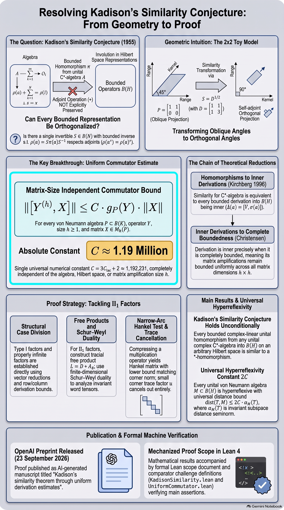

*AI-generated overview. The big picture is right, but the first panel's formulas are garbled, the constant is misprinted as 1,192,231 (it is about 1,190,648), and the free product is written $`D + A_8`$ instead of $`D \ast A_0`$; see the [errata](assets/README.md#errata).*

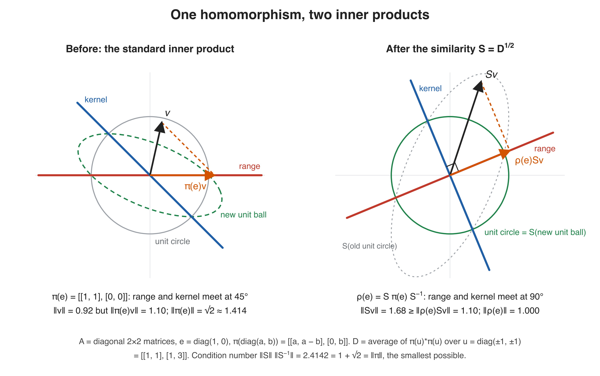

*The whole problem in one picture, computed for the 2×2 example of [section 1.5](#15-a-worked-example-in-two-dimensions). On the left a homomorphism sends a projection to an oblique projection. On the right, after one change of coordinates S, the same homomorphism respects adjoints.*

## Contents

- [TL;DR](#tldr)
- [How to read this](#how-to-read-this)
- [1. The problem](#1-the-problem)
- [2. A short history](#2-a-short-history)
- [3. What the paper proves](#3-what-the-paper-proves)
- [4. Why it matters](#4-why-it-matters)
- [5. The main idea of the proof](#5-the-main-idea-of-the-proof)
- [6. The people whose ideas this builds on](#6-the-people-whose-ideas-this-builds-on)
- [7. What it does not prove, and caveats](#7-what-it-does-not-prove-and-caveats)
- [8. Glossary](#8-glossary)
- [9. Slides, audio and other assets](#9-slides-audio-and-other-assets)
- [How this explainer was made](#how-this-explainer-was-made)

---

## TL;DR

- **The question.** A *C\*-algebra* is an algebra of operators (think: matrices, but possibly infinite-dimensional) that is closed under taking adjoints, the infinite-dimensional version of the conjugate transpose. A *bounded homomorphism* $\pi$ copies the algebra's sums and products into operators on a Hilbert space, but it need not copy adjoints: $\pi(a^{\ast})$ can differ from $\pi(a)^{\ast}$. In 1955 Richard Kadison asked whether one invertible operator $S$ can always repair this, so that $a \mapsto S\pi(a)S^{-1}$ respects adjoints too. Equivalently: is there always one new inner product in which $\pi$ is honest?
- **What was known.** Yes for *nuclear* algebras (Bunce and Christensen, 1981), for *cyclic* representations and for algebras without tracial states (Haagerup, 1983), and for II₁ factors with property Γ (Christensen, 1986). Haagerup showed that the answer is yes exactly when $\pi$ is *completely bounded*, and Kirchberg (1996) showed the whole question is equivalent to one about *derivations*. Pisier built a quantitative theory around the *similarity degree*. The general case stayed open for about 70 years.
- **What this paper proves.** The answer is always yes: for every unital C\*-algebra and every Hilbert space, with no separability or other assumption.
- **How.** The engine is a new **uniform commutator estimate**: if an operator $Y$ nearly commutes with every element of a von Neumann algebra $P$, then the block-diagonal copy of $Y$ nearly commutes with every $h\times h$ matrix over $P$, with a loss factor $C \approx 1.19$ million that does not depend on $h$, $P$ or the Hilbert space. That makes every derivation completely bounded, hence implemented by an operator, and Kirchberg's theorem turns this into the similarity. The hard case, II₁ factors, is handled with a free-product construction and a Hankel-matrix test. As a corollary, every von Neumann algebra is *hyperreflexive* with one universal constant.
- **What it doesn't do.** It gives no explicit bound on how badly conditioned the repairing operator $S$ must be, and it does not compute any similarity degree. It does not settle Dixmier's analogous question for groups (a separate preprint in openai/math claims that). It is an AI-generated preprint; a Lean scope document lists its main statements, but this explainer did not re-run the Lean build.

## How to read this

| You have… | Read |
|---|---|
| 2 minutes | The TL;DR, the infographic and the figure above |
| 15 minutes | Sections 1, 3, 4 and 7 |
| An hour, and you like linear algebra | Everything, including [section 5](#5-the-main-idea-of-the-proof) and the worked calculations inside it |

---

## 1. The problem

### 1.1 Hilbert spaces and operators

You already know the prototype: $\mathbb{C}^n$ with the inner product $\langle x, y\rangle = \sum_i x_i \overline{y_i}$. A **Hilbert space** $H$ is the same thing, except that it may be infinite-dimensional; the standard example is $\ell^2$, the sequences $(x_1, x_2, \dots)$ with $\sum \lvert x_i\rvert^2 < \infty$. Everything below makes sense for $H = \mathbb{C}^n$, and finite dimensions are where the examples live.

An **operator** is a linear map $T : H \to H$. It is **bounded** if its operator norm $\lVert T\rVert = \sup_{x \ne 0} \lVert Tx\rVert / \lVert x\rVert$ is finite (in $\mathbb{C}^n$ every matrix is bounded, and $\lVert T\rVert$ is its largest singular value). The bounded operators form an algebra written $\mathcal{B}(H)$; for $H = \mathbb{C}^n$ it is just the $n\times n$ matrices $M_n(\mathbb{C})$.

Each bounded operator has an **adjoint** $T^{\ast}$, defined by $\langle Tx, y\rangle = \langle x, T^{\ast}y\rangle$. For matrices, $T^{\ast}$ is the conjugate transpose. Three kinds of operators matter here:

| Kind | Condition | Matrix intuition |
|---|---|---|
| **Self-adjoint** | $T^{\ast} = T$ | Hermitian matrix: real eigenvalues, orthogonal eigenvectors |
| **Unitary** | $T^{\ast}T = TT^{\ast} = 1$ | Preserves lengths and angles |
| **Orthogonal projection** | $P = P^2 = P^{\ast}$ | Drops a perpendicular onto a subspace |

An **idempotent** with $P^2 = P$ but $P^{\ast} \ne P$ is an *oblique* projection: it projects onto its range *along* a kernel that is not perpendicular to the range. Its norm is bigger than 1. The left half of the figure at the top shows one.

### 1.2 C\*-algebras and von Neumann algebras

A **C\*-algebra** is, concretely, a set of bounded operators on some Hilbert space that is closed under sums, products, scalar multiples and adjoints, and closed under limits in the operator norm. Gelfand and Naimark (1943) characterised them abstractly. In today's streamlined form, a C\*-algebra is a complete normed algebra with an operation $a \mapsto a^{\ast}$ satisfying $\lVert a^{\ast}a\rVert = \lVert a\rVert^2$. Their theorem says every abstract C\*-algebra can be realised concretely (background from the [Wikipedia article](https://en.wikipedia.org/wiki/C*-algebra)). Examples:

- $M_n(\mathbb{C})$, all $n\times n$ matrices;
- the **diagonal** $n\times n$ matrices, which as an algebra is just $\mathbb{C}^n$ with entrywise multiplication;
- the continuous functions on a compact space, with $f^{\ast} = \overline{f}$;
- $\mathcal{B}(H)$ itself.

"Unital" means the algebra has an identity element 1. Every algebra in the paper's theorem is unital.

A **von Neumann algebra** is a C\*-algebra of operators that is also closed under a weaker kind of limit (pointwise convergence of $Tx$ for every vector $`x`$). The paper writes $M'$ for the **commutant** of $M$: all operators that commute with every element of $M$. A **factor** is a von Neumann algebra whose centre is only the scalars. The **II₁ factors** are the infinite-dimensional factors with a *trace*, a positive linear functional $\tau$ with $\tau(1) = 1$ and $\tau(ab) = \tau(ba)$, like the normalised matrix trace $\frac1n \mathrm{Tr}$. One can be built from a growing chain of matrix algebras $M_2 \subset M_4 \subset M_8 \subset \cdots$, and that kind of subalgebra ("generated by increasing full matrix algebras") plays a starring role in the proof.

### 1.3 Representations versus bounded homomorphisms

Let $A$ be a unital C\*-algebra. There are two natural ways to map it into operators:

- A **\*-homomorphism** (or **\*-representation**) $\rho : A \to \mathcal{B}(H)$ is linear, multiplicative, unital, and respects adjoints: $\rho(a^{\ast}) = \rho(a)^{\ast}$. Such maps are automatically contractive, $\lVert\rho(a)\rVert \le \lVert a\rVert$.
- A **bounded homomorphism** $\pi : A \to \mathcal{B}(H)$ is linear, multiplicative and unital with $\lVert\pi\rVert < \infty$, and nothing is said about adjoints.

The difference is measured by the norm. For a unital homomorphism into $\mathcal{B}(H)$, being a \*-homomorphism is equivalent to $\lVert\pi\rVert = 1$, because an operator is unitary exactly when it and its inverse both have norm 1 (this is the observation that opens [Ozawa's 2006 notes](https://www.kurims.kyoto-u.ac.jp/~narutaka/notes/similarity.pdf), which the paper cites). So a bounded homomorphism with $\lVert\pi\rVert > 1$ is a "distorted" representation.

### 1.4 Similarity: changing the inner product

Given an invertible operator $S$, the map $\rho(a) = S\pi(a)S^{-1}$ is again a unital homomorphism. We say $\pi$ is **similar** to $\rho$. Similarity has a clean geometric meaning. Define a new inner product $\langle x, y\rangle_S = \langle Sx, Sy\rangle$. It is equivalent to the old one, because $\lVert S^{-1}\rVert^{-1}\lVert x\rVert \le \lVert x\rVert_S \le \lVert S\rVert\ \lVert x\rVert$. A short computation shows that $\rho$ respects the old adjoint exactly when $\pi$ respects the adjoint of the new inner product.

So Kadison's question can be phrased like this:

> **Kadison's similarity problem (1955).** Let $\pi$ be a bounded unital homomorphism from a unital C\*-algebra into $\mathcal{B}(H)$. Is there always one equivalent inner product on $H$ in which every $\pi(a^{\ast})$ is the adjoint of $\pi(a)$? Equivalently, is there an invertible $S$ with $S\pi(\cdot)S^{-1}$ a \*-homomorphism?

The number $\lVert S\rVert\ \lVert S^{-1}\rVert$ is the **condition number** of $S$, the familiar quantity from numerical linear algebra. It measures how much the new inner product distorts lengths. Since $\lVert\rho\rVert = 1$, we always have $\lVert\pi(a)\rVert = \lVert S^{-1}\rho(a)S\rVert \le \lVert S\rVert\ \lVert S^{-1}\rVert\ \lVert a\rVert$, so **the condition number of any repairing $S$ is at least $`\lVert\pi\rVert`$**.

### 1.5 A worked example in two dimensions

Take $A$ to be the diagonal $2\times2$ matrices and fix a real number $t$. Define

```math
\pi\begin{pmatrix} a & 0\\ 0 & b\end{pmatrix} = \begin{pmatrix} a & t(a-b)\\ 0 & b\end{pmatrix}.
```

Multiplying two such matrices gives $`\begin{pmatrix} ac & t(ac - bd)\\ 0 & bd\end{pmatrix}`$, so $\pi$ is a unital homomorphism. It is **not** a \*-homomorphism when $t \ne 0$. The projection $e = \mathrm{diag}(1,0)$ is self-adjoint, but $`\pi(e) = \begin{pmatrix}1 & t\\ 0 & 0\end{pmatrix}`$ is an oblique projection, not a self-adjoint one.

We computed everything below with a short NumPy script (numbers rounded):

| | $t = 1$ | $t = 2$ | $t = 10$ |
|---|---|---|---|
| $\lVert\pi\rVert$ (computed; equals $`t + \sqrt{1+t^2}`$) | 2.4142 | 4.2361 | 20.0499 |
| Condition number of the "obvious" repair $`S_0 = \begin{pmatrix}1 & t\\ 0 & 1\end{pmatrix}`$, which diagonalises $\pi$ | 2.6180 | 5.8284 | 101.99 |
| Condition number of the averaged repair $S = D^{1/2}$ (below) | 2.4142 | 4.2361 | 20.0499 |

**The averaging trick.** The four diagonal matrices $u = \mathrm{diag}(\pm1, \pm1)$ are unitaries that span $A$. Average:

```math
D = \frac14 \sum_{u} \pi(u)^{\ast}\pi(u), \qquad S = D^{1/2}.
```

For $t = 1$ this gives $`D = \begin{pmatrix}1 & 1\\ 1 & 3\end{pmatrix}`$. Because the four $u$ form a group, $\pi(u)^{\ast}D\pi(u) = D$ for each of them, so each $S\pi(u)S^{-1}$ is unitary, and therefore $\rho = S\pi S^{-1}$ respects adjoints (the script checks this to about $`10^{-15}`$). Indeed $`\rho(e) \approx \begin{pmatrix}0.854 & 0.354\\ 0.354 & 0.146\end{pmatrix}`$ is the orthogonal projection onto the line at $22.5^\circ$. The condition number of $S$ equals $\lVert\pi\rVert$, which by the lower bound in section 1.4 is the best possible. In the figure at the top, the range and kernel of $\pi(e)$ meet at $45^\circ$ before, and at $90^\circ$ after.

**The same example as a derivation.** The off-diagonal entry $\Delta(\mathrm{diag}(a,b)) = t(a-b)$ satisfies $\Delta(xy) = \Delta(x)\sigma(y) + \lambda(x)\Delta(y)$, with $\lambda(\mathrm{diag}(a,b)) = a$ and $\sigma(\mathrm{diag}(a,b)) = b$. That makes it a *rectangular derivation* in the paper's sense (section 5 explains why these matter). It is *inner*: $\Delta(x) = V\sigma(x) - \lambda(x)V$ with $V = -t$. And the formula $V = -D_{11}^{-1}D_{12}$ recovers $V = -t$ from the averaged metric $D$ for $t = 1, 2, 10$. The paper's Lemma 2.2 uses the same formula, after first dividing the off-diagonal entry by $`\lVert\Delta\rVert`$. This is the bridge, in miniature, between "similar to a \*-homomorphism" and "derivation is inner".

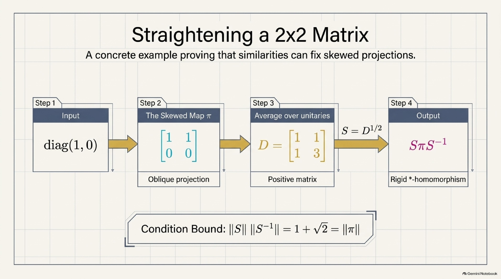

*AI-generated slide summarising the same example for $t = 1$.*

### 1.6 Why infinite dimensions are hard

The averaging trick works for every finite-dimensional C\*-algebra, because its unitary group is compact and can be averaged over. It also works whenever there is an *invariant mean* to average with. That is how amenable groups were handled in 1950 (section 1.7), and Ozawa's notes explain that, once Haagerup showed in 1983 that nuclear C\*-algebras are amenable, the same idea also proves the nuclear case. For a general infinite-dimensional algebra no such average is available, and nobody could find the repairing inner product.

**Haagerup's cyclic theorem, and why it does not finish the job.** A vector $\xi$ is *cyclic* for $\pi$ if the vectors $\pi(a)\xi$, $a \in A$, are dense in $H$. Haagerup proved in 1983 that a bounded homomorphism with a cyclic vector is always similar to a \*-homomorphism (Ozawa's notes state it for a finite cyclic set of vectors). A \*-representation always splits into an orthogonal sum of cyclic pieces, because the orthogonal complement of an invariant subspace is again invariant when adjoints are respected. If every bounded homomorphism split like that, one could hope to apply Haagerup's theorem piece by piece. For a mere homomorphism this splitting fails, as Ozawa's notes point out. The 2×2 example already shows it. The line spanned by $(1,0)$ is invariant under every $\pi(x)$, but its orthogonal complement is not, since $\pi(\mathrm{diag}(a,b))$ sends $(0,1)$ to $(t(a-b), b)$. (That example is cyclic, with cyclic vector $(0,1)$, so Haagerup's theorem covers it.) Step 4 of [section 5](#level-2-the-step-by-step-picture) is where the paper meets the same gluing problem on the derivation side, and solves it.

A second way to see the difficulty is **complete boundedness**. A linear map $\varphi$ on an algebra can be applied entrywise to $h\times h$ matrices whose entries are algebra elements; write $\varphi_h$ for that amplified map and $\lVert \varphi\rVert_{\mathrm{cb}} = \sup_h \lVert \varphi_h\rVert$. A \*-homomorphism has $\lVert\rho_h\rVert \le 1$ for every $h$. So if $\pi$ is similar to one, then $\lVert\pi\rVert_{\mathrm{cb}} \le \lVert S\rVert\ \lVert S^{-1}\rVert < \infty$. But boundedness at level 1 does not control level $h$ in general. A standard example (checked with our script): the transpose map on $M_n$ has norm 1, yet its $n$-fold amplification sends the "flip" matrix $\sum_{i,j} e_{ij}\otimes e_{ji}$, of norm 1, to a matrix of norm $n$. Kadison's question is whether, for homomorphisms of C\*-algebras, level-1 boundedness secretly controls every level.

### 1.7 The group version: Dixmier's problem

There is an older cousin. A **uniformly bounded representation** of a group $G$ assigns to each $g$ an invertible operator $T_g$ with $T_{gh} = T_gT_h$ and $\sup_g \lVert T_g\rVert < \infty$. It is **unitarizable** if some invertible $S$ makes every $ST_gS^{-1}$ unitary. Background from the [Wikipedia article](https://en.wikipedia.org/wiki/Uniformly_bounded_representation) and Ozawa's notes:

- Sz.-Nagy (1947) proved that every uniformly bounded representation of the integers is unitarizable. Equivalently, an invertible operator is similar to a unitary exactly when all its positive and negative powers are uniformly bounded.
- In 1950–51 Dixmier (1950), Day (1950), and Nakamura and Takeda (1951) extended it to all amenable groups, by averaging $T_g^{\ast}T_g$ with an invariant mean, exactly as in section 1.5.
- Dixmier asked whether unitarizability characterises amenability. Some non-amenable groups are known not to be unitarizable: $SL(2,\mathbb{R})$ (Ehrenpreis and Mautner, 1955) and the free group on two generators. Subgroups of unitarizable groups are unitarizable, so no group containing a free subgroup is unitarizable. Later work of Pisier, of Epstein and Monod, and of Monod and Ozawa sharpened the picture.

The two problems are related but not the same. A bounded homomorphism of the group C\*-algebra restricts to a uniformly bounded representation of the group, but, as the paper points out, a uniformly bounded group representation need not extend boundedly to the full or reduced group C\*-algebra; it extends automatically only to $\ell^1(G)$. So this paper does not settle Dixmier's problem. A separate openai/math preprint (family 251) claims that for discrete groups.

### 1.8 A web of equivalent questions

Over the decades Kadison's question was shown to be equivalent to several others. For a unital C\*-algebra $A$ (with more than one dimension), the following are equivalent, by the results named in the right-hand column. This is how the paper can attack similarity without ever writing down $S$.

| Property of $A$ | Equivalent because of |
|---|---|
| **(SP)** Every bounded unital homomorphism $A \to \mathcal{B}(H)$ is similar to a \*-homomorphism | Kadison's question |
| Every bounded unital homomorphism is *completely* bounded | Haagerup (1983): similar to a \*-homomorphism exactly when completely bounded. Paulsen (1984): the similarity can then be chosen with condition number at most $\lVert\pi\rVert_{\mathrm{cb}}$ |
| There are $d$ and $K$ with $\lVert\pi\rVert_{\mathrm{cb}} \le K\lVert\pi\rVert^d$ for every bounded unital homomorphism (a finite *similarity degree*) | Pisier (1999), as stated in Ozawa's notes |
| **(DP)** For every faithful \*-representation $\sigma$, every derivation into $\mathcal{B}(K)$ is inner | Kirchberg (1996). Ringrose (1972) makes every such derivation automatically bounded, and Christensen (1977) showed that a derivation is inner exactly when it is completely bounded |

Eleftherakis and Paulsen (2026) added one more equivalence for the problem as a whole: the answer is yes for every C\*-algebra exactly when every von Neumann algebra is *hyperreflexive* (defined in [section 3](#3-what-the-paper-proves)). The paper works with the derivation form **(DP)**.

---

## 2. A short history

The "Source" column says where each fact was checked: the paper's own introduction and references, [Ozawa's 2006 notes](https://www.kurims.kyoto-u.ac.jp/~narutaka/notes/similarity.pdf) (cited by the paper), Wikipedia, or the author's own background knowledge.

| When | Who | What happened | Source |
|---|---|---|---|
| 1943 | **Israel Gelfand, Mark Naimark** | Abstract characterisation of C\*-algebras | Wikipedia |
| 1947 | **Béla Sz.-Nagy** | Uniformly bounded representations of $\mathbb{Z}$ and $\mathbb{R}$ are unitarizable | Wikipedia |
| 1950–1951 | **Jacques Dixmier; Mahlon Day (both 1950); Masahiro Nakamura and Ziro Takeda (1951)** | Amenable groups are unitarizable; Dixmier asks about the converse | Wikipedia (text and reference list), Ozawa |
| 1955 | **Richard Kadison** | Poses the similarity problem in *On the orthogonalization of operator representations* | Paper |
| 1955 | **Leon Ehrenpreis, Friedrich Mautner** | Non-unitarizable uniformly bounded representations of $SL(2,\mathbb{R})$ | Wikipedia |
| 1966 | **Kadison; Shôichirô Sakai** | Every derivation of a C\*-algebra into its weak closure is inner | Ozawa (statement); the year is not in the paper or Ozawa, and was checked against their two 1966 *Annals of Mathematics* papers |
| 1972 | **John Ringrose** | Derivations of C\*-algebras are automatically continuous | Paper |
| 1977 | **Erik Christensen** | A derivation into $\mathcal{B}(H)$ is inner exactly when it is completely bounded | Paper |
| 1981 | **John Bunce; Erik Christensen** | The similarity property for nuclear C\*-algebras | Paper |
| 1983 | **Uffe Haagerup** | Solves the cyclic case; similarity to a \*-representation is equivalent to complete boundedness; algebras without tracial states have the similarity property; separately, nuclear C\*-algebras are amenable | Paper |
| 1984 | **Vern Paulsen** | Completely bounded homomorphisms of operator algebras are similar to complete contractions, with condition number at most $\lVert\pi\rVert_{\mathrm{cb}}$ | Paper |
| 1986 | **Erik Christensen** | II₁ factors with property Γ have the similarity property | Paper |
| 1996 | **Eberhard Kirchberg** | The similarity problem and the derivation problem are equivalent | Paper |
| 1997–2001 | **Gilles Pisier** | The similarity degree and its interpretation as a length of matrix factorizations | Paper, Ozawa |
| 1997 | **Gilles Pisier** | Solves Halmos's problem: a polynomially bounded operator not similar to a contraction, so the analogue of the question fails for non-self-adjoint algebras | Background (not in the paper); the date matches Wikipedia and the 1997 *J. Amer. Math. Soc.* paper |
| 2004–2006 | **Gilles Pisier** | A C\*-algebra is nuclear exactly when its similarity exponent is below 3; partial results on Dixmier's problem | Paper, Ozawa |
| 2006 | **Narutaka Ozawa** | Survey notes; at the time it was unknown whether the free group factor $L(\mathbb{F}_2)$ or $\prod_n M_n$ has the similarity property | Ozawa |
| 2009–2010 | **Inessa Epstein, Nicolas Monod; Monod and Ozawa** | Non-unitarizable groups without free subgroups | Wikipedia |
| 2014 | **Liam Dickson; Sorin Popa** | A row estimate for bounded homomorphisms; independence theorems in ultraproducts of II₁ factors. Both are inputs to this proof | Paper |
| 2026 | **G. K. Eleftherakis, Vern Paulsen** | A positive answer is equivalent to every von Neumann algebra being hyperreflexive | Paper |
| 23 Sep 2026 | **OpenAI** (internal model) | This paper: the similarity conjecture for every unital C\*-algebra, with a universal hyperreflexivity constant | Paper |

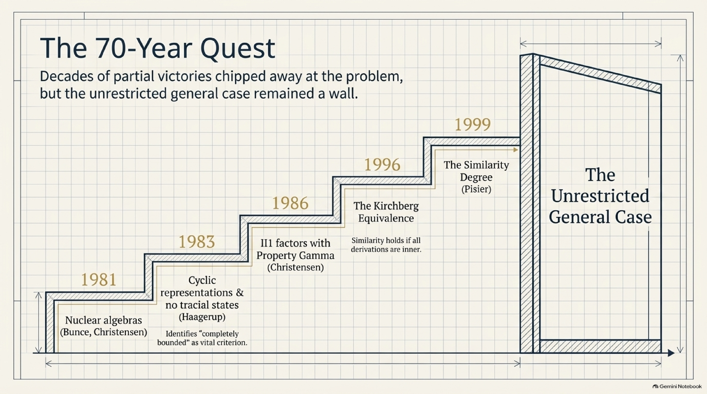

NotebookLM's sketch-note timeline tells the same story. Its title counts "83 years" from Gelfand and Naimark's 1943 work; Kadison's question itself dates from 1955. It leaves out the group side (Sz.-Nagy, Dixmier), and its "Q.E.D." and "Finally solved!" overstate the status of an unrefereed preprint (see the [errata](assets/README.md#errata)).

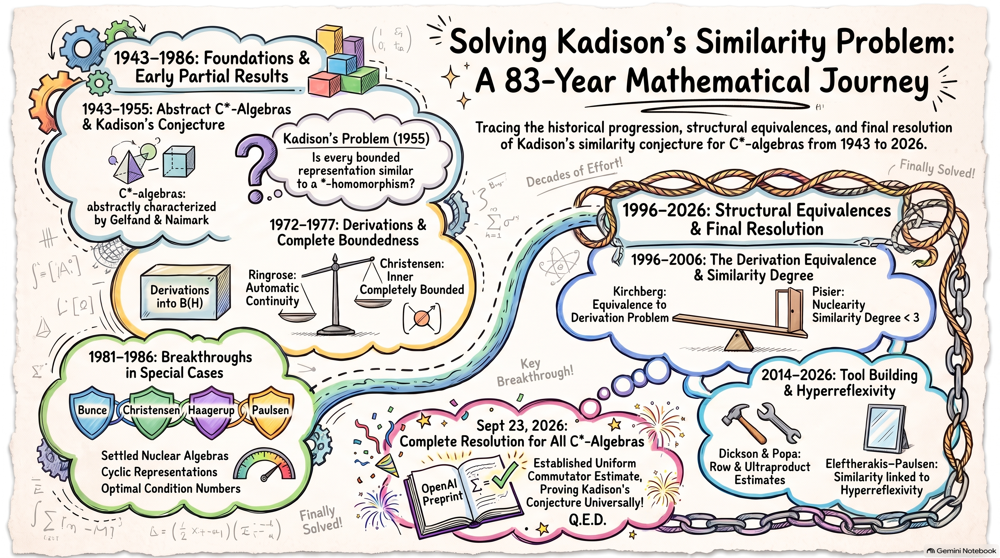

---

## 3. What the paper proves

> **Theorem 1.1 (Similarity).** Let $A$ be any unital complex C\*-algebra, let $H$ be any complex Hilbert space, and let $\pi : A \to \mathcal{B}(H)$ be a bounded, complex-linear, unital algebra homomorphism. There is an operator $S \in \mathcal{B}(H)$, invertible with bounded inverse, such that $\rho(a) = S\pi(a)S^{-1}$ is a \*-homomorphism. In particular $\rho(a^{\ast}) = \rho(a)^{\ast}$ for every $a \in A$.

In plain words: **every bounded homomorphism of a C\*-algebra is an honest \*-representation in disguise.** One change of inner product, chosen once for the whole algebra, makes all adjoints come out right. The paper stresses that no separability, nuclearity, finite generation, faithfulness or normality is assumed, and that $S$ may depend on $\pi$. It proves existence only: there is no claimed bound on $\lVert S\rVert\ \lVert S^{-1}\rVert$.

The engine of the proof is a second theorem. For a von Neumann algebra $P \subset \mathcal{B}(K)$ and an operator $Y$, the paper measures how far $Y$ is from commuting with $P$ by

```math
g_P(Y) = \sup_{a \in P,\ \lVert a\rVert \le 1} \lVert Ya - aY\rVert ,
```

and writes $Y^{(h)}$ for the block-diagonal operator with $h$ copies of $Y$ on $K^h$.

> **Theorem 1.2 (Uniform commutator estimate).** There is an absolute constant $C < \infty$ such that for every complex Hilbert space $K$, every unital von Neumann algebra $P \subset \mathcal{B}(K)$, every $Y \in \mathcal{B}(K)$, every integer $h \ge 1$ and every $h\times h$ matrix $X$ with entries in $P$,
> ```math
> \lVert [Y^{(h)}, X] \rVert \le C\ g_P(Y)\ \lVert X\rVert, \qquad [T,U] = TU - UT.
> ```

In plain words: **testing commutators on single elements of $P$ already controls commutators with matrices of every size**, with one loss factor $C$ for all algebras, all Hilbert spaces and all sizes. The constant is explicit: $C = 3C_{\mathrm{fac}} + 2 \approx 1.19\times10^6$ (see the table in [section 5](#level-3-the-machinery-for-readers-with-operator-algebra-background)). Combined with Arveson's distance formula, which the paper uses for the next corollary, it says that if $Y$ nearly commutes with $P$, then $Y$ is within $\tfrac{C}{2}\ g_P(Y)$ of an operator that commutes with $P$ exactly. (This one-line consequence is our own deduction; the paper applies the formula only in the proof of Corollary 1.3, with $P = M'$.)

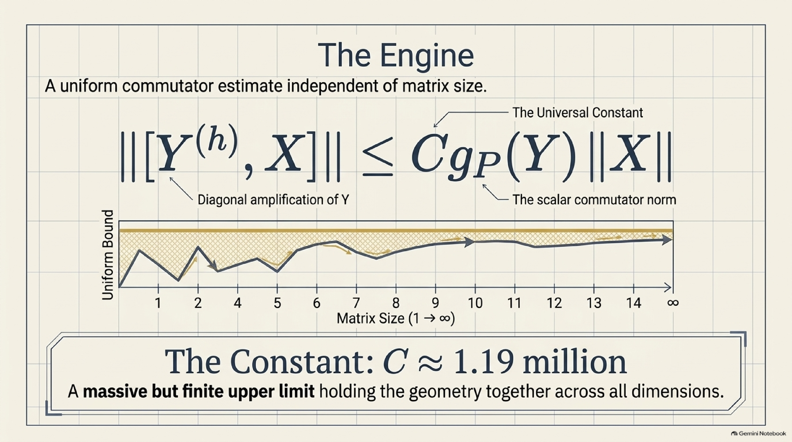

*AI-generated slide. The formula and the constant are right; the curve is only an illustration, not computed data, and its axis skips the label 3.*

> **Corollary 1.3 (Universal hyperreflexivity).** Let $M \subset \mathcal{B}(H)$ be a unital von Neumann algebra on any complex Hilbert space and, for $T \in \mathcal{B}(H)$, let $\alpha_M(T) = \sup\lbrace \lVert(1-e)Te\rVert : e \in M',\ e = e^{\ast} = e^2\rbrace$. Then $\mathrm{dist}(T, M) \le 2C\ \alpha_M(T)$.

In plain words: an operator that *almost* leaves every invariant subspace of $M$ invariant is *close* to an element of $M$, with one constant $2C \approx 2.38\times10^6$ for all von Neumann algebras. The paper adds: "No optimality of this constant is asserted."

The Lean 4 statement of Theorem 1.1, from the [openai/math Comparator challenge file](https://github.com/openai/math/blob/main/lean/ComparatorChallenges/KadisonSimilarity.lean), reads:

```lean
abbrev BoundedUnitalHom :=
  {π : A →ₐ[ℂ] (H →L[ℂ] H) // Continuous π}

def SimilarToStar (π : BoundedUnitalHom A H) : Prop :=
  ∃ S : (H →L[ℂ] H)ˣ, ∀ a : A,
    (S : H →L[ℂ] H) * π.1 (star a) * (↑S⁻¹ : H →L[ℂ] H) =
      star ((S : H →L[ℂ] H) * π.1 a * (↑S⁻¹ : H →L[ℂ] H))

def SimilarityTheorem : Prop :=
  ∀ (A : Type u) [CStarAlgebra A] (K : Type v) [NormedAddCommGroup K]
    [InnerProductSpace ℂ K] [CompleteSpace K] (π : BoundedUnitalHom A K),
    SimilarToStar A K π

theorem similarityTheorem : SimilarityTheorem.{u,v}
```

A continuous, unital $\mathbb{C}$-algebra homomorphism into the bounded operators on a complex Hilbert space is conjugated by a unit $S$ of $\mathcal{B}(H)$ to a map that sends `star a` to the adjoint. The same file states `universalCommutatorTheorem`, which asserts only that *some* constant $C \ge 0$ works, and `universalHyperreflexivity`, which uses the explicit constant `2 * universalConstant` (`universalConstant` is defined by the paper's formula for $`C`$). A second file, [`UniformCommutator.lean`](https://github.com/openai/math/blob/main/lean/ComparatorChallenges/UniformCommutator.lean), states Theorem 1.2 on its own.

---

## 4. Why it matters

| | Before | After (if the preprint holds up) |
|---|---|---|
| **Kadison's similarity problem** (1955) | Solved for nuclear algebras, for cyclic representations, for algebras without tracial states, and for II₁ factors with property Γ | Every unital C\*-algebra, every Hilbert space, including the two algebras that Ozawa's 2006 notes named as open, $L(\mathbb{F}_2)$ and $\prod_n M_n$ |
| **The derivation problem**: is every derivation into $\mathcal{B}(H)$ inner? | Equivalent to the similarity problem (Kirchberg) and open with it | Proposition 7.3: for every unital \*-representation $\sigma$, every bounded $\sigma$-derivation has $\lVert\Delta\rVert_{\mathrm{cb}} \le C\lVert\Delta\rVert$ and is inner. By Ringrose's theorem, boundedness is automatic |
| **Hyperreflexivity** of von Neumann algebras | Eleftherakis and Paulsen (2026) showed that a positive similarity answer is equivalent to every von Neumann algebra being hyperreflexive | Every von Neumann algebra is hyperreflexive, with one universal constant $2C$ (Corollary 1.3) |
| **Matrix commutator estimates** | No uniform bound was known in general (one would have solved the problem, by the route in section 5) | $\lVert[Y^{(h)}, X]\rVert \le C\ g_P(Y)\lVert X\rVert$ with an explicit absolute $C$ (Theorem 1.2) |

The deeper significance is that a 70-year-old question at the centre of operator algebras, and a network of problems known to be equivalent to it, closes in the positive direction. The paper's route is also different in emphasis from the quantitative programme organised by Pisier. That programme bounds homomorphisms through the similarity degree. This paper is "organized around a uniform bound for derivations, and concludes with existence of a similarity."

---

## 5. The main idea of the proof

The paper has seven sections (31 pages in total). Here it is at three zoom levels.

### Level 1: the one-paragraph version

Think of the inner product as a ruler for lengths and angles. A bounded homomorphism is a faithful copy of the algebra's multiplication drawn with a bent ruler: projections come out oblique instead of perpendicular. Kadison asks for **one** re-calibration of the ruler that straightens **every** picture at once. Hunting for that ruler directly is hopeless, so the paper studies *infinitesimal* bends instead: derivations, the "derivatives" of homomorphisms. Kirchberg proved that the ruler always exists if every infinitesimal bend is just a change of coordinates (an *inner* derivation). Christensen and Paulsen showed that a bend is a change of coordinates exactly when it stays bounded on matrices of every size. So everything comes down to one inequality: commutators must not grow when you pass from single operators to $h\times h$ blocks. The paper proves this with a constant that is the same for every algebra and every size. The hard case is the II₁ factors, where no averaging trick is available. There the paper builds a "free-product laboratory" in which a small corner of size $u$ produces a signal of size about $u$ and also costs about $u$, so the size cancels.

> **Analogy:** to check that a spring obeys the same stiffness law at every scale, you cannot test every scale. Instead you build a test rig in which a tiny sample and its measured response shrink together, so their ratio is visibly independent of the sample's size.

### Level 2: the step-by-step picture

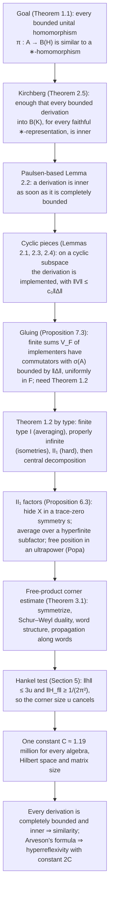

**Step 1: From similarity to derivations.** A **derivation** relative to a \*-representation $\sigma$ is a linear map with the product rule $\Delta(ab) = \Delta(a)\sigma(b) + \sigma(a)\Delta(b)$. It is **inner** if $\Delta(a) = V\sigma(a) - \sigma(a)V$ for some bounded $V$. The link to homomorphisms is the triangular trick of section 1.5: $\Delta$ is a derivation exactly when $`a \mapsto \begin{pmatrix}\sigma(a) & \Delta(a)\\ 0 & \sigma(a)\end{pmatrix}`$ is a homomorphism, and $\Delta$ is inner exactly when that homomorphism is similar to a \*-homomorphism. (Our script checks the identity $`\begin{pmatrix}a & Va - aV\\ 0 & a\end{pmatrix} = \begin{pmatrix}1 & V\\ 0 & 1\end{pmatrix}\begin{pmatrix}a & 0\\ 0 & a\end{pmatrix}\begin{pmatrix}1 & -V\\ 0 & 1\end{pmatrix}`$ on random matrices.) Kirchberg's theorem, in the per-algebra form the paper takes from Ozawa (Theorem 2.5), runs the much harder converse: **if every bounded derivation of $A$ in every faithful \*-representation is inner, then every bounded homomorphism of $A$ is similar to a \*-homomorphism.** So the paper never constructs $S$ directly.

**Step 2: Complete boundedness implies inner.** Lemma 2.2 adapts the triangular-metric argument recalled in Ozawa's notes. If $\Delta$ is completely bounded, then the triangular homomorphism is completely bounded, Paulsen's theorem supplies a similarity $S$, and the metric $D = S^{\ast}S$ yields the implementer $V = -d\ D_{11}^{-1}D_{12}$. This is the computation we ran on the 2×2 example. It also bounds $\lVert V\rVert$.

**Step 3: Rows, columns and cyclic vectors.** Dickson's estimate (credited by Dickson to Christensen, and derived from Haagerup's little Grothendieck inequality) says that every bounded unital homomorphism $\varphi$ satisfies $\lVert\varphi\rVert_{\mathrm{row}} \le \sqrt2\ \lVert\varphi\rVert^2$, where the row norm tests $1\times h$ matrices. Applying it to the triangular homomorphism gives row *and* column bounds for every bounded rectangular derivation, with constant $c_{\mathrm{row}} = 4\sqrt2$ (Lemma 2.1). If the domain representation has a **cyclic vector** (one vector whose orbit is dense), then any unit vector $(\xi_1, \dots, \xi_h)$ in $K^h$ can be written as $v\zeta$ for one unit vector $\zeta \in K$ and a column contraction $v$ with entries in the von Neumann algebra generated by $\sigma(A)$ (Lemma 2.3, using Haagerup's standard form). Columns then control everything. **Every bounded rectangular derivation with a cyclic domain is completely bounded and inner, with $`\lVert V\rVert \le c_0\lVert\Delta\rVert`$** (Lemma 2.4). In spirit, this plays the role of Haagerup's 1983 cyclic theorem, but for derivations.

**Step 4: The gluing problem, and why Theorem 1.2 is needed.** A general \*-representation splits into orthogonal cyclic pieces $K_i$, and Step 3 gives an implementer $V_i : K_i \to K$ on each, with $\lVert V_i\rVert \le c_0\lVert\Delta\rVert$. But all the $V_i$ map into the same space $K$, so their sum can grow without bound as more pieces are added. What *is* uniform is a commutator bound. For every finite set $F$ of pieces, the partial sum $V_F$ satisfies $[V_F, \sigma(a)] = \Delta(a)q_F$, so $g(V_F) \le \lVert\Delta\rVert$. If 1×1 commutator bounds controlled all matrix levels, then $\lVert\Delta_h(X)q_F^{(h)}\rVert \le C\lVert\Delta\rVert\ \lVert X\rVert$ for every $F$, and letting $F$ grow gives $\lVert\Delta\rVert_{\mathrm{cb}} \le C\lVert\Delta\rVert$ (Proposition 7.3). That is exactly Theorem 1.2.

**Step 5: Theorem 1.2, type by type.** Reductions in Section 7 bring the estimate down to *factors* on separable Hilbert spaces (central direct-integral decomposition, then separable reducing subspaces, at the cost of turning $C_{\mathrm{fac}}$ into $`3C_{\mathrm{fac}} + 2`$). For factors (Proposition 7.1):

| Factor type | Trick | Constant |
|---|---|---|
| Finite type I ($`M_n`$) | Average $Y$ over the compact unitary group to get $Y_0$ commuting with the factor and within $g_P(Y)$ of $Y$ | 2 |
| Properly infinite | Isometries $v_1, \dots, v_h$ in $P$ with orthogonal ranges squeeze an $h\times h$ matrix into a single element; the row and column bounds of Step 3 pay for it | $1 + 2c_{\mathrm{row}}$ |
| Type II₁ | The rest of the paper (Sections 3–6) | $3c_1 + 2$ |

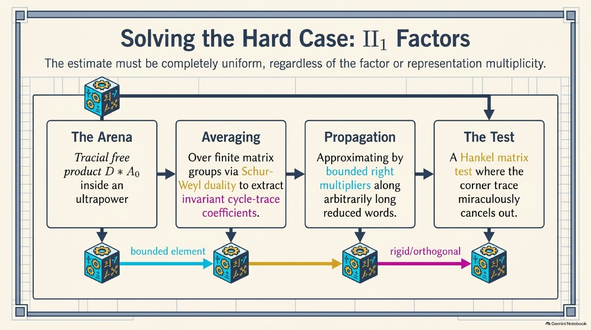

*AI-generated summary of Steps 6–8. In the paper, averaging over the matrix unitary groups (Lemma 3.3) and the Schur–Weyl analysis of the averaged operator (Lemma 3.4) are two separate steps.*

**Step 6: Setting up the II₁ case.** Proposition 6.3 starts with a matrix $X$ (of norm at most 1) over a II₁ factor $M$ and hides it in the corner of the self-adjoint unitary

```math
s = \begin{pmatrix} (1 - XX^{\ast})^{1/2} & X\\ X^{\ast} & -(1 - X^{\ast}X)^{1/2}\end{pmatrix}, \qquad s = s^{\ast} = s^{-1}, \quad \tau(s) = 0,
```

so that a single commutator with $L_s$ contains $[Y^{(h)}, X]$ as a block. (Our script checks $s = s^{\ast} = s^{-1}$ and $\tau(s) = 0$ for a random contraction.) The operator $Y$ is then averaged over an irreducible subfactor $R$ generated by increasing matrix algebras (Lemma 6.1, after Popa 1981), which costs at most $g_M(Y)$. The whole picture is moved into an ultrapower, where Popa's 2014 independence theorem supplies a matrix-generated subfactor $D$ that is *free* from the constant copy of the matrix algebra $P = M_m(M)$ that contains $s$ (Lemma 6.2). This produces the setting of Theorem 3.1: a tracial free product $\mathcal{L} = D \ast A_0$ and an operator $G$ that commutes with left multiplication by $D$ and has small commutators with one corner $e\mathcal{L}e$, where $\tau(e) = 1/N$.

**Step 7: The free-product corner estimate (Theorem 3.1).** This is the heart of the paper. Its conclusion bounds the compressed commutator of $G$ with a trace-zero symmetry $s \in A_0$ by $c_1\epsilon$, with $c_1 = 6\pi^2(1 + 4c_0)$. The point is that $c_1$ is **independent of the corner trace $`1/N`$**. The proof has four moves:

1. **Symmetrize** $G$ over the unitary groups of the matrix stages of $D$ (Lemma 3.3).
2. **Invariant theory** (Lemma 3.4). $L^2(\mathcal{L})$ splits into "reduced words" $d_0a_1d_1\cdots a_kd_kz$ that alternate between the two free factors. Finite-dimensional **Schur–Weyl duality** writes every conjugation-invariant form on word spaces as a combination of "cycle-trace" terms, one for each permutation of the letters. Two size estimates kill every term except those that match the letters of one word bijectively with the letters of another word of the same length. So $G$ preserves word length, and on a word with a repeated letter $x^{\otimes k}$ it acts only on the $A_0$ part, through an operator $B_k$ that does not depend on $x$ (Lemma 3.5).
3. **Propagation** (Lemmas 4.1–4.2). On small right supports, $G$ is within $c_0\epsilon$ of a right multiplication; this uses the cyclic Lemma 2.4 again. That lets the paper compare $B_k$ with $B_0$ along words of every length, with error $2c_0\epsilon$ independent of $k$.
4. **Compression** (Lemma 4.3 and Section 5). Words $e(sd)^kv$, for a free symmetry $d \in D$, span a copy of $\ell^2(\mathbb{N}_0)\otimes L^2(A_0)$ on which $G$ looks like $I\otimes B_0$. Compressing left multiplication by a cleverly chosen corner element $h = eb_fe$ gives a **Toeplitz part plus a Hankel part**, $u(T_f\otimes I + H_f\otimes L_s)$ with $u = 2/N$. Its commutator with $I\otimes B_0$ has norm exactly $u\ \lVert H_f\rVert\ \lVert[B_0, L_s]\rVert$.

**Step 8: The narrow-arc test makes the corner size cancel.** Choose $f$ on the unit circle to be $1$ on an arc of half-width $\theta = 1/(2N)$, minus its mean. Then the corner element has $\lVert h\rVert \le 3u$, and the Hankel matrix $H_f = (\gamma_{j+k+1})$, built from the Fourier coefficients $\gamma_l = \sin(l\theta)/(\pi l)$, has norm at least $1/(2\pi^2)$ **for every $`N`$**. Putting the two together:

```math
\frac{u}{2\pi^2}\ \lVert [B_0, L_s]\rVert \;\le\; u\ \lVert H_f\rVert\ \lVert [B_0, L_s]\rVert \;\le\; (1+4c_0)\ \epsilon\ \lVert h\rVert \;\le\; 3u\ (1+4c_0)\ \epsilon ,
```

and $u$ cancels: $\lVert[B_0, L_s]\rVert \le 6\pi^2(1 + 4c_0)\ \epsilon = c_1\epsilon$.

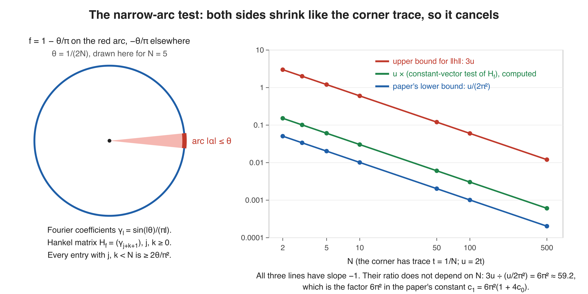

<details>
<summary><b>The Hankel test in numbers</b> (a worked calculation)</summary>

The paper proves the lower bound by noting that every entry $\gamma_{j+k+1}$ with $j, k < N$ is at least $2\theta/\pi^2$ (because $\sin x \ge 2x/\pi$ on $`[0, \pi/2]`$), and then testing the $N\times N$ corner of $H_f$ on the constant unit vector. We computed both quantities, and the norm of a large truncation of $H_f$, with a short NumPy script:

| $N$ | corner trace $t = 1/N$ | smallest entry of the $N\times N$ block | paper's entry bound $2\theta/\pi^2$ | constant-vector test value | paper's bound $1/(2\pi^2)$ | $\lVert H_f\rVert$, truncation of size $40N$ |
|---|---|---|---|---|---|---|
| 2 | 0.5 | 0.0723 | 0.0507 | 0.1518 | 0.0507 | 0.4090 |
| 5 | 0.2 | 0.0277 | 0.0203 | 0.1516 | 0.0507 | 0.4092 |
| 10 | 0.1 | 0.0136 | 0.0101 | 0.1516 | 0.0507 | 0.4092 |
| 50 | 0.02 | 0.00269 | 0.00203 | 0.1516 | 0.0507 | 0.4092 |
| 500 | 0.002 | 0.000268 | 0.000203 | 0.1516 | 0.0507 | (not computed) |

The individual entries shrink like $1/N$, but there are $N^2$ of them in the block, and the test value, which is $1/N$ times their sum, stays at about $0.1516$ no matter how small the corner is. The paper's bound $1/(2\pi^2) \approx 0.0507$ is not sharp: its own intermediate expression $2\theta N/\pi^2$ equals $1/\pi^2 \approx 0.101$, since $\theta N = 1/2$, and the paper then rounds this down. Since $\lVert h\rVert \le 3u$ on the other side, the ratio $3u \div \frac{u}{2\pi^2} = 6\pi^2 \approx 59.2$ is the factor $6\pi^2$ inside $c_1$.
</details>

**Step 9: Back up the chain.** Theorem 3.1 gives the II₁-factor constant $3c_1 + 2$ (Proposition 6.3), then all factors (Proposition 7.1), then all von Neumann algebras (Proposition 7.2 and the proof of Theorem 1.2). Proposition 7.3 makes every derivation completely bounded and inner, and Kirchberg's theorem finishes Theorem 1.1. For Corollary 1.3, apply Theorem 1.2 to the commutant $P = M'$ and use Arveson's formula $2\ \mathrm{dist}(T, M) = \lVert \mathrm{ad}_T\vert_{M'}\rVert_{\mathrm{cb}}$, together with $g_{M'}(T) \le 4\alpha_M(T)$.

### Level 3: the machinery, for readers with operator-algebra background

**The explicit constants.** Every constant in the chain is a number, and the same definitions appear in the Lean file `OAI/Analysis/KadisonSimilarity/Constants.lean`:

| Constant | Definition | Value (computed) | Where it comes from |
|---|---|---|---|
| $c_{\mathrm{row}}$ | $4\sqrt2$ | 5.657 | Dickson's row estimate for $\lVert\varphi\rVert \le 2$ (Lemma 2.1) |
| $c_0$ | $(1 + 4c_{\mathrm{row}})^2$ | 558.25 | Implementation on a cyclic domain (Lemma 2.4) |
| $c_1$ | $6\pi^2(1 + 4c_0)$ | 132,293 | Free-product corner estimate (Theorem 3.1) |
| $C_{\mathrm{fac}}$ | $\max\lbrace 3c_1 + 2,\ 1 + 2c_{\mathrm{row}},\ 2\rbrace$ | 396,882 | Factors (Proposition 7.1) |
| $C$ | $3C_{\mathrm{fac}} + 2$ | 1,190,648 | Theorem 1.2 |
| $2C$ | | 2,381,296 | Hyperreflexivity constant (Corollary 1.3) |

**Why Schur–Weyl duality forces word structure.** Fix word levels $k$ and $l$ and restrict all letters to a matrix stage $D_j \cong M_m(\mathbb{C})$. A scalar slice of $G$, call it $Y$, gives a multilinear form $F$ in $1 + k + l$ matrix variables that is invariant under simultaneous unitary conjugation. Schur–Weyl duality writes it as $\sum_{\pi}\lambda_\pi\Phi_\pi$, a sum over permutations $\pi$ of the $1 + k + l$ slots, where $\Phi_\pi$ multiplies normalized traces along the cycles of $\pi$. The forms $\Phi_\pi$ are linearly independent once $m \ge 1 + k + l$ (the paper cites Grinko and Ozols for this), so the coefficients stabilise as $j$ grows. Testing on matrix units $v_i = e_{i,\pi(i)}$ isolates one coefficient. The **$`L^1`$ endpoint bound** (the slice is a right multiplier, so the first slot is controlled in $`L^1`$) gives

```math
\lvert\lambda_\pi\rvert\ m^{-c(\pi)} \le \lVert Y\rVert\ m^{-1-(k+l)/2},
```

where $c(\pi)$ is the number of cycles. Letting $m \to \infty$ forces $\lambda_\pi = 0$ unless $c(\pi) \ge 1 + (k+l)/2$. With centred tail letters this leaves only permutations that fix the first slot and pair the remaining slots. A second test with long orthonormal families of letters uses **Hilbert-space boundedness** to kill pairs inside one side. Only bijections between source and test letters survive. That forces $k = l$ and gives $Y = I_E\otimes\sum_\sigma a_\sigma U_\sigma$. Each permutation operator $U_\sigma$ fixes every repeated-letter tensor $x^{\otimes k}$, so the action on such tensors does not depend on $x$.

**Where the Toeplitz-plus-Hankel form comes from.** Take a projection $p \in D$ of trace $1/2$ with $e \le p$. With the free symmetries $d = 2p - 1 \in D$ and $s \in A_0$, the element $w = ds$ is a Haar unitary, the corner $p\mathcal{C}p$ of $\mathcal{C} = W^{\ast}(d,s)$ is the algebra of even functions of $w$ (Lemma 5.1), and the dihedral relation gives

```math
w^j p\ w^{-k} = \tfrac12\left(w^{j-k} + w^{j+k+1}s\right).
```

The free-compression Lemma 5.2 gives $E_{\mathcal{C}}(ebe) = u^2 b$ and $\lVert ebe\rVert \le 2\sqrt u\ \lVert b\rVert_2 + u\lVert b\rVert$. Together they yield the matrix coefficients $U_j^{\ast}L_hU_k = u(\gamma_{j-k}I + \gamma_{j+k+1}L_s)$. The index $j - k$ produces a Toeplitz matrix, and the index $j + k + 1$ produces a Hankel matrix multiplied by $L_s$. Commuting with $I\otimes B_0$ kills the Toeplitz part and leaves $u\ H_f\otimes[B_0, L_s]$.

**Where nonseparability goes.** The free-product and ultrapower steps need separable preduals. The final proof of Theorem 1.2 restricts to the separable reducing subspace generated by $Y$, the finitely many entries of $X$ and a test vector, and uses the quotient norm and Kaplansky density to keep $g$ under control. Proposition 7.3 decomposes an arbitrary representation into cyclic pieces indexed by a set of any cardinality and passes to the limit along finite subsets.

---

## 6. The people whose ideas this builds on

| Person | Idea | Where it shows up in the proof |
|---|---|---|
| **Richard Kadison** | Posed the similarity problem (1955); with Sakai, derivations into the weak closure are inner | The whole question |
| **Jacques Dixmier, Béla Sz.-Nagy** | Unitarizability of amenable groups and of $\mathbb{Z}$; the group version of the question | Background (section 1.7) |
| **Uffe Haagerup** | The cyclic case and the complete-boundedness criterion (1983); no tracial states; nuclear implies amenable; the standard form of von Neumann algebras (1975); the little Grothendieck inequality | Lemma 2.3 uses his standard form; Dickson's row estimate rests on his Grothendieck inequality |
| **Erik Christensen** | Inner iff completely bounded for derivations (1977); the nuclear case (1981); property Γ factors (1986); the row estimate in Dickson's form | The derivation route (Steps 2–3) |
| **John Bunce** | The nuclear case (1981) | Background |
| **Vern Paulsen** | Completely bounded similarity theorem with optimal condition number (1984); with Eleftherakis, the hyperreflexivity equivalence (2026) | Lemma 2.2; context for Corollary 1.3 |
| **Eberhard Kirchberg** | Similarity property ⇔ derivation property (1996) | The final step of Theorem 1.1 |
| **Gilles Pisier** | Similarity degree and factorization length; nuclearity ⇔ exponent below 3 | Context: the quantitative theory the paper contrasts with |
| **Narutaka Ozawa** | Per-algebra formulation of Kirchberg's theorem; the triangular-metric argument (2006 notes) | Theorem 2.5 and Lemma 2.2 follow his notes |
| **John Ringrose** | Automatic continuity of derivations (1972) | Lets "derivation" mean "bounded derivation" |
| **Liam Dickson** | Row estimate $\lVert\varphi\rVert_{\mathrm{row}} \le \sqrt2\lVert\varphi\rVert^2$ (2014) | Lemma 2.1 |
| **Sorin Popa** | Irreducible hyperfinite subfactors (1981); free-independent sequences (1995); independence in ultraproducts (2014) | Lemmas 6.1 and 6.2 |
| **Wai-Mee Ching, Dan Voiculescu** | Free products of von Neumann algebras, reduced words | Sections 3–5 |
| **Issai Schur, Hermann Weyl** (via **Dmitry Grinko, Maris Ozols**) | Schur–Weyl duality; linear independence of the permutation operators | Lemma 3.4 |
| **Éric Ricard, Quanhua Xu** | Creation/annihilation/diagonal decomposition of free-product letters | Lemma 5.2 |
| **William Arveson** (via **Christensen, Sinclair, Smith, White**) | The commutant-distance formula | Corollary 1.3 |
| **Irving Kaplansky** | The density theorem | Lemma 2.4 and Section 7, to pass from a C\*-algebra to the von Neumann algebra it generates |

---

## 7. What it does not prove, and caveats

> [!IMPORTANT]
> **Existence, not a bound.** The theorem says a repairing operator $S$ exists for each bounded homomorphism. It gives no explicit estimate of $\lVert S\rVert\ \lVert S^{-1}\rVert$ in terms of $\lVert\pi\rVert$; the paper says it "does not require an a priori bound for its condition number". In particular it does not compute any similarity degree. (By Pisier's theorem as stated in Ozawa's notes, the similarity property of an algebra does imply some bound of the form $K\lVert\pi\rVert^d$ for that algebra, but the paper computes neither $K$ nor $d$.) Ozawa's 2006 notes remark that a positive answer to the similarity problem would imply one bound on the similarity length for all C\*-algebras; the paper does not state or compute such a number. The constant $C \approx 1.19$ million in Theorem 1.2 is explicit but not claimed to be optimal.

> [!IMPORTANT]
> **The C\*-structure is essential.** The theorem is about homomorphisms of C\*-algebras. For non-self-adjoint operator algebras the analogous statement is false: Pisier's 1997 solution of Halmos's problem gives a polynomially bounded operator that is not similar to a contraction (background knowledge, not from the paper). Paulsen's theorem, which the paper uses, works for *completely* bounded homomorphisms of any unital operator algebra. What is special about C\*-algebras is that plain boundedness turns out to be enough.

> [!NOTE]
> **Groups are a different problem.** Dixmier's question (are unitarizable groups amenable?) is not a special case, because uniformly bounded group representations need not extend to the group C\*-algebra. The paper only mentions the separate family-251 preprint for it; this explainer did not review that preprint.

> [!NOTE]
> **Provenance.** The paper was produced by an unreleased internal OpenAI model as part of the [openai/math](https://github.com/openai/math) release. According to that repository's README, most results came from one fixed procedure, averaging about three hours of ChatGPT Pro thinking compute per result. The README names two exceptions (work on a zero-free region for the Riemann zeta function, and the Hodge conjecture for CM abelian varieties); this family is not among them. The README also says the collection "includes results at different stages of verification" and that "some of the unformalized results could have issues."

> [!WARNING]
> **Verification status.** The [Lean scope document for family 288](https://github.com/openai/math/blob/main/lean/docs/288.md) says that "the formalization proves this for arbitrary Hilbert spaces" and "also gives one universal hyperreflexivity constant for all unital von Neumann algebras", and that the commutator estimate is "uniform over all finite matrix amplifications". It links two Comparator statements. [`KadisonSimilarity.lean`](https://github.com/openai/math/blob/main/lean/ComparatorChallenges/KadisonSimilarity.lean) states `universalCommutatorTheorem`, `universalHyperreflexivity` and `similarityTheorem`; its configuration names the solution module `OAI.Analysis.KadisonSimilarity.UnconditionalSimilarity` and permits only the axioms `propext`, `Quot.sound` and `Classical.choice`. [`UniformCommutator.lean`](https://github.com/openai/math/blob/main/lean/ComparatorChallenges/UniformCommutator.lean) states `OAI.Kadison.uniform_commutator`. The development has more than 500 Lean files under `lean/OAI/Analysis/KadisonSimilarity/`, including files named after the Kirchberg, Paulsen and Popa steps. However, as of 7 October 2026, [`lean/formalization.yaml`](https://github.com/openai/math/blob/main/lean/formalization.yaml) does **not** list this paper among its sources or these Comparator configurations among its main results, and that catalogue's `review` field reads `unchecked`. This explainer did not re-run the Lean build or Comparator. If the Comparator check passes, the statements above are proved using only Lean's three standard axioms; whether it passes has not been checked here. As of October 2026 the result is an unrefereed preprint; the usual next step is independent review by experts.

> [!TIP]
> **Simplifications.** To stay readable, this explainer suppresses the distinction between a homomorphism and its matrix amplifications in several places, the bookkeeping of right supports and polar decompositions, the passage between Hilbert-space and tracial ultrapowers, and the normalisation of the triangular homomorphism by $d = \lVert\Delta\rVert$. Every precise statement is in the paper.

---

## 8. Glossary

| Term | Meaning |
|---|---|
| **Hilbert space** $H$ | A complete inner-product space, like $\mathbb{C}^n$ but possibly infinite-dimensional (for example $`\ell^2`$) |
| **Bounded operator**, $\mathcal{B}(H)$ | A linear map $T$ with finite operator norm $\sup\lVert Tx\rVert/\lVert x\rVert$; all of them form the algebra $\mathcal{B}(H)$ |
| **Adjoint** $T^{\ast}$ | The operator with $\langle Tx, y\rangle = \langle x, T^{\ast}y\rangle$; the conjugate transpose for matrices |
| **Self-adjoint, unitary, projection** | $T^{\ast} = T$; $T^{\ast}T = TT^{\ast} = 1$; $P = P^2 = P^{\ast}$ (orthogonal projection) |
| **Idempotent (oblique projection)** | $P^2 = P$ without $P^{\ast} = P$ |
| **C\*-algebra** | A norm-closed algebra of operators closed under adjoints; abstractly, a Banach algebra with $\lVert a^{\ast}a\rVert = \lVert a\rVert^2$ |
| **Von Neumann algebra** | A C\*-algebra of operators closed under pointwise (strong) limits; it equals its double commutant |
| **Commutant** $M'$ | All operators commuting with every element of $M$ |
| **Factor; II₁ factor** | A von Neumann algebra with trivial centre; an infinite-dimensional factor with a finite trace |
| **Property Γ** (of a II₁ factor) | For every finite set of elements and every $\varepsilon > 0$ there is a trace-zero unitary that commutes with each of them up to $\varepsilon$ in the trace norm $\lVert x\rVert_2 = \tau(x^{\ast}x)^{1/2}$ (a background definition, not from the paper) |
| **Trace** $\tau$ | A linear functional with $\tau(1) = 1$ and $\tau(ab) = \tau(ba)$, like $\frac1n\mathrm{Tr}$ |
| **\*-homomorphism / \*-representation** | A linear, multiplicative, unital map with $\rho(a^{\ast}) = \rho(a)^{\ast}$ |
| **Bounded homomorphism** | A linear, multiplicative, unital map with finite norm; adjoints need not be respected |
| **Similar** | $\rho = S\pi S^{-1}$ for an invertible $S$; the same as changing to the inner product $\langle Sx, Sy\rangle$ |
| **Condition number** | $\lVert S\rVert\ \lVert S^{-1}\rVert$; how much $S$ distorts lengths |
| **Cyclic vector** | A vector whose images under the algebra are dense |
| **Amplification; completely bounded** | Applying a map entrywise to $h\times h$ matrices; bounded uniformly over all $h$, with norm $\lVert \varphi\rVert_{\mathrm{cb}}$ |
| **Row and column norms** | The norms of the amplifications to $1\times h$ and $h\times1$ matrices |
| **Derivation; inner derivation** | A linear map with $\Delta(ab) = \Delta(a)\sigma(b) + \sigma(a)\Delta(b)$; one of the form $V\sigma(a) - \sigma(a)V$ |
| **Rectangular derivation** | The same with two different representations, $\Delta(ab) = \Delta(a)\sigma(b) + \lambda(a)\Delta(b)$ |
| **Commutator seminorm** $g_P(Y)$ | $\sup\lbrace\lVert Ya - aY\rVert : a \in P,\ \lVert a\rVert \le 1\rbrace$ |
| **Nuclear C\*-algebra** | A C\*-algebra with a strong finite-dimensional approximation property; Haagerup showed that nuclear algebras are amenable |
| **Amenable group; unitarizable group** | A group with an invariant mean; a group all of whose uniformly bounded representations are similar to unitary ones |
| **Similarity degree** | Pisier's smallest exponent $d$ with $\lVert\pi\rVert_{\mathrm{cb}} \le K\lVert\pi\rVert^d$ for all bounded homomorphisms; finite exactly when the algebra has the similarity property |
| **Hyperreflexive** | $\mathrm{dist}(T, M) \le K\sup_e\lVert(1-e)Te\rVert$ over the invariant-subspace projections $e$ of $M$ |
| **Free product** $D \ast A_0$ | The von Neumann algebra in which $D$ and $A_0$ are "free": alternating products of trace-zero elements have trace zero |
| **Haar unitary** | A unitary whose powers $w^n$, $n \ne 0$, all have trace zero, like multiplication by $z$ on the circle |
| **Toeplitz / Hankel matrix** | A matrix whose entries depend only on $j - k$ / only on $j + k$ |
| **Ultrapower** | Bounded sequences in a tracial algebra, modulo those that tend to zero in the trace norm along an ultrafilter; it contains the original algebra as constant sequences and has room for new, free elements |
| **Schur–Weyl duality** | Operators on $(\mathbb{C}^m)^{\otimes p}$ commuting with all $u^{\otimes p}$ are combinations of permutations of the factors |
| **Lean 4, Comparator** | A proof assistant that checks every step of a proof, and a tool that checks that a formal proof matches a published statement and uses only allowed axioms |

---

## 9. Slides, audio and other assets

Everything below except the two hand-made figures was generated with **Google NotebookLM** (now "Gemini Notebook") from the paper, the Lean scope document and the Wikipedia article on C\*-algebras. The report and the mind map used only the paper and the Lean scope document. The outputs are kept exactly as NotebookLM produced them, apart from one revision of the slide deck that fixed slides 7 and 13 and partly fixed slide 14. They are AI-generated and contain mistakes, so see the [errata](assets/README.md#errata) before relying on any detail. In particular, slide 14 still shows "Verified" check marks next to the Lean files, although its own footer says the build was not re-run for this explainer.

| Asset | What it is |
|---|---|
| [Slide deck (PDF)](assets/notebooklm/slides.pdf) · [PPTX](assets/notebooklm/slides.pptx) | 14 beginner slides, from adjoints and the 2×2 example to the Lean status. Three slides were regenerated once to fix errors; some smaller issues remain |
| [Infographic: overview](assets/notebooklm/infographic-overview.png) | The one-page summary shown at the top |
| [Infographic: history timeline](assets/notebooklm/infographic-history-timeline.png) | From Gelfand–Naimark (1943) to September 2026, in sketch-note style |
| [Audio overview (≈1.8 min)](assets/notebooklm/audio-overview-brief.m4a) | A short podcast-style summary (not reviewed) |
| [Beginner report](assets/notebooklm/beginner-explainer-report.md) | NotebookLM's long-form written explainer. Its theorem statements and proof outline are accurate; its constants table and one history row are wrong |
| [Mind map](assets/notebooklm/mindmaps.md) | How the proof fits together |
| [Two-inner-products figure](assets/figures/two-inner-products.svg) | Hand-made: the 2×2 example, the averaged inner product and the orthogonal projection after the similarity |
| [Narrow-arc figure](assets/figures/narrow-arc-cancellation.svg) | Hand-made: the arc function of Section 5 and the computed bounds showing that the corner size cancels |

<details>
<summary><b>All 14 slides</b> (click to expand)</summary>

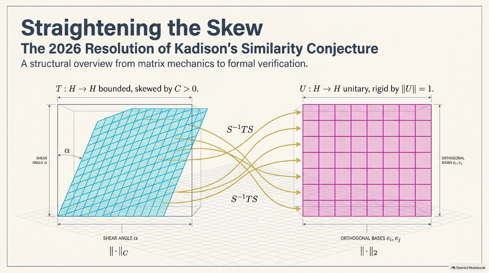

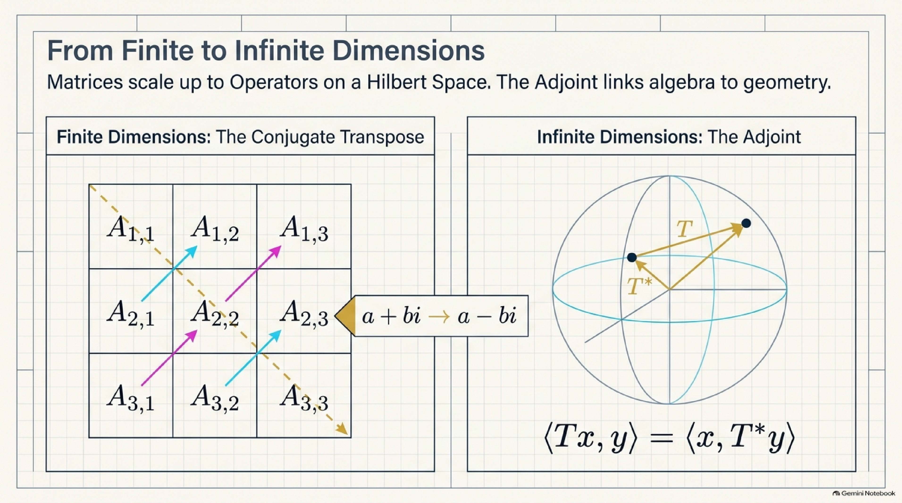

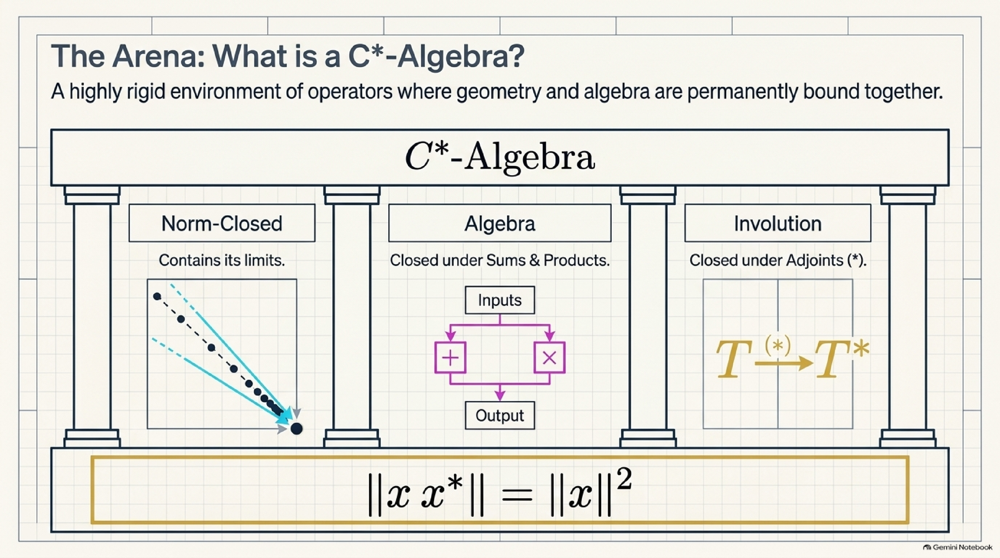

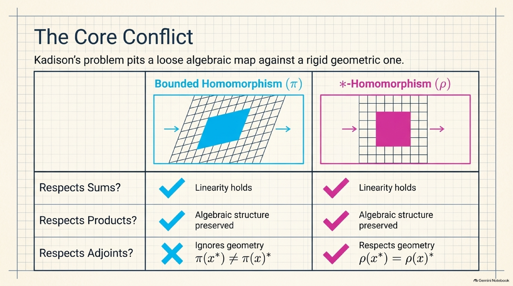

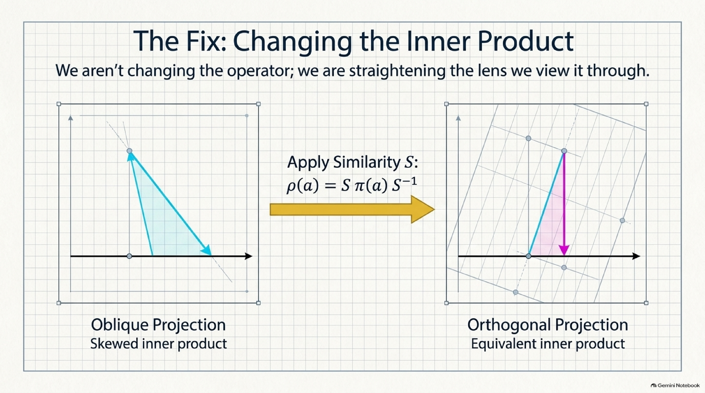


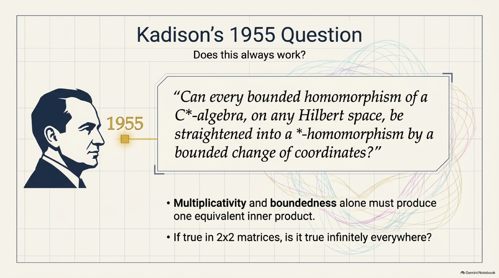


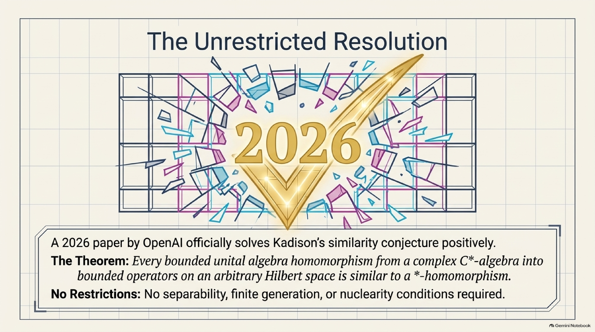


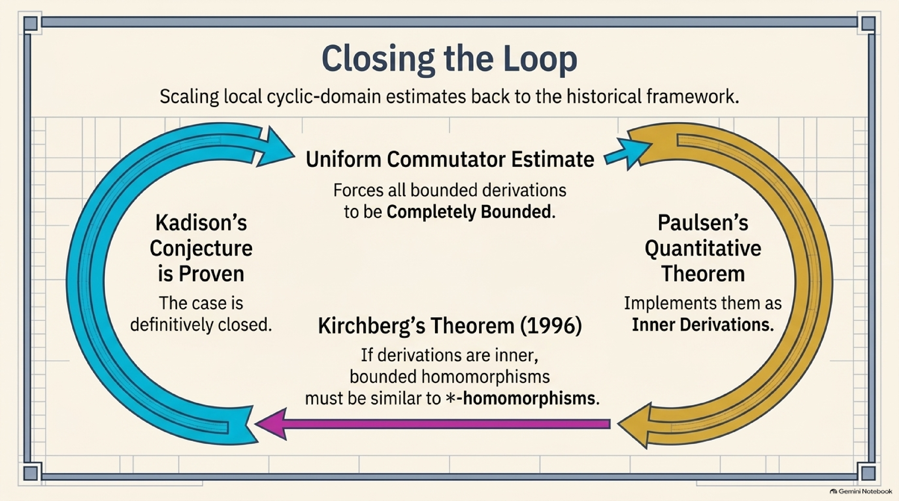

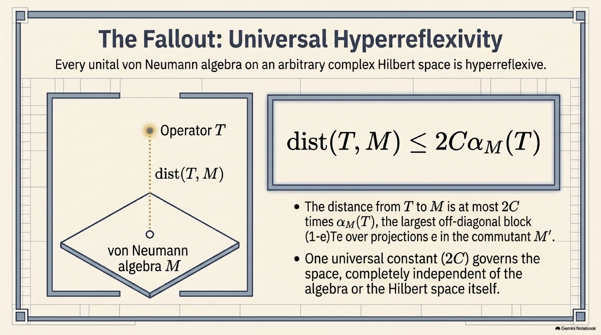

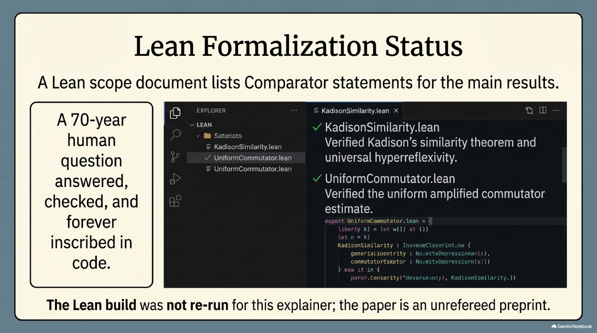

</details>

See [`assets/README.md`](assets/README.md) for the full inventory and the file-by-file [errata](assets/README.md#errata).

---

## How this explainer was made

1. The paper (with its TeX source), its openai/math README, the family entry in `CONTENTS.md`, the Lean scope document `lean/docs/288.md`, the two Comparator challenge files and their configurations, and `lean/formalization.yaml` were downloaded from [openai/math](https://github.com/openai/math) on 7 October 2026. There is no reasoning-trace summary for this family. Ozawa's 2006 notes, cited by the paper, and the Wikipedia articles on [C\*-algebras](https://en.wikipedia.org/wiki/C*-algebra) and [uniformly bounded representations](https://en.wikipedia.org/wiki/Uniformly_bounded_representation) were used to check background history.
2. The paper, the Lean scope document and the Wikipedia article on C\*-algebras were loaded into a NotebookLM notebook through the [`notebooklm-mcp-cli`](https://github.com/jacob-bd/gemini-notebook-mcp-cli) MCP/CLI, which generated the slides, infographics, report, mind map and audio in [`assets/notebooklm/`](assets/notebooklm/) from prompts written as plain statements of the paper's results. The report and the mind map were restricted to the paper and the Lean scope document. The first slide-deck request failed on NotebookLM's side and was repeated once. Every slide, both infographics, the report and the mind map were then read against the paper. Three clearly wrong slides (7, 13 and 14) were regenerated once with `nlm slides revise`, and a slide-by-slide diff confirmed that nothing else changed. The errors that remain are listed in the [errata](assets/README.md#errata).
3. The text on this page was written by hand (with AI assistance) directly from the paper's TeX source: the introduction, the statements and proofs in Sections 2–7, and the reference list. The 2×2 example, the averaged metric and the implementer it yields, the transpose amplification, the symmetry $s$, the triangular identity, the Hankel numbers and the constants were computed with small Python scripts, and the two figures were drawn as SVG from computed coordinates.

See [`PIPELINE.md`](../../PIPELINE.md) for the exact, repeatable steps.

*Citation for the underlying paper:*

```bibtex
@misc{OAI:Kadisons-similarity-theorem-through-uniform-derivation-estimates-September-23-2026,
  author = {{OpenAI}},
  title = {{Kadison's similarity theorem through uniform derivation estimates}},
  howpublished = {OpenAI Math Release preprint
                  \href{https://github.com/openai/math/blob/main/preprints/Kadisons-similarity-theorem-through-uniform-derivation-estimates-September-23-2026/paper.pdf}{OAI:Kadisons-similarity-theorem-through-uniform-derivation-estimates-September-23-2026}},
  year = {2026}
}
```
