# Erdős's conjecture on arithmetic progressions, explained for beginners

> - **Paper:** [*Quasipolynomial Bounds for Arithmetic Progressions*](https://github.com/openai/math/blob/main/preprints/Quasipolynomial-Bounds-for-Arithmetic-Progressions-September-23-2026/paper.pdf), OpenAI, 23 September 2026 (198 pages; [TeX source](https://github.com/openai/math/tree/main/preprints/Quasipolynomial-Bounds-for-Arithmetic-Progressions-September-23-2026/build))
> - **openai/math family:** 159, *Erdős's reciprocal-sum conjecture and quasipolynomial Szemerédi bounds* · **Field:** combinatorics (additive combinatorics)
> - **Also released:** an [abridged summary of the model's reasoning](https://github.com/openai/math/blob/main/reasoning_traces/quasipolynomial-arithmetic-progressions.pdf) for this result (see [section 7](#7-what-it-does-not-prove-and-caveats)) · the paper's companion on [van der Waerden numbers](https://github.com/openai/math/blob/main/preprints/Quantitative-Superexponential-Bounds-for-van-der-Waerden-Numbers-September-23-2026/paper.pdf) (family 160)
> - **Formal proof:** only the reciprocal-sum statement (Corollary 1.2) has a Lean 4 formalization ([scope](https://github.com/openai/math/blob/main/lean/docs/159.md)); the quantitative bound (Theorem 1.1) does not. Details in [section 7](#7-what-it-does-not-prove-and-caveats)
> - **Who this is for:** anyone comfortable with high-school algebra, sums and logarithms. No combinatorics needed.

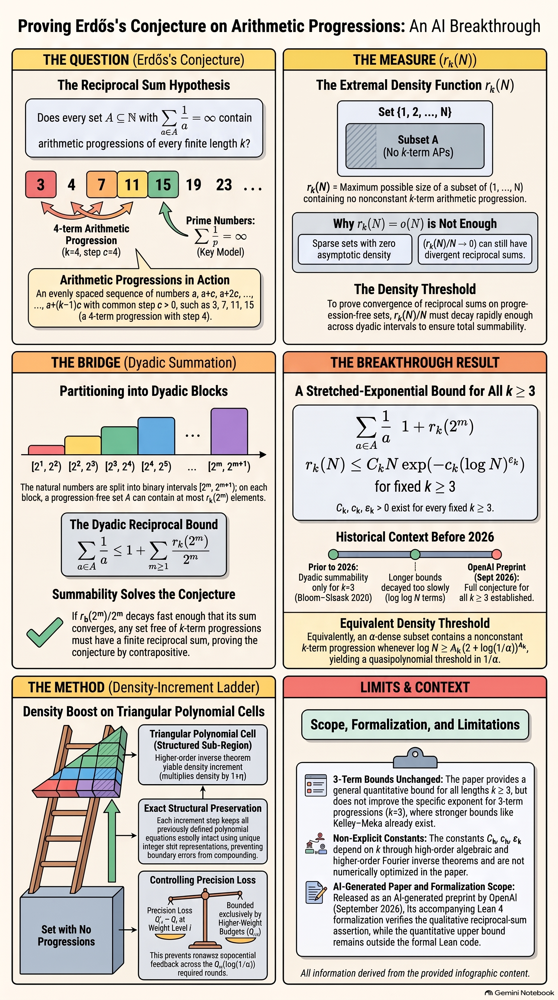

*AI-generated overview (NotebookLM). It has a few typos inside formulas; see the [errata](assets/README.md#errata).*

## Contents

- [TL;DR](#tldr)
- [How to read this](#how-to-read-this)
- [1. The problem](#1-the-problem)
- [2. A short history](#2-a-short-history)
- [3. What the paper proves](#3-what-the-paper-proves)
- [4. Why it matters](#4-why-it-matters)
- [5. The main idea of the proof](#5-the-main-idea-of-the-proof)
- [6. The people whose ideas this builds on](#6-the-people-whose-ideas-this-builds-on)
- [7. What it does not prove, and caveats](#7-what-it-does-not-prove-and-caveats)
- [8. Glossary](#8-glossary)
- [9. Slides, audio and other assets](#9-slides-audio-and-other-assets)
- [How this explainer was made](#how-this-explainer-was-made)

---

## TL;DR

- **The question.** An *arithmetic progression* is an evenly spaced list such as 3, 7, 11, 15. Paul Erdős conjectured that if a set of positive whole numbers is "large" in the sense that the sum of the reciprocals of its members diverges, $\sum_{a\in A} 1/a = \infty$, then it contains progressions of **every** finite length. The primes are the most famous such set. Erdős offered a cash prize for a proof (3,000 US dollars in 1976, according to Wikipedia).
- **What was known.** Szemerédi's theorem (1975) handles sets with a positive *proportion* of the integers, but sets with divergent reciprocal sum can be much thinner. The reciprocal-sum statement needs a strong *quantitative* bound on $r_k(N)$, the size of the largest subset of $\lbrace 1,\dots,N\rbrace$ with no $k$-term progression. Before this paper, a strong enough bound was known only for $k = 3$ (Bloom and Sisask, 2020).
- **What this paper proves.** For every fixed $k \ge 3$,
  $r_k(N) \le C_k N \exp\big(-c_k (\log N)^{\varepsilon_k}\big)$
  with positive constants depending only on $k$. Summing this over the blocks $[2^m, 2^{m+1})$ proves **Erdős's conjecture for every length $k$**.
- **How.** It uses a *density increment* argument. A progression-free set must be noticeably denser on some structured sub-region, and you keep zooming in until the density would pass 100%. The new ingredient is the bookkeeping. Each zoom keeps all the old defining equations exactly, adds only polynomially many new coordinates, and the extra precision it loses at each level is controlled by the levels above it (and by size data fixed in advance), never by that level's own precision. So the total cost stays polynomial in $\log(1/\alpha)$ instead of exploding.
- **What it doesn't do.** It does not improve the best bounds for 3-term progressions, the constants are not explicit, and the true size of $r_k(N)$ is still unknown. The 198-page argument is an AI-generated preprint. Only the qualitative reciprocal-sum statement is covered by the Lean formalization.

## How to read this

| You have… | Read |
|---|---|
| 2 minutes | The TL;DR, the infographic above and the figure in [section 1.4](#14-from-a-density-bound-to-the-reciprocal-sum-conjecture) |
| 15 minutes | Sections 1–4 and 7 |
| An hour, and you like analysis | Everything, including [section 5](#5-the-main-idea-of-the-proof) |

---

## 1. The problem

### 1.1 Arithmetic progressions

A **$k$-term arithmetic progression** is a list $a, a+d, a+2d, \dots, a+(k-1)d$ with a common difference $d > 0$. For example 3, 7, 11, 15 has four terms and $d = 4$. The primes 5, 11, 17, 23, 29 form a five-term progression with $d = 6$.

Sets can avoid progressions. The eight numbers

$$1,\ 2,\ 4,\ 5,\ 10,\ 11,\ 13,\ 14$$

contain no 3-term progression, because none of them is the average of two others. The question is **how many** numbers a set can have before progressions become unavoidable.

### 1.2 Colourings, density and the function $r_k(N)$

There are two classical ways to ask this.

- **Colouring (van der Waerden, 1927).** However you colour the positive integers with finitely many colours, one colour contains arbitrarily long progressions.
- **Density (asked by Erdős and Turán in 1936, proved by Szemerédi in 1975).** Any set containing a fixed positive *proportion* of the integers contains arbitrarily long progressions. This is **Szemerédi's theorem**.

The quantitative version uses one function. For $k \ge 3$ and $N \ge 1$, let

> $r_k(N)$ = the largest size of a subset of $[N] = \lbrace 1, \dots, N\rbrace$ with no $k$-term progression.

Szemerédi's theorem says exactly that $r_k(N)/N \to 0$. A set with no $k$-term progression occupies a vanishing fraction of $[N]$. The research question is **how fast** that fraction goes to zero.

### 1.3 Divergent reciprocal sums

A set $A$ of positive integers is "large" in Erdős's sense if

$$\sum_{a\in A} \frac{1}{a} = \infty .$$

- All positive integers: $1 + \tfrac12 + \tfrac13 + \cdots = \infty$ (the harmonic series diverges).
- The squares: $1 + \tfrac14 + \tfrac19 + \cdots = \pi^2/6$, which is finite, so the squares are *not* large.
- The primes: Euler showed in 1737 that $\tfrac12 + \tfrac13 + \tfrac15 + \tfrac17 + \cdots = \infty$. But the primes up to $N$ number only about $N/\log N$, so their proportion tends to **zero**.

Every set with positive density has a divergent reciprocal sum, but not conversely (the primes again). So Erdős's conjecture is **stronger than Szemerédi's theorem**. It also contains the Green–Tao theorem that the primes contain arbitrarily long progressions. As the paper puts it, "the qualitative estimate $r_k(N)=o(N)$ does not by itself settle Erdős's question". You need to know how fast $r_k(N)/N$ goes to zero.

### 1.4 From a density bound to the reciprocal-sum conjecture

Here is the whole connection. It is the proof of the paper's Corollary 1.2.

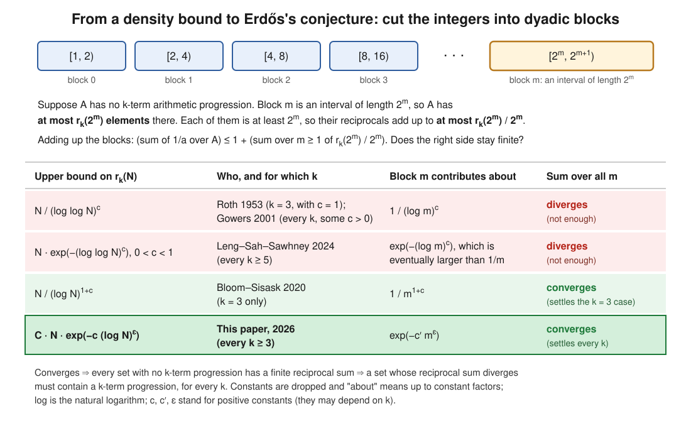

Suppose $A$ has no $k$-term progression. Cut the positive integers into **dyadic blocks** $[2^m, 2^{m+1})$. Block $m$ is an interval of length $2^m$, and shifting an interval doesn't create or destroy progressions. So $A$ has at most $r_k(2^m)$ elements there, each at least $2^m$:

$$\sum_{a \in A \cap [2^m,\ 2^{m+1})} \frac1a \ \le\ \frac{r_k(2^m)}{2^m}.$$

Adding the blocks,

$$\sum_{a\in A}\frac1a \ \le\ 1 + \sum_{m\ge1}\frac{r_k(2^m)}{2^m}.$$

**If the right-hand side is finite, every progression-free set has a finite reciprocal sum.** Equivalently, a set with divergent reciprocal sum must contain a $k$-term progression. So the conjecture follows from the **summability condition** $\sum_m r_k(2^m)/2^m < \infty$.

<details>
<summary><b>Worked calculation: why the paper's bound is summable and the older ones are not</b></summary>

Put $N = 2^m$, so $\log N = m\log 2$.

- **The paper's bound** $r_k(N) \le C N e^{-c(\log N)^{\varepsilon}}$ gives block terms at most $C e^{-c(m\log 2)^{\varepsilon}}$. Since $m^{\varepsilon}/\log m \to \infty$, these terms are eventually smaller than $1/m^2$, and $\sum 1/m^2$ converges. This is the paper's own argument.
- **A toy version with numbers.** Take $C = c = 1$ and $\varepsilon = 1/2$. Block 10 contributes at most $e^{-\sqrt{6.93}} \approx 0.072$, block 100 at most $e^{-\sqrt{69.3}} \approx 0.00024$, and block 1000 at most about $4\times10^{-12}$. From block 142 on, every term is below $1/m^2$. All the block terms for $m \ge 1$ add up to about 2.53, so with the 1 from block 0 the reciprocal sum is at most about 3.5.
- **The borderline** $r_k(N) \approx N/\log N$ gives block terms $1/(m\log 2)$. That's the harmonic series, which diverges. The sum of blocks 2 to 100,000 is already about 16 and still growing, so this is **not** enough.
- **Leng–Sah–Sawhney (2024)** proved $r_k(N) \ll N e^{-(\log\log N)^{c}}$ with $0 < c < 1$ for $k \ge 5$. The block terms are about $e^{-(\log m)^{c}}$. Because $c < 1$, $(\log m)^c$ is eventually smaller than $\log m$, so the terms are eventually larger than $1/m$, and the sum diverges. The paper says this saving "does not give the dyadic summability above".
- **Bloom–Sisask (2020)** proved $r_3(N) \ll N/(\log N)^{1+c}$. The block terms are about $1/m^{1+c}$, which is summable. That settled $k = 3$.

</details>

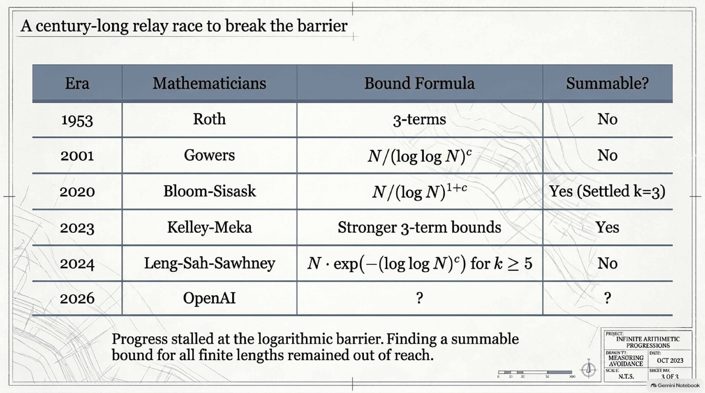

### 1.5 What shape of bound is possible?

Behrend (1946) built large sets without 3-term progressions: $r_3(N) \ge N \exp(-C\sqrt{\log N})$. A set with no 3-term progression has no longer progression either, so $r_k(N) \ge r_3(N)$ for every $k \ge 3$. Two consequences:

- No bound of the form $r_k(N) \le N^{1-\delta}$ (a "power saving") is possible, as the paper notes.
- In the paper's bound the exponent $\varepsilon_k$ can never exceed $1/2$, since otherwise it would contradict Behrend's construction.

So a saving of the form $\exp(-c(\log N)^{\varepsilon})$ is the natural shape. Turned around, it says that a set of density $\alpha$ must contain a progression once

$$\log N \ \ge\ A_k\big(2 + \log(1/\alpha)\big)^{A_k}.$$

The interval length you need is $\exp$ of a power of $\log(1/\alpha)$. That is called **quasipolynomial** in $1/\alpha$, between polynomial, $(1/\alpha)^{C}$, and exponential. That's where the title comes from.

---

## 2. A short history

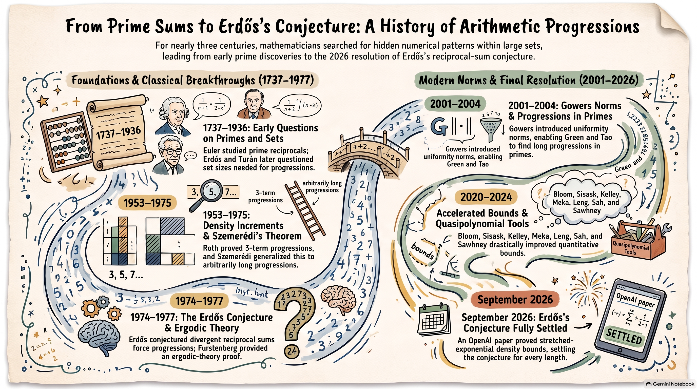

*AI-generated timeline. The table below is the checked version; see the [errata](assets/README.md#errata).*

| When | Who | What happened |
|---|---|---|
| 1737 | **Leonhard Euler** | The reciprocals of the primes have a divergent sum |
| 1927 | **B. L. van der Waerden** | Every finite colouring of the integers has a monochromatic progression of each length |
| 1936 | **Paul Erdős, Pál Turán** | Began the study of progression-free sets; conjectured $r_3(N) = o(N)$ |
| 1946 | **Felix Behrend** | Large 3-progression-free sets: $r_3(N) \ge N e^{-C\sqrt{\log N}}$ |
| 1953 | **Klaus Roth** | Proved the 3-term case by Fourier analysis, with $r_3(N) \ll N/\log\log N$, introducing the *density increment* method |
| 1961 | **Paul Erdős** | The all-length density conjecture appears explicitly in his problem survey (as cited by the paper) |
| 1969, 1975 | **Endre Szemerédi** | Four-term progressions, then every length: **Szemerédi's theorem** |
| 1974 | **Paul Erdős** | The reciprocal-sum question in his problem list (the paper cites Problem 4.33.6 of *Math. Balkanica* 4) |
| 1976, 1996 | **Paul Erdős** | Offered 3,000 US dollars for a proof, later raised to 5,000 (per Wikipedia, which cites the 1977 Manitoba proceedings and Soifer's *The Mathematical Coloring Book*; [erdosproblems.com #3](https://www.erdosproblems.com/3) also lists 5,000 US dollars) |
| 1977 | **Hillel Furstenberg** | An ergodic-theory proof of Szemerédi's theorem (multiple recurrence) |
| 1987, 1990 | **Roger Heath-Brown; Endre Szemerédi** | $r_3(N) \ll N/(\log N)^{c}$ |
| 1998, 2001 | **Timothy Gowers** | Uniformity norms; $r_k(N) \ll N/(\log\log N)^{c_k}$ for every $k$ |
| 1999–2016 | **Jean Bourgain, Tom Sanders, Thomas Bloom** | Density increments on Bohr sets; $r_3(N) \ll N/(\log N)^{1-o(1)}$ |
| 2004 (published 2008) | **Ben Green, Terence Tao** | The primes contain arbitrarily long progressions |
| 2012 | **Ben Green, Terence Tao, Tamar Ziegler** | The inverse theorem for the Gowers $U^{s+1}[N]$ norms (all degrees) |
| 2017 | **Ben Green, Terence Tao** | $r_4(N) \ll N/(\log N)^{c}$ |
| 2020 | **Thomas Bloom, Olof Sisask** | $r_3(N) \ll N/(\log N)^{1+c}$, which crosses the summability threshold and proves Erdős's conjecture for **3-term** progressions |
| 2023 | **Zander Kelley, Raghu Meka** | $r_3(N) \ll N e^{-c(\log N)^{1/12}}$; Bloom and Sisask then simplified the argument and improved $1/12$ to $1/9$ |
| 2024 | **James Leng, Ashwin Sah, Mehtaab Sawhney** | A quasipolynomial inverse theorem, and $r_k(N) \ll N e^{-(\log\log N)^{c_k}}$ for every $k \ge 5$ |
| 2026 | **Rushil Raghavan** | $r_3(N) \le N e^{-(\log N)^{1/6-o(1)}}$ (arXiv preprint [2603.27045](https://arxiv.org/abs/2603.27045), as cited by the paper) |
| Sept 2026 | **OpenAI** (internal model) | $r_k(N) \le C_k N e^{-c_k(\log N)^{\varepsilon_k}}$ for every $k$, and with it Erdős's conjecture for every length |

---

## 3. What the paper proves

> **Theorem 1.1.** For each fixed integer $k\ge 3$ there are constants $C_k, c_k, \varepsilon_k > 0$ such that, for every $N \ge 2$,
> $$r_k(N) \le C_k N \exp\big(-c_k(\log N)^{\varepsilon_k}\big).$$
> Equivalently, there is $A_k \ge 1$ such that an $\alpha$-dense subset of $[N]$ contains a nonconstant $k$-term progression whenever $\log N \ge A_k(2+\log(1/\alpha))^{A_k}$, for $0 < \alpha \le 1$.

> **Corollary 1.2 (Divergent reciprocal sums).** Every set $A$ of positive integers with $\sum_{a\in A} 1/a = \infty$ contains nonconstant arithmetic progressions of every finite length.

In plain words: a set that avoids $k$-term progressions can fill only a fraction of about $\exp(-c(\log N)^{\varepsilon})$ of $\lbrace 1,\dots,N\rbrace$. That fraction shrinks fast enough that, block by block, the reciprocals of such a set add up to something finite. So any set whose reciprocals add up to infinity, however thin, contains progressions of every length.

The paper says that "the exponent is not optimized" and that "no improvement of the three-term exponent is claimed". Its contribution is the **all-length, summable** bound.

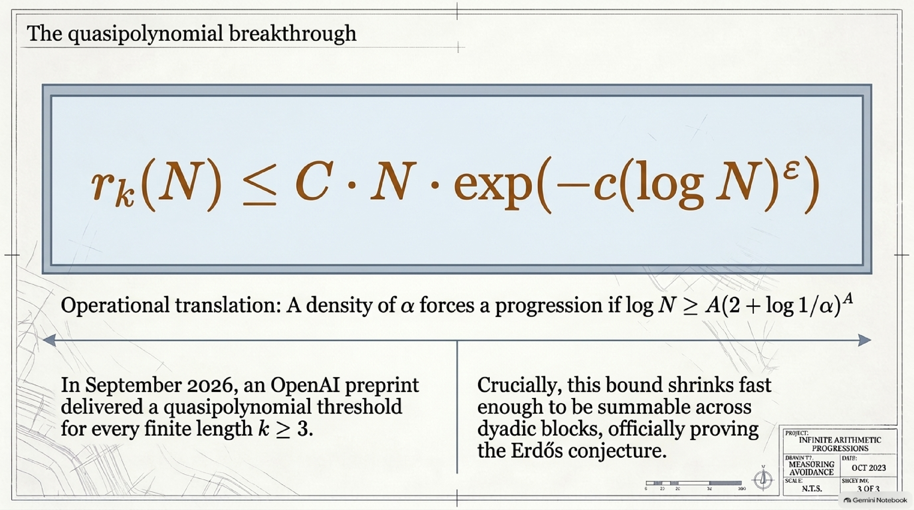

**Other consequences** (Section 11 and Section 1.4 of the paper):

- **A uniform harmonic bound.** There is a constant $H_k$ such that *every* $k$-progression-free set has $\sum_{a\in A} 1/a \le H_k$ (Corollary 11.2). For every $0 < a < c_k$, the part of the sum beyond $x$ is at most $C_{k,a}e^{-a(\log x)^{\varepsilon_k}}$ (Corollary 11.5).
- **Heavier weights.** For every fixed $B \ge 0$, if $\sum_{a\in A} (\log(2+a))^B/a = \infty$, then $A$ contains progressions of every length (Corollary 11.4). Also $r_k(N) \le C_{k,B} N (\log N)^{-B}$.
- **Dense subsets of the primes.** The paper *recovers* the Green–Tao theorem that any subset of the primes with positive relative upper density contains infinitely many $k$-term progressions. This is an old theorem obtained in a new way, not a new result.
- **Colourings.** If $W_r(k)$ is the least $N$ such that every $r$-colouring of $[N]$ has a one-colour $k$-term progression, then $W_r(k) \le \lceil \exp(A_k(2+\log r)^{A_k})\rceil$. This is quasipolynomial in the number of colours $r$.

The Lean 4 statement of Corollary 1.2, from the [openai/math Comparator challenge](https://github.com/openai/math/blob/main/lean/ComparatorChallenges/ErdosReciprocal.lean), reads:

```lean
def HasAP (A : Set ℕ) (k : ℕ) : Prop :=
  ∃ a d : ℕ, 0 < d ∧ ∀ i < k, a + i * d ∈ A

def ReciprocalProgressionTheorem : Prop :=
  ∀ A : Set ℕ, ¬ Summable (reciprocalTerm A) → ∀ k : ℕ, HasAP A k
```

Here `reciprocalTerm A n` is $1/n$ if $n \in A$ and $0$ otherwise.

---

## 4. Why it matters

| Consequence | Before | After |
|---|---|---|
| **Erdős's reciprocal-sum conjecture** | Proved only for 3-term progressions (Bloom–Sisask 2020) | Proved for **every** length $k$ |
| **Bound on $r_k(N)$ for $k \ge 5$** | $N e^{-(\log\log N)^{c_k}}$ with $c_k < 1$ (Leng–Sah–Sawhney) | $C_k N e^{-c_k(\log N)^{\varepsilon_k}}$: a saving in a power of $\log N$, not of $\log\log N$ |
| **Bound on $r_4(N)$** | $N/(\log N)^{c}$ (Green–Tao) | The same stretched-exponential form as above |
| **Interval length that forces a progression at density $\alpha$** | From the Leng–Sah–Sawhney bound, $\log\log N$ has to exceed a power of $\log(1/\alpha)$, so $N$ is a double exponential of that power | $\log N \ge A_k(2+\log(1/\alpha))^{A_k}$ (quasipolynomial) |
| **Colourings** ($W_r(k)$, $r$ colours) | From the earlier density bounds: quasipolynomial in $r$ for $k = 3$ (Kelley–Meka); for $k \ge 5$, only that $\log\log W_r(k)$ is at most a power of $\log r$ (Leng–Sah–Sawhney) | $W_r(k) \le \exp(A_k(2+\log r)^{A_k})$. With the [companion paper's](https://github.com/openai/math/blob/main/preprints/Quantitative-Superexponential-Bounds-for-van-der-Waerden-Numbers-September-23-2026/paper.pdf) lower bound $W_r(k) > \exp((\log r)^2/(64\log 2))$ for $r \ge 256$, growth in $r$ is "superpolynomial but at most quasipolynomial" for each fixed $k$ |
| **Weighted divergence** | — | $\sum_{a\in A}(\log(2+a))^B/a = \infty$ already forces progressions of every length |

The deeper point is about **methods**. Leng, Sah and Sawhney had already shown, in a quasipolynomial inverse theorem, that structure can be *detected* cheaply. As the paper puts it, what remained was "the cost of localizing and iterating that correlation". This paper shows that a density-increment argument can be run for every $k$ with only polynomial total cost in $\log(1/\alpha)$. For three-term progressions, the Kelley–Meka bound already implied a quasipolynomial threshold; this paper gets one for every $k$.

---

## 5. The main idea of the proof

The paper is 198 pages: Sections 1–11 take about 80 pages and nine appendices (A–I) most of the rest. Here it is at three zoom levels.

### Level 1: the one-paragraph version

Suppose $A \subseteq [N]$ has density $\alpha$ and no $k$-term progression. Avoiding progressions is a kind of conspiracy, and conspiracies leave fingerprints: $A$ must be **noticeably denser, by a fixed factor $1+\eta$, on some structured sub-region**. Zoom into that region and repeat. Density can never exceed 100%, so after about $\log(1/\alpha)/\log(1+\eta)$ zooms you reach a contradiction, *provided $N$ was long enough to pay for all the zooms*. The whole difficulty is the price of a zoom. Each new region is cut out by more, and more delicate, polynomial equations, arranged in levels. If the precision a zoom loses at some level could depend on that same level's current precision, the losses would compound from round to round and $N$ would have to be astronomically long. The paper arranges the costs in a **triangle**. The precision lost at each level is bounded using only the levels above it (and size data such as $\log(1/\alpha)$ and the dimensions), so the total bill stays polynomial in $\log(1/\alpha)$.

> **Analogy:** a tower of floors, where renovating a floor can only be billed for work on the floors *above* it. The top floor's bill is fixed, which fixes the next floor's, and so on down. With a fixed number of floors, the total stays under control. If every floor could also bill for itself, the costs would feed on themselves round after round.

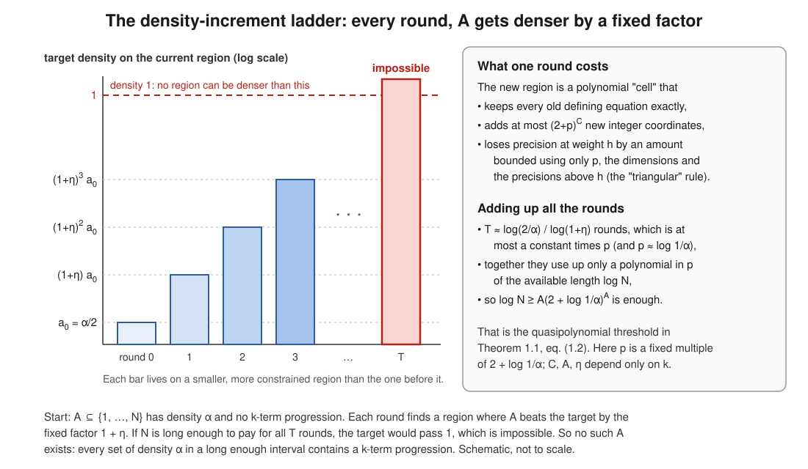

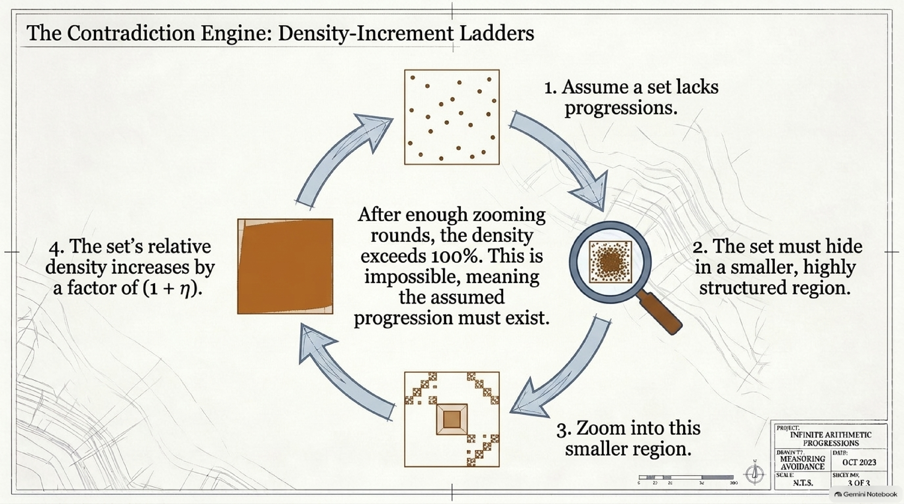

### Level 2: the step-by-step picture

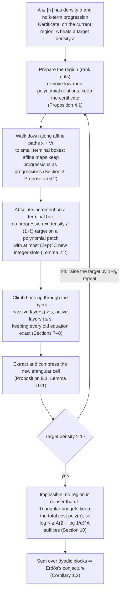

**Step 0: density increments (Roth's idea).** The argument works with a *certificate* $\mathbb{E}[f B^-] > a\ \mathbb{E}[B^+]$. Here $f$ starts as the indicator of $A$ (in general it is any $[0,1]$-valued function whose support has no $k$-term progression), $B^-$ and $B^+$ are a region and a slightly enlarged copy of it, and $a$ is the current target density. Each round produces a new certificate at target $(1+\eta)a$ on a new region. A certificate with $a \ge 1$ is impossible, because $f B^- \le B^+$ pointwise. The run starts on the whole interval with $a_0 = \alpha/2$ (Proposition 10.4). The gain is **multiplicative**, so only $O(\log(1/\alpha))$ rounds are ever needed.

**Step 1: the regions are "triangular polynomial cells".** A point $u$ of the region comes with integer "helper" blocks $b_1, \dots, b_D$, each pinned down by a narrow window:

$$\Vert b_h - C_h(u, b_1, \dots, b_{h-1}) - l_h \Vert_\infty \le w_h, \qquad 0 < w_h \le 1/32 .$$

Here $C_h$ is a polynomial whose weighted degree is at most $h$ (the "weight" of $b_h$), $l_h$ is a fixed centre, and $w_h$ is the width. Because the windows are narrow, each $b_h$ is **unique** when it exists. Block $b_1$ is determined by $u$, block $b_2$ by $u$ and $b_1$, and so on. The paper's Figure 1 shows the same successive structure for a *patch* (the smooth test an increment produces), with $A_1(u) = u$, $A_2(u,b_1) = (u^2 + u b_1)/2$ and windows of half-width $1/4$. At $u = 1$ the only allowed integer pair is $(b_1, b_2) = (1,1)$. Write $Q_h = \log(2/w_h)$ for the **precision** at weight $h$. Smaller windows mean larger $Q_h$.

**Step 2: why old equations must be kept exactly.** No bound is imposed on the coefficients of the polynomials $C_h$. An error in one helper integer would therefore enter every later polynomial that uses it, with no control on the damage. So the proof never approximates an old helper integer. When it adds new constraints, it substitutes the actual integers exactly.

**Step 3: prepare, then walk down.** *Rank cuts* remove degenerate polynomial relations, by lowering the dimension of a rational value space while keeping the certificate (Proposition 4.1). Then the argument samples many integer-affine maps $\psi(t) = x + Vt$ along which the constraint polynomials have small residuals and exact integer lifts (Section 3). Affine maps send progressions to progressions, so the input stays progression-free on each sampled box. Proposition 6.2 ("forward mass") ensures that the sampled "terminal" boxes on which the input still has density close to the target carry probability at least a fixed multiple of $a$.

**Step 4: the absolute increment.** On a terminal box, a progression-free function of mean at least $a$ has a structured test, a *polynomial patch* with at most $d_0 = (2+p)^{C}$ integer slots, on which its mean exceeds $(1+\xi)a$ (Lemma 2.2). Here $p$ is a constant multiple of $2+\log(1/\alpha)$. The slot count $d_0$ does not depend on the box's dimension, and this is essential. The ingredients are listed in Level 3.

**Step 5: climb back up and extract.** The increment was found on a small sampled box. It has to be re-expressed in the original variables while keeping every old determining equation exact. The return goes layer by layer from $D$ down to $1$. Layers above $s = k - 2$ are *passive*: the new test does not use their integers. The last $s$ layers are *active* (Sections 7–8). Section 9 then solves the inactive integer equations, real constraints and congruences to produce a new triangular cell.

**Step 6: close the budgets.** Theorem 2.1 is the "triangular increment" and the heart of the paper. Each round adds at most $d_0$ plus a polynomial in the *higher* dimensions to the dimension at weight $i$. The precision loss at weight $i$ is bounded by a polynomial in $p$, the dimension forecasts and the **higher** precisions $Q_{i+1}, \dots, Q_D$ only:

$$Q'_i - Q_i \ \le\ P'_i\big(p,\ \text{dimensions},\ Q_{i+1},\dots,Q_D\big).$$

"The main point is the absence of $Q_i, Q_{<i}$ from the right-hand side." Descending induction from the top weight $D$ down to $1$ then bounds every precision after $O(p)$ rounds by a polynomial in $p$ (Propositions 10.2 and 10.3). Every logarithmic cost of the run is then polynomial in $p$, so an interval with $\log N \ge \text{poly}(p)$ can sustain all the rounds (Proposition 10.4). Inverting this gives Theorem 1.1.

<details>
<summary><b>Worked calculation: why the triangular rule matters</b> (a toy model with made-up numbers)</summary>

Take two weights and $p = 10$, so about 10 rounds. Start both precisions at 0.

**Triangular rule** (the paper's shape). The top precision grows by $p$ each round. The lower one grows by $(p + Q_2)^2$, which depends only on the level above:

$$Q_2 \mapsto Q_2 + p, \qquad Q_1 \mapsto Q_1 + (p + Q_2)^2 .$$

After 10 rounds $Q_2 = 100$ and $Q_1 = 100 \cdot (1^2 + 2^2 + \cdots + 10^2) = 38{,}500$. In general $Q_1$ is about $p^5/3$, a polynomial in $p$.

**Compounding rule** (what the paper avoids). Suppose instead the loss at a level depended on that level's own precision, for example $Q_1 \mapsto Q_1 + Q_1^2$. Starting from $Q_1 = 2$, the values are $6, 42, 1806, 3263442, \dots$. After 10 rounds $Q_1$ has 417 digits. The number of digits roughly doubles every round, so the growth is doubly exponential in $p$. The interval would need $\log N$ at least that large, which is useless.

This is the paper's warning that "a bound polynomial in all current width logs would not suffice: repeated substitution could raise the polynomial degree at every round". The released reasoning summary shows the model hitting exactly this wall, a recurrence of the form $P_{j+1} = P_j + (2+P_j)^E$, before it reorganised the costs into "warm" and "cold" budgets (sections 28–37 of the summary).

</details>

### Level 3: the analytic engine, for readers who know some additive combinatorics

Fix $k$ and put $s = k - 2$. Write $\mathcal P(p) = (2+p)^C$ and $\mathcal B(p) = \exp((2+p)^C)$, as the paper does. The absolute increment (Lemma 2.2) is assembled from these statements (see the paper's Table 1):

1. **Inverse theorem** (Theorem A.7). A 1-bounded function on an interval whose Gowers $U^{s+1}$ norm is at least $e^{-p}$ correlates by at least $\mathcal B(p)^{-1}$ with a degree-$s$ *niltest* of complexity $\mathcal P(p)$. A niltest is a Lipschitz function evaluated along a polynomial orbit on a nilmanifold. On intervals this is the quasipolynomial inverse theorem of Leng, Sah and Sawhney. The appendices prove the versions needed on integer boxes and products of cyclic groups.
2. **Shift comparison** (Theorem C.1). Suppose $0 \le f, g, J \le e^p$ on $\mathbb{Z}/N\mathbb{Z}$ and $f$ never beats $g$ by more than $e^{-\mathcal P(p)}$ against degree-$\le d$ niltests. Then outside an exceptional set of at most $e^{-p}N$ shifts $h$, the product $f(n)J(n+h)$ never beats $(1+\epsilon)g(n)J(n+h)$ by more than $e^{-p}$ against degree-$(d-1)$ niltests. This lowers the degree while multiplying by an arbitrary nonnegative translate. The degree-one case adapts **Kelley–Meka unbalancing and sifting** (as developed on Bohr sets by Bloom and Sisask), with the **Schoen–Sisask** almost-periodicity theorem as its key input. The paper stresses that this theorem keeps the incoming radius as a multiplicative factor. Higher degrees remove top-degree frequencies using the inverse theorem and **Leng's efficient equidistribution** of nilsequences.
3. **Positive grids and positive counting** (Lemma D.1, Proposition D.2). Using only *upper* comparisons, grid products $\mathbb{E}\prod_\beta f_\beta(t_{1,\beta_1}+\cdots+t_{j,\beta_j})$ are at most $(1+\delta)^{\text{size}}$. A Cauchy–Schwarz step with sign-coupled final factors then turns "no density surplus on niltests" into a two-sided estimate. All $k$-term progression averages of the normalised densities are within $\tau$ of 1. In the paper's words, "the same grid upper bound can treat both a surplus and a deficit".
4. **Absolute increment in fixed dimension** (Proposition D.3). A progression-free $f : Q \to [0,1]$ of mean $\alpha$, on a box of distinct large primes, has a degree-$(k-2)$ niltest $T$ of complexity $\mathcal P(p)$ with
   $\mathbb{E}_Q\big(f-(1+\xi)\alpha\big)T \ge \exp(-(2+p)^C)$.
   This is the contrapositive of positive counting: zero progressions is far from "within $\tau$ of 1".
5. **Relative lifting with additive rank** (Proposition D.7, proved as Theorem I.15). Starting from an old patch of rank $d$, the theorem returns a new patch of rank at most $d + d_0$. Applied to the constant patch ($d = 0$), it turns the fixed-dimension rule into Lemma 2.2, with fresh rank $d_0$ independent of the ambient dimension.

The *return* to the original cell (Sections 3–9, about 60 pages) takes up most of the main text; the appendices hold the analytic engine above and the sampling and lifting arguments behind it. It has its own tools: a constrained affine sampler, cube comparison, and a cube version of **Conlon–Fox–Zhao densification** that replaces sparse factors by bounded ones before the inverse theorem is applied (Section 5, "Densification without paying the chart mass"). It also has a strict bookkeeping order. "Warm" data at layer $j$ (dimensions, $p$, higher-layer budgets) are fixed before the "cold" choices, which may use the current width $Q_j$. A cold quantity is never allowed to feed back into the relative width loss at layer $j$ (the paper's Figure 2 and Definition 2.3). The paper names the Leng–Sah–Sawhney inverse theorem and the Schoen–Sisask almost-periodicity theorem as "the two principal external analytic inputs".

---

## 6. The people whose ideas this builds on

| Person | Idea | Where it shows up in the proof |
|---|---|---|
| **Paul Erdős, Pál Turán** | Progression-free sets and their extremal sizes; the reciprocal-sum conjecture | The question itself |
| **B. L. van der Waerden** | Monochromatic progressions in colourings | The colouring corollary $W_r(k)$ |
| **Klaus Roth** | Density increments: a shortage of progressions forces higher density on a structured set | The overall strategy (Step 0) |
| **Endre Szemerédi** | Every positive-density set has long progressions | The qualitative theorem this quantifies |
| **Hillel Furstenberg** | Multiple recurrence; the ergodic viewpoint | Background for nilsystems and nilsequences |
| **Felix Behrend** | Large 3-progression-free sets | Shows a power saving is impossible |
| **Timothy Gowers** | Uniformity norms; density increments beyond linear Fourier analysis | The norms detected by the inverse theorem |
| **Bernard Host, Bryna Kra, Tamar Ziegler, Vitaly Bergelson** | Characteristic factors and nilsequences in ergodic theory | The structured objects (niltests) used as tests |
| **Ben Green, Terence Tao, Tamar Ziegler** | Inverse theorems; quantitative behaviour of polynomial orbits; density increments from inverse theory | Detection and factorisation of structure |
| **Alexander Leibman, Frederick Manners** | Distribution of polynomial orbits; quantitative inverse bounds on cyclic groups | Background to the quantitative inverse theory |
| **James Leng, Ashwin Sah, Mehtaab Sawhney** | Quasipolynomial inverse theorem; improved Szemerédi bounds | Theorem A.7, "the interval input used here" |
| **James Leng** | Efficient equidistribution of nilsequences | Removing top-degree frequencies in shift comparison |
| **Zander Kelley, Raghu Meka** | Unbalancing, sifting and positivity for 3-term progressions | The degree-one shift comparison |
| **Thomas Bloom, Olof Sisask** | The Kelley–Meka method on Bohr sets; the 3-term reciprocal result | The degree-one shift comparison; the $k = 3$ benchmark |
| **Tomasz Schoen, Olof Sisask** | Radius-sensitive almost-periodicity (their Theorem 5.4) | A principal external input |
| **Ernie Croot, Olof Sisask; Tom Sanders** | Probabilistic almost-periodicity; local control of large spectra; Bogolyubov–Ruzsa | Behind the Schoen–Sisask input |
| **David Conlon, Jacob Fox, Yufei Zhao** | Densification in the relative Szemerédi theorem | Cube densification in the return (Section 5) |

---

## 7. What it does not prove, and caveats

> [!IMPORTANT]
> **What is not claimed.** The paper does not improve the best bounds for 3-term progressions (Kelley–Meka, Bloom–Sisask, Raghavan). Its constants $C_k, c_k, \varepsilon_k, A_k$ are not explicit, and "the exponent is not optimized". The true size of $r_k(N)$ is still open: Behrend-type constructions show $r_k(N) \ge N e^{-C\sqrt{\log N}}$, so $\varepsilon_k \le 1/2$, and the gap between the bounds remains.

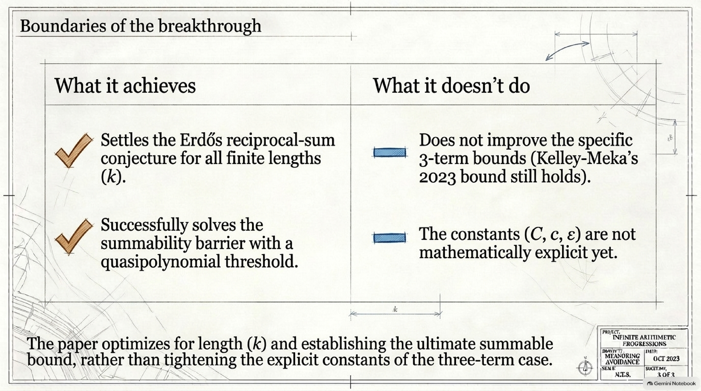

> [!NOTE]
> **Provenance.** The paper was produced by an unreleased internal OpenAI model as part of the [openai/math](https://github.com/openai/math) release. That repository's README says the "vast majority" of its results came from one fixed procedure, averaging three hours of ChatGPT Pro thinking compute per result. The exceptions it names (the zeta zero-free region and the Hodge conjecture for CM abelian varieties) do not include this paper.

> [!NOTE]
> **The released reasoning summary.** For this family openai/math also published a [*Summarized chain of thought*](https://github.com/openai/math/blob/main/reasoning_traces/quasipolynomial-arithmetic-progressions.pdf) (41 pages). It is an **abridged, third-person summary** of the model's reasoning, with short verbatim excerpts. It is not the full trace and not a proof. It shows two consecutive tasks:
> - **Part I.** "Prove or disprove" the reciprocal-sum statement. Over 27 sections the model tries and abandons many routes (finite-field models, sparse counting, transference) and eventually aims at $r_k(N) \ll N/(\log N)^3$.
> - **Part II.** The prompt (as excerpted) was "Please give quasipolynomial bounds for k-th arithmetic progressions for all k>=3. Use the previous bounds you have done." Here the model isolates the compounding-precision problem and reorganises the argument into the triangular warm and cold budgets of the final paper.
>
> Read it as context on how the result was found, not as evidence that it is correct.

> [!WARNING]
> **Verification status, stated exactly.** [`lean/docs/159.md`](https://github.com/openai/math/blob/main/lean/docs/159.md) says the formalization proves the reciprocal-sum statement: "for every requested length, such a set contains a progression with positive common difference". It adds that "the paper's quantitative upper bound for the largest progression-free subset of $\lbrace 1,\ldots,N\rbrace$ is outside this statement". The Comparator challenge is [`ErdosReciprocal.lean`](https://github.com/openai/math/blob/main/lean/ComparatorChallenges/ErdosReciprocal.lean), with solution module `OAI.Combinatorics.Progressions.Main` and permitted axioms `propext`, `Quot.sound` and `Classical.choice`.
>
> Two further observations from the Lean sources:
> - Alongside that statement, the Lean library states its own, **weaker** quantitative bound, $r_k(N) \le C N \exp(-c(\log\log N)^{1+\eta})$ for $N \ge 3$. Both come out of one theorem, `manuscript_main_theorems`, and that weaker bound is still enough for the dyadic sum. See [`Model.lean`](https://github.com/openai/math/blob/main/lean/OAI/Combinatorics/Progressions/Model.lean) and [`Results/Conclusions.lean`](https://github.com/openai/math/blob/main/lean/OAI/Combinatorics/Progressions/Results/Conclusions.lean).
> - [`lean/formalization.yaml`](https://github.com/openai/math/blob/main/lean/formalization.yaml) describes itself as a "catalog of papers with a formalized main result". As of the initial release commit (6 October 2026), it does **not** list this paper or `ErdosReciprocal` among its sources or main results. Its overall review status is "unchecked".
>
> Theorem 1.1 itself is **not** formalized. This explainer did not build the Lean project or run Comparator. As of October 2026 the paper is a preprint. The usual next step is independent review by experts, and openai/math warns that "some of the unformalized results could have issues".

> [!TIP]
> **Simplifications.** To stay readable, this explainer drops smoothing cutoffs, the strict and enlarged boxes, target discounts, slices and strides, congruence bookkeeping, and the warm, cold and late parameter schedule. Every precise statement is in the paper.

---

## 8. Glossary

| Term | Meaning |
|---|---|
| **Arithmetic progression** ($k$-term) | $a, a+d, \dots, a+(k-1)d$ with $d > 0$ ("nonconstant") |
| **$r_k(N)$** | The size of the largest subset of $\lbrace 1,\dots,N\rbrace$ with no $k$-term progression |
| **Density** | The proportion $\lvert A\rvert/N$ of an interval that a set occupies |
| **Divergent reciprocal sum** | $\sum_{a\in A} 1/a = \infty$, Erdős's notion of a "large" set |
| **Dyadic block** | An interval $[2^m, 2^{m+1})$; summing over these turns density bounds into reciprocal-sum bounds |
| **Szemerédi's theorem** | Every set of positive density contains arbitrarily long progressions; equivalently $r_k(N)/N \to 0$ |
| **Density increment** | Showing that a progression-free set is denser by a fixed factor on a structured sub-region, and iterating |
| **Quasipolynomial** | Of size $\exp((\log x)^{C})$ for a fixed $C > 1$: bigger than any polynomial in $x$, much smaller than $e^{x}$ |
| **Stretched-exponential saving** | A factor $\exp(-c(\log N)^{\varepsilon})$ with $0 < \varepsilon < 1$ |
| **Gowers uniformity norm** $U^{s+1}$ | A measure of how far a function is from random at "degree $s$"; it controls counts of $(s+2)$-term progressions |
| **Inverse theorem** | If a Gowers norm is large, the function correlates with a structured object (a nilsequence) |
| **Nilsequence / niltest** | A function $F(g(n)\Gamma)$: a bounded Lipschitz function along a polynomial orbit on a nilmanifold. "Niltest" is the paper's name for one, with its complexity (dimension, heights, Lipschitz norm) tracked; the counting steps use $[0,1]$-valued ones |
| **Bohr set** | The set of $x$ at which finitely many characters are all close to 1; the classical structured sets for 3-term progressions |
| **Almost-periodicity** | A convolution changes very little under many small shifts (Croot–Sisask, Schoen–Sisask) |
| **Triangular polynomial cell** | The paper's structured region: integer blocks $b_h$, each pinned within a width $w_h$ of a polynomial in $u$ and the earlier blocks |
| **Weight / precision $Q_h$** | Block $b_h$ has weight $h$; $Q_h = \log(2/w_h)$ measures how narrow its window is |
| **Patch, slots, rank** | The smooth structured test produced by an increment; its integer slots become new coordinates; the rank is the number of slots |
| **Certificate** | The inequality $\mathbb{E}[fB^-] > a\ \mathbb{E}[B^+]$: $A$ beats target density $a$ on the region |
| **Van der Waerden number** $W_r(k)$ | The least $N$ such that every $r$-colouring of $[N]$ has a one-colour $k$-term progression |
| **Lean 4 / Comparator** | A proof assistant that checks every logical step, and a tool that checks a formal proof against a fixed challenge statement |

---

## 9. Slides, audio and other assets

Everything below was generated with **Google NotebookLM** (now "Gemini Notebook"). The slides, infographics and audio come from the paper, the reasoning summary, the Lean scope document and the Wikipedia article on Erdős's conjecture. The report and mind map come from the paper and the Lean scope document only. The outputs are kept exactly as NotebookLM produced them. They are AI-generated, so see the [errata](assets/README.md#errata) before relying on any detail. The first deck had three wrong slides (3, 9 and 13); they were regenerated once, and the revised text of all three is correct. The drawings on slides 3 and 9 still contain errors: the prime grid on slide 3, and the "Coordinate Complexity" label on slide 9.

| Asset | What it is |
|---|---|
| [Slide deck (PDF)](assets/notebooklm/slides.pdf) ([PPTX](assets/notebooklm/slides.pptx)) | 14 beginner slides, revised once (slides 3, 9 and 13) |
| [Infographic: overview](assets/notebooklm/infographic-overview.png) | The one-page summary shown at the top |
| [Infographic: history timeline](assets/notebooklm/infographic-history-timeline.png) | From Euler (1737) to 2026 |
| [Audio overview (≈1.5 min)](assets/notebooklm/audio-overview-brief.m4a) | A short podcast-style summary (not checked against a transcript) |
| [Beginner report](assets/notebooklm/beginner-explainer-report.md) | NotebookLM's long-form written explainer |
| [Mind map](assets/notebooklm/mindmaps.md) | How the proof fits together |
| [Dyadic-blocks figure](assets/figures/dyadic-blocks.svg) ([PNG](assets/figures/dyadic-blocks.png)) | Hand-made diagram used in section 1.4: which density bounds are summable |
| [Density-increment figure](assets/figures/density-increment.svg) ([PNG](assets/figures/density-increment.png)) | Hand-made diagram used in section 5: the ladder of rounds and what each round costs |

<details>
<summary><b>All 14 slides</b> (click to expand)</summary>

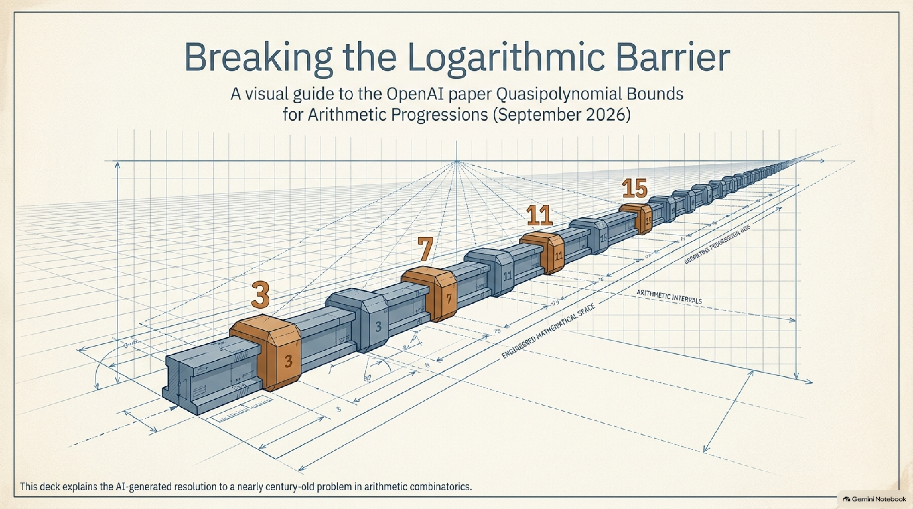

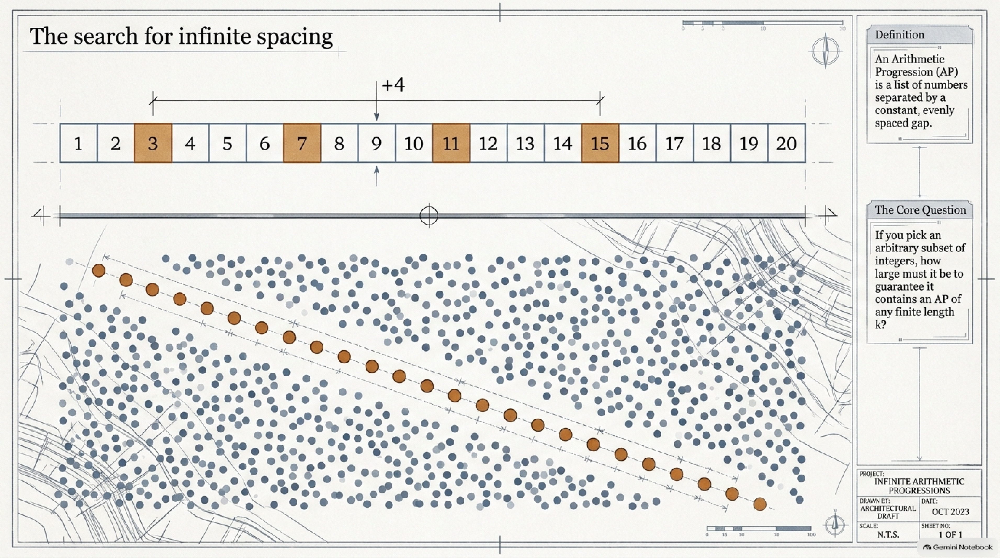

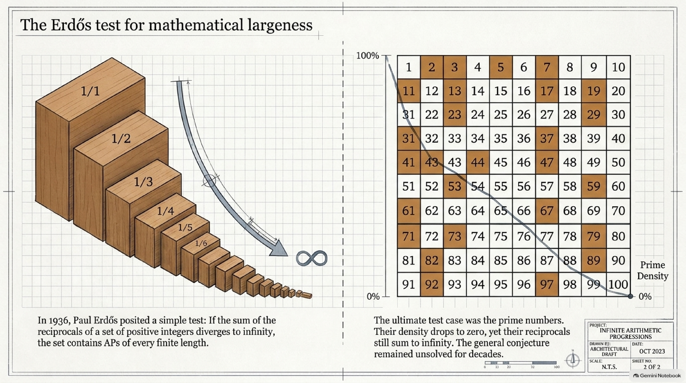

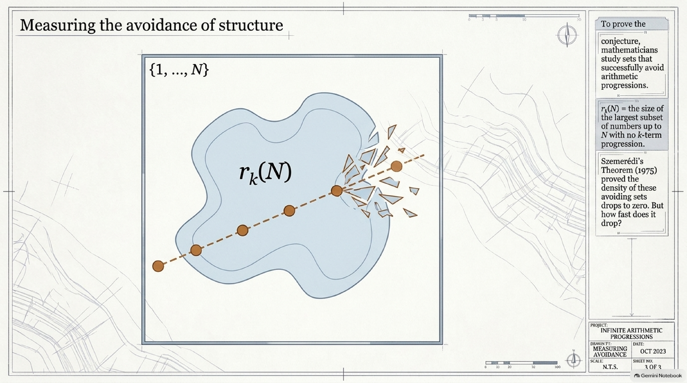

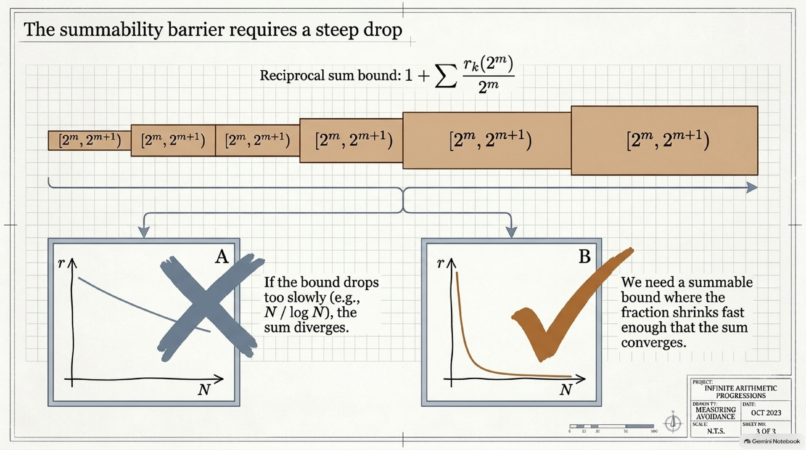


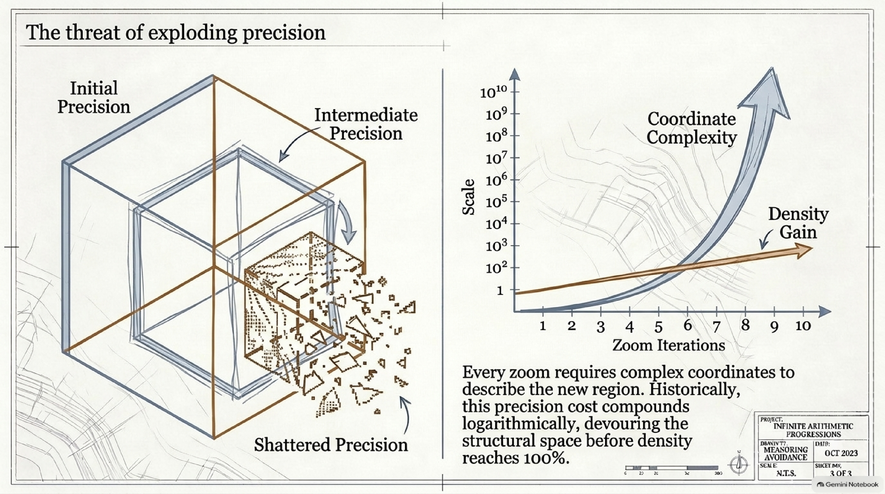

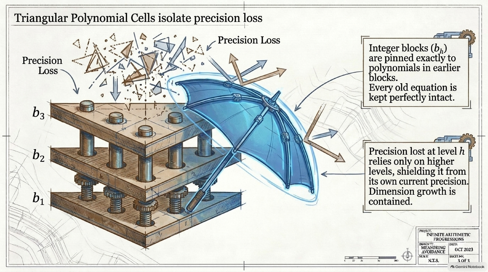


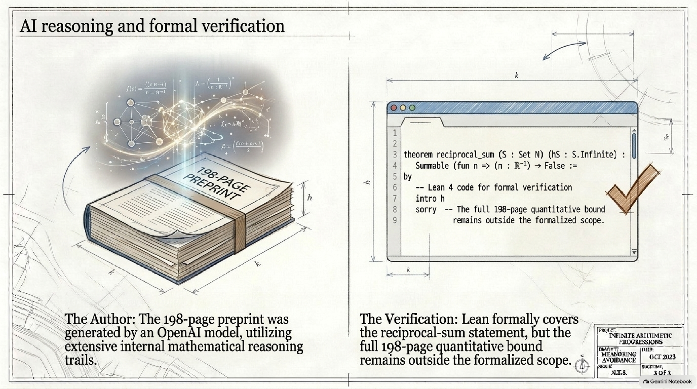

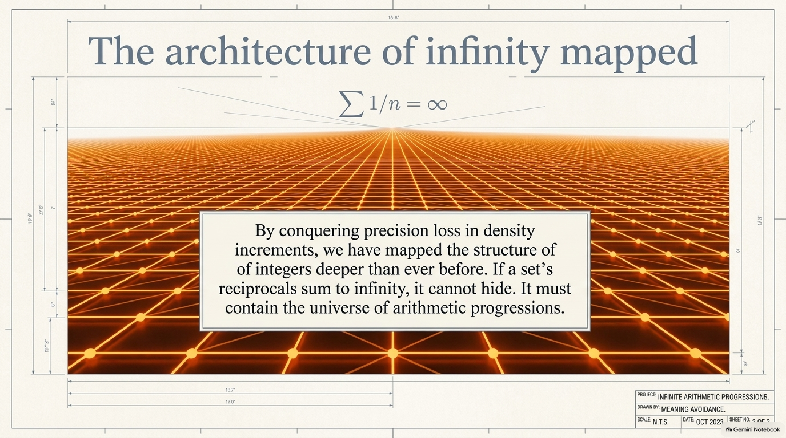

</details>

---

## How this explainer was made

1. The paper, its TeX source, the reasoning summary, the Lean scope document and the Lean sources were downloaded from [openai/math](https://github.com/openai/math).
2. The paper, the reasoning summary, the Lean scope document and the Wikipedia article on [Erdős's conjecture on arithmetic progressions](https://en.wikipedia.org/wiki/Erd%C5%91s_conjecture_on_arithmetic_progressions) were loaded into a NotebookLM notebook through the [`notebooklm-mcp-cli`](https://github.com/jacob-bd/gemini-notebook-mcp-cli) CLI. It generated the slides, infographics, report, mind map and audio in [`assets/notebooklm/`](assets/notebooklm/). The report and mind map were restricted to the paper and the Lean scope document. Every slide, both infographics, the report and the mind map were read against the paper, and the mistakes are listed in the [errata](assets/README.md#errata). The slide deck was revised once, to fix slides 3, 9 and 13. The audio was not reviewed.
3. The text on this page was written by hand (with AI assistance) directly from the paper's TeX source. That means the introduction, Section 2 (cells and the triangular increment), Section 10 (the iteration), Section 11 (consequences) and the appendix overview. Historical dates were checked against the paper's bibliography where it covers them. Euler's 1737 result and the 2004 preprint date of Green–Tao are standard background not in that bibliography. The two prize amounts come from Wikipedia (erdosproblems.com confirms the current 5,000 US dollars, but not the dates) and are marked as such. Raghavan's 2026 preprint was checked on arXiv.

See [`PIPELINE.md`](../../PIPELINE.md) for the exact, repeatable steps.

*Citation for the underlying paper:*

```bibtex
@misc{OAI:Quasipolynomial-Bounds-for-Arithmetic-Progressions-September-23-2026,
  author = {{OpenAI}},
  title = {{Quasipolynomial Bounds for Arithmetic Progressions}},
  howpublished = {OpenAI Math Release preprint
                  \href{https://github.com/openai/math/blob/main/preprints/Quasipolynomial-Bounds-for-Arithmetic-Progressions-September-23-2026/paper.pdf}{OAI:Quasipolynomial-Bounds-for-Arithmetic-Progressions-September-23-2026}},
  year = {2026}
}
```
