# The Quasi-Riemann Hypothesis, explained for beginners

> - **Paper:** [*The Quasi-Riemann Hypothesis: A Zero-Free Half-Plane Re(s) > 7/8*](https://github.com/openai/math/blob/main/preprints/The-Quasi-Riemann-Hypothesis-September-30-2026/paper.pdf), OpenAI, 30 September 2026
> - **openai/math family:** 003, *The quasi-Riemann hypothesis* · **Field:** analytic number theory
> - **Companions:** [an alternate, human-edited proof of the weaker 11/12 version](https://github.com/openai/math/blob/main/preprints/The-Quasi-Riemann-Hypothesis-October-5-2026/paper2.pdf) (5 Oct 2026) · [Uniform exclusion of Landau–Siegel zeros](https://github.com/openai/math/blob/main/preprints/Uniform-exclusion-of-Landau-Siegel-zeros-October-1-2026/paper.pdf) (1 Oct 2026)
> - **Formal proof:** the headline statements are listed as formalized in Lean 4 ([scope](https://github.com/openai/math/blob/main/lean/docs/003.md))
> - **Who this is for:** anyone comfortable with high-school algebra and the idea of complex numbers. No number theory needed.

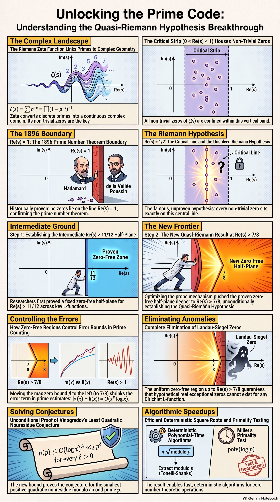

## Contents

- [TL;DR](#tldr)
- [How to read this](#how-to-read-this)
- [1. The problem](#1-the-problem)
- [2. A short history](#2-a-short-history)
- [3. What the paper proves](#3-what-the-paper-proves)
- [4. Why it matters](#4-why-it-matters)
- [5. The main idea of the proof](#5-the-main-idea-of-the-proof)
- [6. The people whose ideas this builds on](#6-the-people-whose-ideas-this-builds-on)
- [7. What it does not prove, and caveats](#7-what-it-does-not-prove-and-caveats)
- [8. Glossary](#8-glossary)
- [9. Slides, audio and other assets](#9-slides-audio-and-other-assets)
- [How this explainer was made](#how-this-explainer-was-made)

---

## TL;DR

- **The question.** The Riemann zeta function $\zeta(s)$ encodes the prime numbers. Its *zeros* control how irregularly the primes are spread out. The famous **Riemann Hypothesis** (open since 1859) says every interesting zero sits on the vertical line where the real part is exactly $1/2$.
- **What was known.** Since 1896 we have known there are no zeros on the line where the real part is $1$. But zeros could, in principle, creep arbitrarily close to that line as you go up the plane. Nobody could rule out zeros in *any* fixed strip to the left of it.
- **What this paper proves.** There are **no zeros at all with real part bigger than 7/8**, for $\zeta(s)$ and for every Dirichlet $L$-function, the cousins of $\zeta$ that count primes in arithmetic progressions. A fixed zero-free half-plane like this is called a **quasi-Riemann hypothesis**.
- **Why that's a big deal.** It gives the first unconditional "power-saving" error term in the prime number theorem, about $x^{7/8}$ instead of something only slightly smaller than $x$. It also kills off hypothetical "Siegel zeros". Several results that used to need the unproven Generalized Riemann Hypothesis become true outright.
- **What it doesn't do.** It does **not** prove the Riemann Hypothesis. The band between $1/2$ and $7/8$ is still open.

## How to read this

| You have… | Read |
|---|---|
| 2 minutes | The TL;DR and the infographic above |
| 15 minutes | Sections 1–4 and 7 |
| An hour, and you like analysis | Everything, including [section 5](#5-the-main-idea-of-the-proof) and the [slides](#9-slides-audio-and-other-assets) |

---

## 1. The problem

### 1.1 Counting primes

The primes $2, 3, 5, 7, 11, 13, \dots$ look random up close, but they thin out in a very regular way overall. Write $\pi(x)$ for the number of primes up to $x$. Around 1792–1798, Gauss and Legendre guessed that

$$\pi(x) \approx \frac{x}{\log x}\quad\text{(more precisely, }\pi(x)\approx \mathrm{li}(x)=\int_2^x \frac{dt}{\log t}\text{)}.$$

That guess is the **Prime Number Theorem**. The real question is **how big the error** $\pi(x) - \mathrm{li}(x)$ can be. That is where the zeros come in.

### 1.2 The zeta function: primes in disguise

For a number $s$ with real part bigger than 1, define

$$\zeta(s) = 1 + \frac{1}{2^s} + \frac{1}{3^s} + \frac{1}{4^s} + \cdots$$

In 1737 Euler discovered that this sum over *all* whole numbers equals a product over *only the primes*:

$$\zeta(s) = \prod_{p\ \text{prime}} \frac{1}{1 - p^{-s}}.$$

This is unique factorization (every number is a product of primes in exactly one way) written as an identity between functions. So $\zeta$ is a "fingerprint" of the primes.

### 1.3 Zeros, the critical strip, and the critical line

Riemann (1859) showed that $\zeta(s)$ makes sense for **complex** $s = \sigma + it$ everywhere except a single "pole" at $s = 1$. He then asked where $\zeta(s) = 0$.

- There are boring "trivial" zeros at $-2, -4, -6, \dots$.
- All the other, interesting zeros lie in the **critical strip** $0 < \text{Re}(s) < 1$.
- The **Riemann Hypothesis (RH)** says they all lie on the **critical line** $\text{Re}(s) = 1/2$. The first few are at $\tfrac12 \pm 14.13i,\ \tfrac12 \pm 21.02i,\ \tfrac12 \pm 25.01i, \dots$

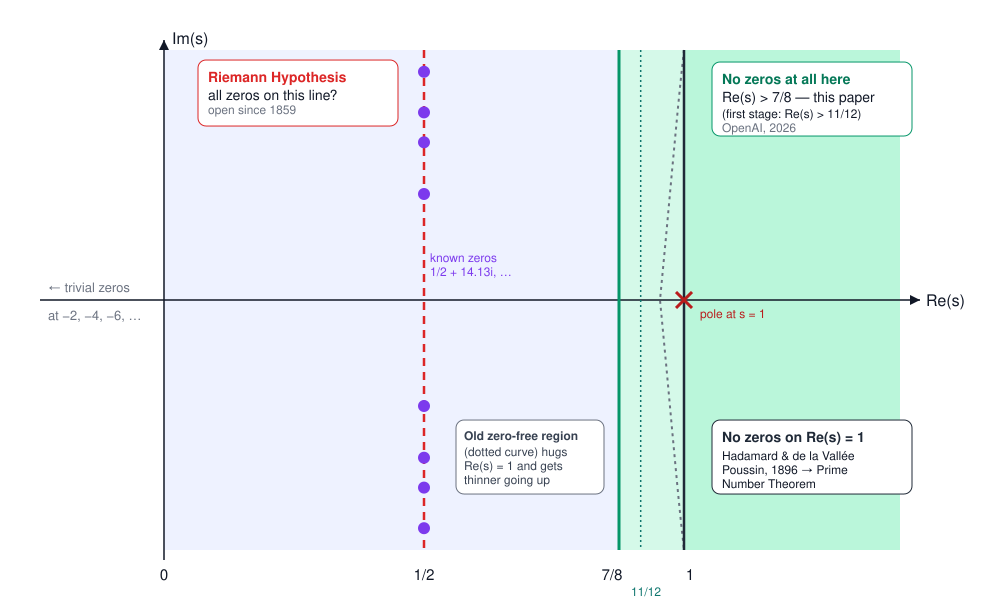

### 1.4 Why the zeros control the primes

Riemann's "explicit formula" writes the prime-counting error as a sum of waves, one per zero $\rho = \beta + i\gamma$:

$$\text{error in counting primes up to }x \quad \approx\quad  \sum_{\rho} \frac{x^{\rho}}{\rho}, \qquad |x^{\rho}| = x^{\beta}.$$

Think of each zero as a musical note. Its height $\gamma$ sets the pitch, and its real part $\beta$ sets the **volume**. A zero with real part $\beta$ contributes noise of size about $x^{\beta}$. So:

- **If RH is true,** every note has volume $x^{1/2}$, and the error is about $\sqrt{x}\log x$, essentially as small as it could be.
- **If some zero had real part close to 1,** the primes would deviate from the Gauss–Legendre prediction by almost as much as $x$ itself.
- **The rightmost zero is what matters.** Proving there are *no zeros to the right of* $\theta$ gives an error of about $x^{\theta}$.

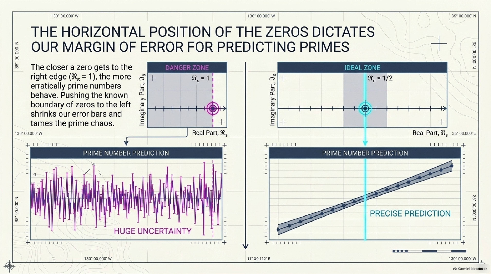

### 1.5 Dirichlet L-functions: primes in arithmetic progressions

Do the primes ending in 1, 3, 7 and 9 appear equally often? To answer questions like this, Dirichlet (1837) introduced **characters** $\chi$. These are periodic "filters" on the whole numbers. He used them to build relatives of zeta:

$$L(s,\chi) = \sum_{n\ge1}\frac{\chi(n)}{n^s}.$$

Their zeros control primes in arithmetic progressions, the way $\zeta$'s zeros control all primes. The **Generalized Riemann Hypothesis (GRH)** says their interesting zeros also all have real part $1/2$.

### 1.6 The quasi-Riemann hypothesis

RH is the strongest possible statement. A **quasi-Riemann hypothesis** asks for much less:

> **Is there some fixed number $\theta < 1$ such that no zero has real part bigger than $\theta$?**

Before this paper, the best answer was "no fixed $\theta$ is known". The known **zero-free regions** hug the line $\text{Re}(s) = 1$ ever more tightly as you go up (the dotted curve in the figure). For Dirichlet $L$-functions there was a second problem. One possible exceptional real zero, the **Landau–Siegel zero**, could sit extremely close to 1 and could not be ruled out. This weakness had been stuck in place for about a hundred years.

---

## 2. A short history

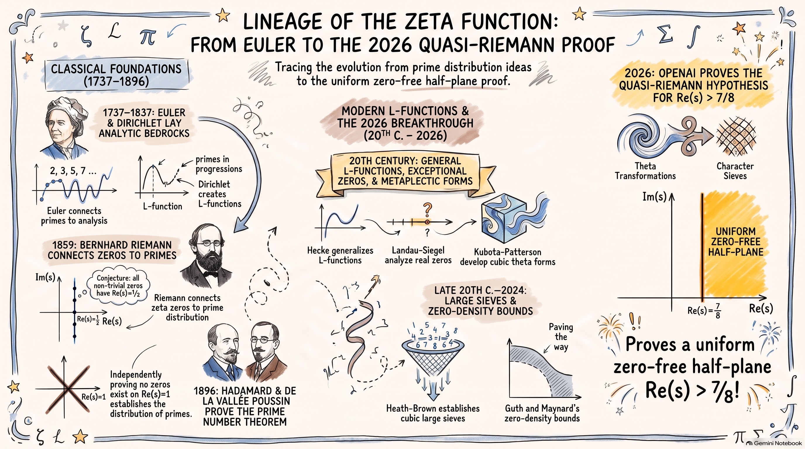

| When | Who | What happened |
|---|---|---|
| 1737 | **Leonhard Euler** | The Euler product: $\zeta$ as a product over primes |
| 1792–1798 | **Carl Friedrich Gauss, Adrien-Marie Legendre** | Conjectured the Prime Number Theorem |
| 1837 | **Peter Gustav Lejeune Dirichlet** | Characters and $L$-functions; infinitely many primes in every possible arithmetic progression |
| 1844 | **Gotthold Eisenstein** | Cubic reciprocity, using the integers $a + b\omega$ with $\omega^3 = 1$, now called Eisenstein integers |
| 1859 | **Bernhard Riemann** | $\zeta$ as a complex function, the explicit formula, and the Riemann Hypothesis |
| 1896 | **Jacques Hadamard, Charles de la Vallée Poussin** | No zeros on $\text{Re}(s) = 1$, which proves the Prime Number Theorem |
| 1899 | **de la Vallée Poussin** | The first zero-free *region* to the left of $\text{Re}(s)=1$, which narrows as you go up |
| 1900 | **David Hilbert** | RH becomes part of Hilbert's 8th problem |
| 1912 | **J. E. Littlewood** | RH is equivalent to the Möbius function having "square-root cancellation". The companion paper builds on this idea |
| 1917–1920 | **Erich Hecke** | $L$-functions for number fields (Hecke $L$-functions), the setting of this paper |
| 1918, 1935 | **Edmund Landau, Carl Ludwig Siegel** | The exceptional real zero problem ("Landau–Siegel zeros") and Siegel's ineffective theorem |
| 1958 | **I. M. Vinogradov, N. M. Korobov** | The best classical zero-free region for $\zeta$, still shrinking to zero width |
| 1969, 1977 | **Tomio Kubota, Samuel Patterson** | The cubic theta function, whose coefficients are cubic Gauss sums |
| 1979, 1995, 2000 | **Roger Heath-Brown** (1979 with Patterson) | Distribution of cubic Gauss sums, then the quadratic and cubic large sieve inequalities |
| 2010s–2020s | **Goldmakher–Louvel, Blomer–Goldmakher–Louvel, Dunn–Radziwiłł** | Large sieves for higher-order characters over number fields; new results on cubic Gauss sums |
| 2024 | **Larry Guth, James Maynard** | New zero-*density* bounds (how *many* zeros can be far right). This limits zeros but doesn't exclude them |
| Sept–Oct 2026 | **OpenAI** (internal model) | First 11/12, then 7/8: a fixed zero-free half-plane for $\zeta$ and all Dirichlet $L$-functions |

---

## 3. What the paper proves

> **Main theorem.** Every finite-order Hecke $L$-function over the field $\mathbb{Q}(\sqrt{-3})$ has no zero with real part greater than $7/8$. The same holds for every Dirichlet $L$-function, including the Riemann zeta function. (The pole at $s = 1$ of the "principal" ones is allowed.)

In plain words: draw the vertical line $\text{Re}(s) = 7/8$. To its right, $\zeta(s)$ and all its Dirichlet cousins are **never zero**, at any height, for any modulus. This makes the green region in the figure above a theorem.

The Lean 4 statement for $\zeta$, from the [openai/math formalization](https://github.com/openai/math/blob/main/lean/ComparatorChallenges/QuasiRiemannHypothesis.lean), reads:

```lean
theorem riemannZeta_ne_zero_of_seven_eighths_lt_re
    {s : ℂ} (hs : (7 / 8 : ℝ) < s.re) : riemannZeta s ≠ 0
```

The proof comes in two stages:

1. **Stage 1 (Part I):** a zero-free half-plane at $11/12$. A [separate, human-edited write-up](https://github.com/openai/math/blob/main/preprints/The-Quasi-Riemann-Hypothesis-October-5-2026/paper2.pdf) gives the friendliest version of this stage.
2. **Stage 2 (Part II):** a refinement that pushes the boundary from $11/12 \approx 0.917$ to $7/8 = 0.875$.

---

## 4. Why it matters

| Consequence | Before | After |
|---|---|---|
| **Error in the Prime Number Theorem** | Only slightly better than $x$: roughly $x\ e^{-c(\log x)^{3/5}}$ | A power saving: about $x^{7/8}$. The 11/12 companion records the uniform version for primes in progressions: $\ll x^{11/12}\log x$ for every modulus $q \le x$ |
| **Landau–Siegel zeros** | A possible exceptional zero near 1 that couldn't be excluded | **Gone.** No real zeros in $(7/8, 1)$ for any character |
| **Least quadratic nonresidue** $n(p)$, the smallest number that is not a perfect square mod $p$ | $\le C(\log p)^2$ only *assuming GRH* (Ankeny) | $\le C(\log p)^{A}$ unconditionally. This proves **Vinogradov's conjecture** $n(p) \ll p^{\delta}$ |
| **Square roots mod $p$** | Fast *randomized* algorithms; deterministic only under GRH | **Deterministic polynomial time** (Tonelli–Shanks with a guaranteed small nonresidue) |
| **Miller's primality test** | Deterministic only under GRH (AKS was already unconditional but slower) | Deterministic polynomial time unconditionally (noted in the 11/12 companion) |
| **Class numbers** of imaginary quadratic fields | Siegel's bound is *ineffective* (no computable constant) | Effective bound $h(D) \gg \sqrt{\lvert D\rvert}/\log\log\lvert D\rvert$, and Euler's list of **65 idoneal numbers** is complete (11/12 companion) |

The deeper significance is that the zero-free *line* from 1896 has been widened into a zero-free *band* of fixed width. Many theorems in number theory were proved "assuming GRH" only because they need such a band, not the full critical line. Those now hold outright.

---

## 5. The main idea of the proof

The 7/8 paper runs to 199 pages of hard analysis; the 11/12 companion is 49. Here it is at three zoom levels.

### Level 1: the one-paragraph version

Assume, for contradiction, that some zero sits to the right of $7/8$. The paper builds a single carefully designed sum and computes it **in two completely different ways**. One way, using a symmetry of a special function called the *cubic theta function*, shows the sum is **small**. The other way, using *Poisson summation*, shows the sum contains a "signal" that would have to be **large** if that zero existed. Both can't be true, so the zero doesn't exist. Everything happens over the Eisenstein integers $\mathbb{Z}[\omega]$, where cube roots of unity live, and then transfers back to ordinary integers.

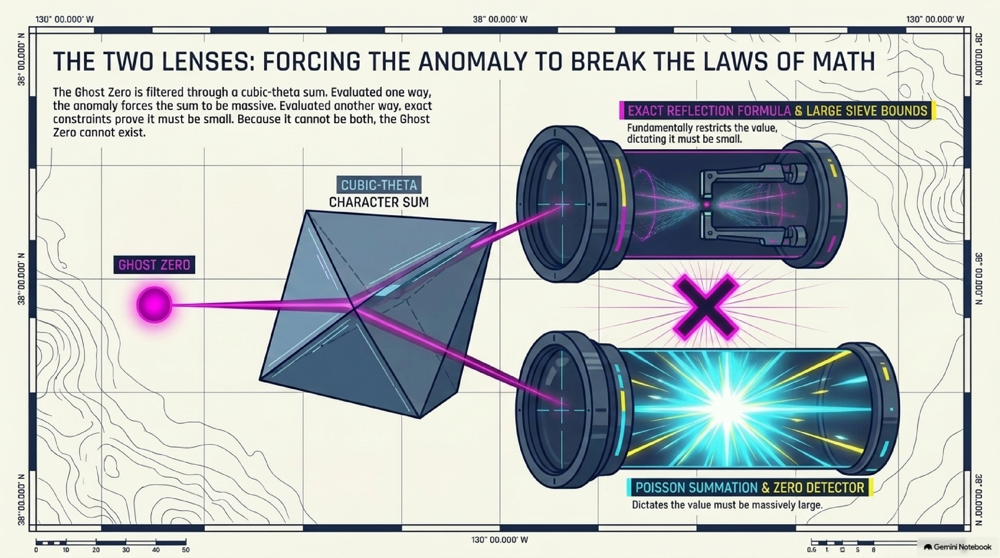

### Level 2: the step-by-step picture

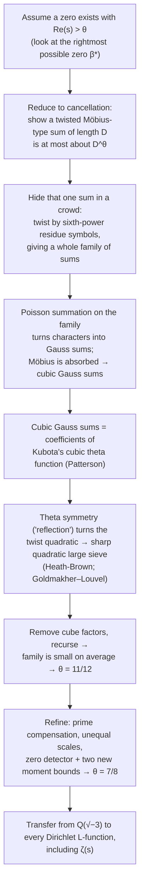

**Step 1: Zeros ↔ cancellation.** The Möbius function $\mu(n)$ is $+1$, $-1$ or $0$ according to the prime factors of $n$, and it behaves like a coin flip. In 1912 Littlewood showed that RH is equivalent to sums of $\mu(n)$ up to $x$ being no bigger than about $\sqrt{x}$, the size you'd expect from coin flips. The same logic works at other thresholds. If a smoothed, character-twisted Möbius sum of length $D$ is at most about $D^{\theta}$, then there are no zeros to the right of $\theta$. So the goal becomes **showing a certain sum has lots of cancellation**.

**Step 2: Hide the sum in a crowd (amplification).** One sum is hard to bound directly. So the paper builds a whole **family** $A_u(D)$ by twisting with *sixth-power residue symbols* $\chi_n(u)$, and proves the family is small **on average**: the mean square is about $D \cdot H$ over $H$ members. The trick is that the original sum hides inside the family many times. For $u = p^6$ (a sixth power of a prime) the twist barely changes anything, so $A_{p^6}(D) \approx A_1(D)$. With about $Y/\log Y$ such primes:

> **Analogy:** if the average of the squared scores in a class is low, and one student's score appears in the list a hundred times, that student cannot have scored high.

<details>
<summary><b>Where the number 11/12 comes from</b> (a two-line calculation)</summary>

The family has $H$ members with total "energy" $\sum_u |A_u(D)|^2 \lesssim D \cdot H$. The original sum appears about $Y = H^{1/6}$ times (once for each $p^6$ of size up to $H$), each time with an error of size about $D/Y$. So

$$Y\ |A_1(D)|^2 \lesssim DH + Y\Big(\frac{D}{Y}\Big)^2 \quad\Longrightarrow\quad |A_1(D)|^2 \lesssim D\ H^{5/6} + D^2 H^{-1/3}.$$

Choosing $H$ just above $D$ gives $|A_1(D)|^2 \lesssim D^{1 + 5/6} = D^{11/6}$, so $A_1(D) \lesssim D^{11/12}$. By Step 1, there are no zeros to the right of $11/12$.

(This is the outline from Section 2 of the [11/12 companion](https://github.com/openai/math/blob/main/preprints/The-Quasi-Riemann-Hypothesis-October-5-2026/paper2.pdf), with logarithms and $\varepsilon$'s suppressed.)
</details>

**Step 3: Switch to "frequencies" (Poisson summation).** To bound the family on average, apply Poisson summation in the family variable $u$. This is the same idea as switching from a signal to its Fourier spectrum. The characters become **Gauss sums**. By classical Gauss–Jacobi identities, the Möbius function $\mu$ combines with them and turns into **cubic Gauss sums**.

**Step 4: A hidden symmetry (the cubic theta function).** Cubic Gauss sums are not random. Patterson (1977), building on Kubota (1969), showed they are the Fourier coefficients of the **cubic theta function**, a highly symmetric function on 3-dimensional hyperbolic space. Its symmetry gives an exact "reflection" formula that rewrites the sum in a new way. A small miracle happens here. At each prime, the twists combine as $\chi^{-1}\cdot\chi^{-2} = \chi^{-3}$, and a sixth-power character cubed is a **quadratic** character. Quadratic families are exactly where the sharpest tool is available, Heath-Brown's **quadratic large sieve** (extended to number fields by Goldmakher and Louvel).

**Step 5: Clean up and recurse.** The theta function naturally includes extra cube factors $b^3$. These are stripped off with Möbius inversion and an induction on the size of the cube part. The result is the mean-square bound from Step 2, which gives **11/12**.

**Step 6: Squeeze to 7/8.** Part II changes the basic sum. Selected prime factors "compensate" for an unwanted Euler-factor contribution, and the two averaging scales are no longer equal. The remaining terms ("rows") are controlled by a **zero detector**. If a row's twisted $L$-function has a zero far enough right, the detector produces two unusually large sums (Dirichlet polynomials). New **moment estimates**, proved by induction with repeated Poisson summation, show there can't be many such rows. Rebalancing all the exponents gives **7/8**.

**Step 7: Transfer back to ordinary primes.** Why work over $\mathbb{Q}(\sqrt{-3})$, whose integers are $a + b\omega$ with $\omega = e^{2\pi i/3}$? Because cube and sixth roots of unity live there, so cubic and sextic residue symbols, cubic reciprocity, and the cubic theta function all make sense. To get back to $\zeta$, apart from finitely many factors that never vanish there, the Hecke $L$-function of $\chi\circ\text{Norm}$ factors as

$$L_{\mathbb{Q}(\sqrt{-3})}(s, \chi\circ N) = L(s,\chi)\ L(s,\chi\chi_{-3}).$$

So a zero of any Dirichlet $L$-function, including $\zeta(s)$ (take $\chi$ trivial), would be a zero of a Hecke $L$-function over $\mathbb{Q}(\sqrt{-3})$. That has been ruled out.

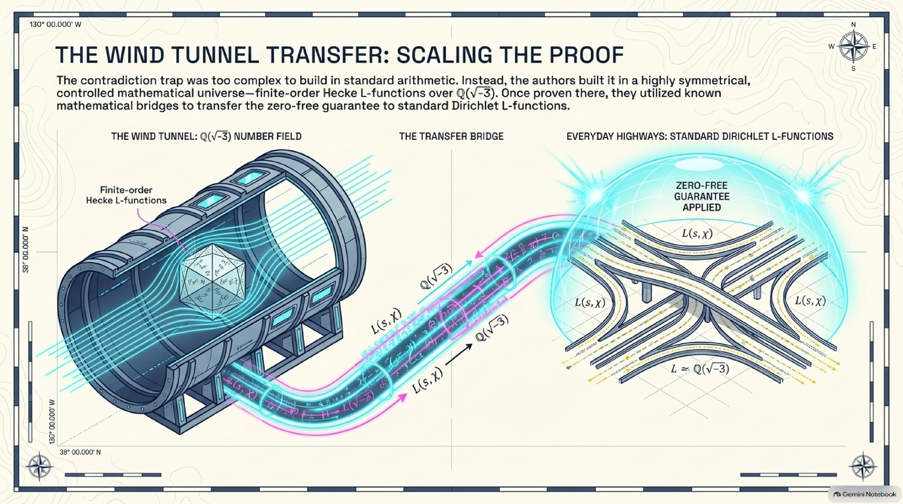

### Level 3: the analytic engine, for readers who know complex analysis

The 7/8 paper packages Steps 1–2 as a **continuation criterion** (the proposition *Continuation from a common signal* in its Section 2). Let $\beta^{\ast}$ be the largest real part of a zero over the *whole family* of primitive Hecke characters over $\mathbb{Q}(\sqrt{-3})$, and suppose $\beta^{\ast} > \sigma_0$. For each character $\eta$, the paper builds a sum $J_\eta(Z)$ that is compared with a Mellin integral of $1/L(s,\eta)$:

$$f_\eta(Z) = \frac{1}{2\pi i}\int_{\text{Re}\ s=2} Z^{C(s)}\ e^{(s-5/6)^2}\ \frac{H_\eta(s)}{L^{\mathcal S}(s,\eta)}\ ds .$$

If $|J_\eta(Z)| \ll Z^{C(\sigma_0)+\omega}$ (the "low" estimate, from the theta reflection) and $|J_\eta - f_\eta| \ll Z^{C(\beta^{\ast})-\sigma}$ (the "high" estimate, from Poisson summation), with margins $\omega,\sigma$ that do **not** depend on $\eta$, then $1/L(s,\eta)$ continues holomorphically a fixed distance to the left of $\beta^{\ast}$. That contradicts the existence of zeros near $\beta^{\ast}$. Two details matter. The whole family has to be handled at once, because Poisson summation produces Hecke twists of the original character. And the margins have to be uniform. Stage I uses $C(s) = s - 2/3$ with $\sigma_0 = 11/12$, and Stage II uses $C(s) = s - 11/16$ with $\sigma_0 = 7/8$.

---

## 6. The people whose ideas this builds on

| Person | Idea | Where it shows up in the proof |
|---|---|---|
| **Leonhard Euler** | The Euler product $\zeta(s) = \prod_p (1-p^{-s})^{-1}$ | The bridge between sums over integers and primes. "Deleting Euler factors" is used throughout |
| **Carl Friedrich Gauss** | Gauss sums; quadratic reciprocity | Gauss sums appear after Poisson summation |
| **Gotthold Eisenstein, Carl Jacobi** | Eisenstein integers $\mathbb{Z}[\omega]$; cubic reciprocity; Jacobi sums | The base field $\mathbb{Q}(\sqrt{-3})$; Gauss–Jacobi identities that absorb $\mu$ |
| **Peter Gustav Lejeune Dirichlet** | Characters and $L$-functions | The final theorem is about every Dirichlet $L$-function |
| **Bernhard Riemann** | Complex zeta, zeros ↔ primes | The whole question |
| **Jacques Hadamard, Charles de la Vallée Poussin** | No zeros on $\text{Re}(s)=1$ | The starting point that this result widens into a band |
| **Erich Hecke** | $L$-functions over number fields, functional equations | The family of Hecke $L$-functions over $\mathbb{Q}(\sqrt{-3})$; Hecke reflection in the moment bounds |
| **J. E. Littlewood** | Möbius cancellation ↔ zero-free regions | Step 1 |
| **Edmund Landau, Carl Ludwig Siegel** | The exceptional-zero problem | The obstacle this paper removes; Landau's prime ideal theorem counts the $p^6$ in Step 2 |
| **Siméon Denis Poisson** | Poisson summation | Steps 3 and 6 |
| **Tomio Kubota, Samuel Patterson** | The cubic theta function and its Gauss-sum coefficients | Step 4, the key symmetry |
| **Roger Heath-Brown** | Quadratic and cubic large sieves; work with Patterson on cubic Gauss sums | Steps 4–5 |
| **Yuri Linnik, Enrico Bombieri, Martin Huxley** and others | The large sieve | The additive (planar) large sieve in Stage I |
| **Leo Goldmakher, Benoît Louvel, Valentin Blomer** | Large sieves for higher-order characters over number fields | The sextic large sieve used to count rows |
| **Alexander Dunn, Maksym Radziwiłł** | Explicit cusp expansions of the cubic theta function | The exact reflection formulas |
| **Manjul Bhargava, Gábor Ivanyos, Rajat Mittal, Nitin Saxena** | Consequences of a fixed zero-free strip for nonresidues | The nonresidue and square-root corollary |

---

## 7. What it does not prove, and caveats

> [!IMPORTANT]
> **This is not a proof of the Riemann Hypothesis.** RH puts all zeros on $\text{Re}(s) = 1/2$. This result only clears the region $\text{Re}(s) > 7/8$. Zeros with real part between $1/2$ and $7/8$ are still not ruled out.

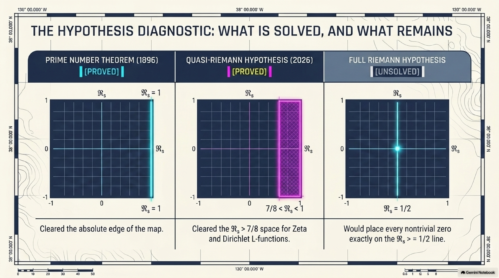

> [!NOTE]
> **Provenance.** The paper was produced by an unreleased internal OpenAI model as part of the [openai/math](https://github.com/openai/math) release. According to that repository's README, the zeta zero-free work was an *exception* to the model's standard fixed procedure. The 11/12 write-up was edited by humans for readability.

> [!NOTE]
> **Verification status.** openai/math lists the 7/8 statements for $\zeta$, for all Dirichlet $L$-functions, and for Hecke $L$-functions over $\mathbb{Q}(\sqrt{-3})$ as formalized in Lean 4, checkable with its Comparator tool ([scope document](https://github.com/openai/math/blob/main/lean/docs/003.md)). The paper's later applications (Section 4 above) are **not** part of the formalization. This explainer did not independently re-run the Lean build. As of October 2026 the result is a preprint; the usual next step is independent review by experts.

> [!TIP]
> **Simplifications.** To stay readable, this explainer suppresses smoothing weights, $\varepsilon$-losses, coprimality conditions, and the bookkeeping of excluded primes. Every precise statement is in the paper.

---

## 8. Glossary

| Term | Meaning |
|---|---|
| **Complex number** $s = \sigma + it$ | A point in the plane: $\sigma = \text{Re}(s)$ is the horizontal coordinate and $t = \text{Im}(s)$ the vertical one |
| **Riemann zeta function** $\zeta(s)$ | $\sum_{n\ge1} n^{-s}$, extended to the whole complex plane; it encodes the primes |
| **Zero** | A point where the function equals 0 |
| **Critical strip / critical line** | The band $0<\text{Re}(s)<1$ / the line $\text{Re}(s)=1/2$ |
| **Zero-free region / half-plane** | A region proven to contain no zeros. A half-plane $\text{Re}(s)>\theta$ has fixed width, unlike the classical regions |
| **Quasi-Riemann hypothesis** | "There is a fixed $\theta<1$ with no zeros to the right of $\text{Re}(s)=\theta$." This paper proves it with $\theta = 7/8$ |
| **Dirichlet character** $\chi$ | A periodic, multiplicative function used to pick out an arithmetic progression |
| **Dirichlet $L$-function** | $\sum \chi(n) n^{-s}$; controls primes in arithmetic progressions |
| **(Generalized) Riemann Hypothesis** | All interesting zeros of $\zeta$ (GRH: of every $L(s,\chi)$) have real part $1/2$ |
| **Landau–Siegel zero** | A hypothetical real zero of some $L(s,\chi)$ extremely close to 1; now ruled out |
| **Möbius function** $\mu(n)$ | $0$ if $n$ has a repeated prime factor, otherwise $(-1)^{\text{number of prime factors}}$ |
| **Eisenstein integers** $\mathbb{Z}[\omega]$ | Numbers $a + b\omega$ with $\omega = e^{2\pi i/3}$; the integers of $\mathbb{Q}(\sqrt{-3})$ |
| **Hecke $L$-function** | The analogue of a Dirichlet $L$-function for a number field such as $\mathbb{Q}(\sqrt{-3})$ |
| **Residue symbol** (quadratic / cubic / sextic) | A character that measures whether a number is a square, cube or sixth power modulo another |
| **Gauss sum** | A finite sum mixing a character with $e^{2\pi i x/n}$; the Fourier transform of a character |
| **Cubic theta function** | Kubota's highly symmetric (automorphic) function whose coefficients are cubic Gauss sums |
| **Poisson summation** | An identity that swaps a sum over a lattice for a sum over its "frequencies" |
| **Large sieve** | An inequality that bounds how often many sums can be large at the same time |
| **Mellin transform** | The multiplicative analogue of the Fourier transform; it connects sums to $L$-functions |
| **Lean 4** | A proof assistant: software that mechanically checks every logical step of a proof |

---

## 9. Slides, audio and other assets

Everything below was generated with **Google NotebookLM** (now "Gemini Notebook") from the paper, the 11/12 companion, the Lean scope document and the Wikipedia article on the Riemann Hypothesis. The outputs are kept exactly as NotebookLM produced them. They are AI-generated, so see the [errata](assets/README.md#errata) before relying on any detail.

| Asset | What it is |
|---|---|
| [Slide deck (PDF)](assets/notebooklm/slides.pdf) | Beginner slide deck |
| [Infographic: overview](assets/notebooklm/infographic-overview.png) | The one-page summary shown at the top |
| [Infographic: history timeline](assets/notebooklm/infographic-history-timeline.png) | From Euler to 2026 |
| [Audio overview (≈1.5 min)](assets/notebooklm/audio-overview-brief.m4a) | A short podcast-style summary |
| [Beginner report](assets/notebooklm/beginner-explainer-report.md) | NotebookLM's long-form written explainer |
| [Study guide](assets/notebooklm/study-guide.md) | Background on RH and the zeta function, with self-test questions |
| [Mind maps](assets/notebooklm/mindmaps.md) | How the proof fits together, and the RH landscape |
| [Critical-strip figure](assets/figures/critical-strip.svg) | Hand-made diagram used in section 1 |

<details>
<summary><b>All 15 slides</b> (click to expand)</summary>

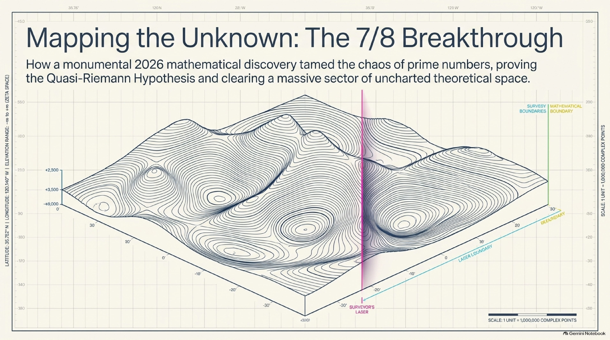

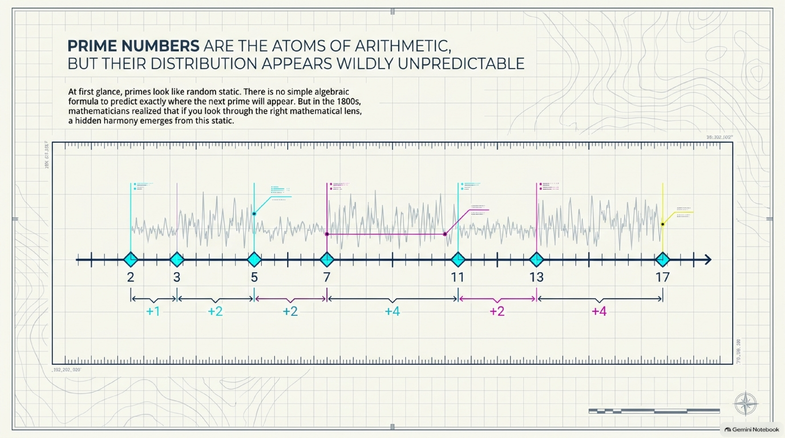

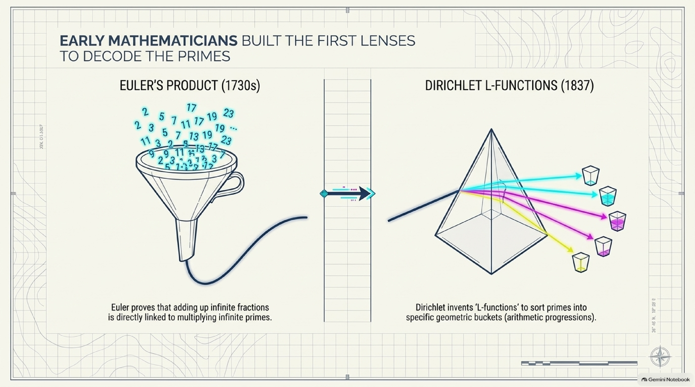

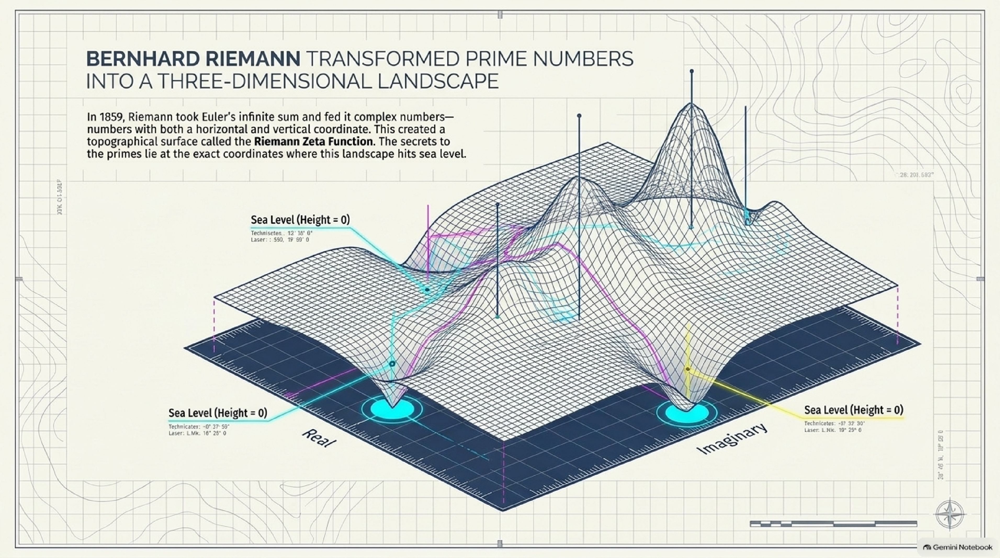

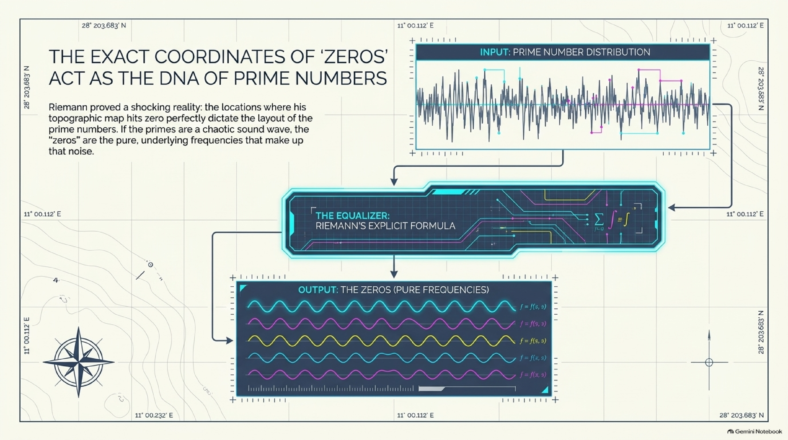

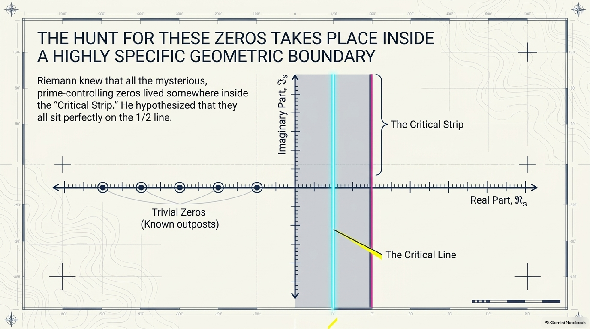


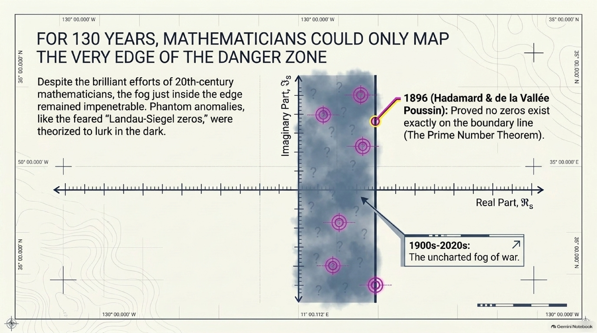

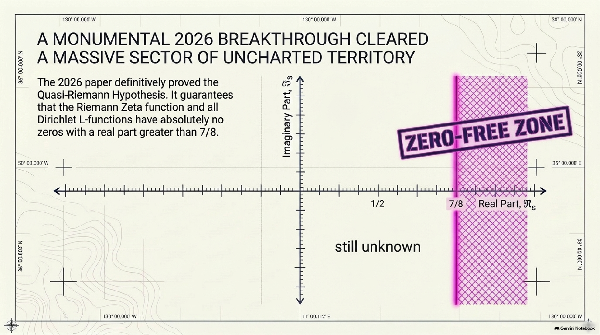

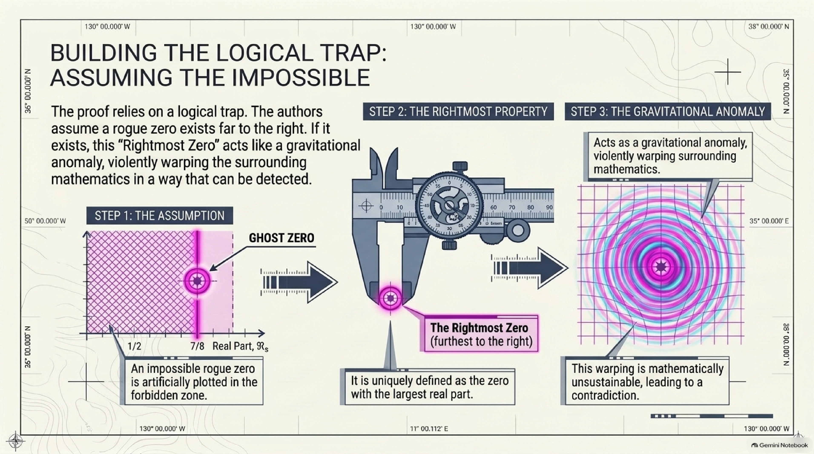


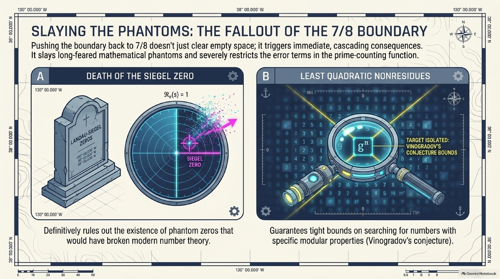

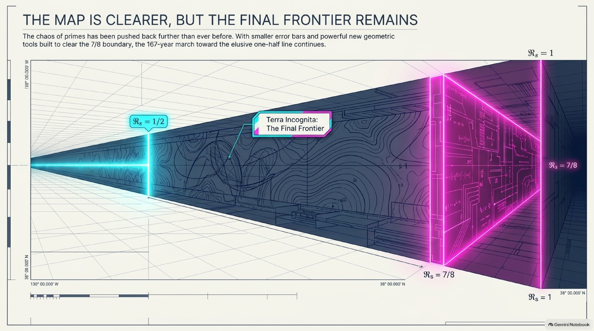

</details>

---

## How this explainer was made

1. The paper and its companions were downloaded from [openai/math](https://github.com/openai/math/tree/main/preprints).
2. They were loaded into a NotebookLM notebook through the [`notebooklm-mcp-cli`](https://github.com/jacob-bd/gemini-notebook-mcp-cli) MCP/CLI, which generated the slides, infographics, reports, mind maps and audio in [`assets/notebooklm/`](assets/notebooklm/).
3. The text on this page was written by hand (with AI assistance) directly from the paper's introduction, proof overview and Section 2, and from the human-edited 11/12 companion. NotebookLM's own reports contain a few mistakes, listed in the [errata](assets/README.md#errata), so they were used as visual and structural aids rather than as the source of truth.

See [`PIPELINE.md`](../../PIPELINE.md) for the exact, repeatable steps.

*Citation for the underlying paper:*

```bibtex
@misc{OAI:The-Quasi-Riemann-Hypothesis-September-30-2026,
  author = {{OpenAI}},
  title = {{The Quasi-Riemann Hypothesis: A Zero-Free Half-Plane $\mathrm{Re}(s)>7/8$}},
  howpublished = {OpenAI Math Release preprint},
  year = {2026}
}
```
