# The symmetric Mahler conjecture, explained for beginners

> - **Paper:** [*The symmetric Mahler conjecture and its equality cases*](https://github.com/openai/math/blob/main/preprints/The-symmetric-Mahler-conjecture-and-its-equality-cases-September-22-2026/paper.pdf), OpenAI, 22 September 2026 (26 pages)
> - **openai/math family:** 087, *The Mahler conjectures, functional inequalities and polar-product symplectic width* · **Field:** convex and metric geometry
> - **Companions:** [The Mahler Conjecture for General Convex Bodies](https://github.com/openai/math/blob/main/preprints/The-Mahler-Conjecture-for-General-Convex-Bodies-September-22-2026/paper.pdf) (22 Sep 2026) · [Symplectic Balls in Symmetric Polar Products](https://github.com/openai/math/blob/main/preprints/Symplectic-Balls-in-Symmetric-Polar-Products-September-22-2026/paper.pdf) (22 Sep 2026) · [abridged summary of the model's reasoning](https://github.com/openai/math/blob/main/reasoning_traces/symmetric-and-general-mahler-conjectures.pdf)
> - **Formal proof:** the inequality and the equality classification are listed as formalized in Lean 4 ([scope](https://github.com/openai/math/blob/main/lean/docs/087.md))
> - **Who this is for:** anyone who knows what area and volume are and has met vectors and the dot product. No convex geometry needed.

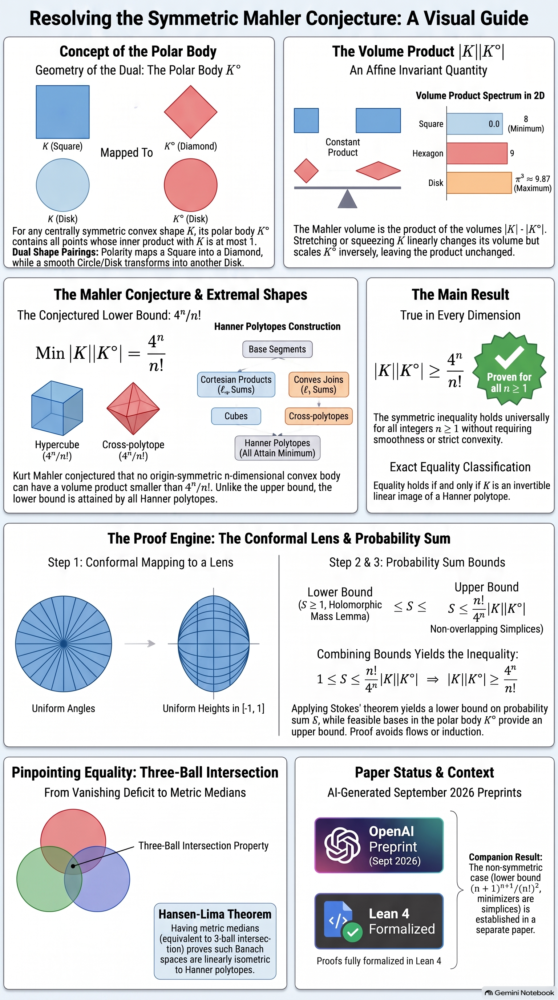

*(AI-generated by NotebookLM. The disk's bar should read π² ≈ 9.87, not π³. "Lean 4 Formalized" and "Proofs fully formalized in Lean 4" overstate the formal scope, and the lens is drawn as a rounded ellipse. See [section 7](#7-what-it-does-not-prove-and-caveats) and the [errata](assets/README.md#errata).)*

## Contents

- [TL;DR](#tldr)
- [How to read this](#how-to-read-this)
- [1. The problem](#1-the-problem)
- [2. A short history](#2-a-short-history)
- [3. What the paper proves](#3-what-the-paper-proves)
- [4. Why it matters](#4-why-it-matters)
- [5. The main idea of the proof](#5-the-main-idea-of-the-proof)
- [6. The people whose ideas this builds on](#6-the-people-whose-ideas-this-builds-on)
- [7. What it does not prove, and caveats](#7-what-it-does-not-prove-and-caveats)
- [8. Glossary](#8-glossary)
- [9. Slides, audio and other assets](#9-slides-audio-and-other-assets)
- [How this explainer was made](#how-this-explainer-was-made)

---

## TL;DR

- **The question.** Take a convex shape $K$ that is symmetric about the origin, like a cube or a ball, and build its **polar body** $K^\circ$, a kind of "dual" shape. Multiply their volumes. This **volume product** does not change when you stretch, squash or shear $K$, so it measures shape alone. **How small can it be?** Kurt Mahler raised this question in work from 1938–39. The conjectured answer, **Mahler's conjecture**, is $4^n/n!$ in $n$ dimensions, the value for a cube. (The polar of a cube is the cross-polytope: a diamond in 2D, an octahedron in 3D.)
- **What was known.** The *largest* value has long been known: balls and ellipsoids (the Blaschke–Santaló inequality). The *smallest* value was known only in dimensions 2 and 3 (Mahler; Iriyeh and Shibata, 2020) and for special families of shapes. In general dimension it was known only up to an exponential factor (Bourgain and Milman, 1987).
- **What this paper proves.** In **every** dimension, every origin-symmetric convex body satisfies $|K|\ |K^\circ| \ge 4^n/n!$. Equality holds **exactly** for linear images of **Hanner polytopes**: the cube, the cross-polytope, and the shapes built from line segments by repeatedly taking products and "joins".
- **How.** By complex analysis. A special map of the unit disk onto a lens turns a random angle into a uniformly random height. With it, the paper defines a probability sum $S$. A fact about holomorphic maps forces $S \ge 1$. The same $S$ also measures non-overlapping simplices packed inside $K^\circ$, which gives $S \le (n!/4^n)\ |K|\ |K^\circ|$. For the equality cases it shows that every minimizer leads to a norm with a special ball-intersection property, which by a 1981 theorem of Hansen and Lima only Hanner bodies have.
- **Status.** This is an AI-generated preprint from the [openai/math](https://github.com/openai/math) release. It has not been peer reviewed. The Lean scope document lists the inequality and the equality classification as formalized ([section 7](#7-what-it-does-not-prove-and-caveats)). Two companion papers handle the non-symmetric conjecture (simplices are the minimizers) and a symplectic strengthening (for $n\ge2$, balls of every capacity below 4 fit symplectically into $K\times K^\circ$).

## How to read this

| You have… | Read |
|---|---|
| 2 minutes | The TL;DR, the infographic above and the figure in [section 1.3](#13-the-volume-product) |
| 15 minutes | Sections 1–4 and 7 |
| An hour, and you like analysis | Everything, including [section 5](#5-the-main-idea-of-the-proof), its worked calculation and the [slides](#9-slides-audio-and-other-assets) |

---

## 1. The problem

### 1.1 Convex bodies

A set is **convex** if, whenever it contains two points, it contains the whole straight segment between them. A disk, a square and a triangle are convex. A star or a crescent is not. A **convex body** is a convex set that is closed and bounded and has some actual volume (it is not flat). The paper only looks at bodies that are **origin-symmetric**: $K = -K$, so if $x$ is in $K$ then so is $-x$. Squares, disks, cubes, balls and regular hexagons centered at the origin are examples. Triangles are not.

### 1.2 The polar body

Each point $y$ defines a "ruler" on space: it measures a point $x$ by the dot product $\langle x, y\rangle = x_1y_1 + \dots + x_ny_n$. The **polar body** of $K$ collects every ruler that never reads more than 1 on $K$:

```math
K^\circ=\{\,y\in\mathbb R^n:\ \langle x,y\rangle\le 1\ \text{ for every } x\in K\,\}.
```

Three things to know:

- **Big and small trade places.** If you blow $K$ up by a factor $t$, then $K^\circ$ is scaled by $1/t$. The ball of radius $r$ has polar the ball of radius $1/r$, so the unit ball is its own polar.
- **Corners and flat sides trade places.** For the square $[-1,1]^2$, the largest value of $x_1y_1 + x_2y_2$ over the square is $|y_1| + |y_2|$. So its polar is the diamond $|y_1| + |y_2| \le 1$. The square's 4 corners become the diamond's 4 sides, and its 4 sides become the diamond's 4 corners. In $n$ dimensions the cube $[-1,1]^n$ has as polar the **cross-polytope** $|y_1| + \dots + |y_n| \le 1$ (an octahedron in 3D).
- **Doing it twice gets you back.** $(K^\circ)^\circ = K$.

### 1.3 The volume product

Write $|K|$ for the volume of $K$ (area in 2D). The **volume product**, also called the **Mahler volume**, is

$$P(K) = |K|\ |K^\circ|.$$

It ignores size and skew. If $T$ is any invertible linear map, then $(TK)^\circ = T^{-\mathsf T}K^\circ$, where $T^{-\mathsf T}$ is the inverse of the transpose of $T$. Applying $T$ multiplies $|K|$ by $|\det T|$ and $|K^\circ|$ by $1/|\det T|$, so $P(TK) = P(K)$. A rectangle $[-a,a]\times[-b,b]$ has area $4ab$; its polar is a diamond of area $2/(ab)$. The product is 8 whatever $a$ and $b$ are.

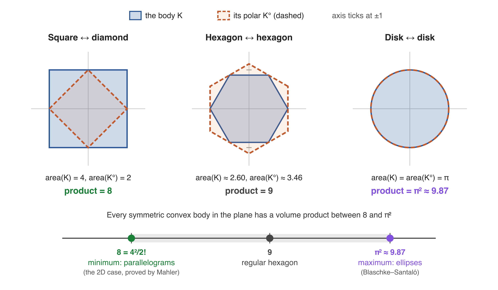

So every symmetric convex body has one number attached to it. The figure shows three: the square scores 8, the regular hexagon 9 and the disk $\pi^2\approx 9.87$. The natural questions are: **which shapes score highest, and which score lowest?**

### 1.4 The top: Blaschke–Santaló

The answer at the top has been known for a long time. Among origin-symmetric convex bodies, the volume product is largest for balls and ellipsoids:

$$|K|\ |K^\circ| \le |B^n|^2,$$

where $B^n$ is the unit ball. Blaschke proved this in low dimensions (1917) and Santaló in all dimensions (1949). In the plane the maximum is $\pi^2$.

### 1.5 The bottom: Mahler's conjecture

The cube $[-1,1]^n$ has volume $2^n$, and its polar, the cross-polytope, has volume $2^n/n!$. So

$$P(\text{cube}) = 2^n\cdot\frac{2^n}{n!} = \frac{4^n}{n!}.$$

> **Mahler's conjecture (symmetric case).** For every origin-symmetric convex body $K$ in $\mathbb R^n$, $|K|\ |K^\circ|\ge 4^n/n!$.

In the plane this says 8. Mahler proved that case himself, so every symmetric planar convex body scores between 8 and $\pi^2$. In higher dimensions the problem stayed open for decades; dimension 3 was settled only in 2020.

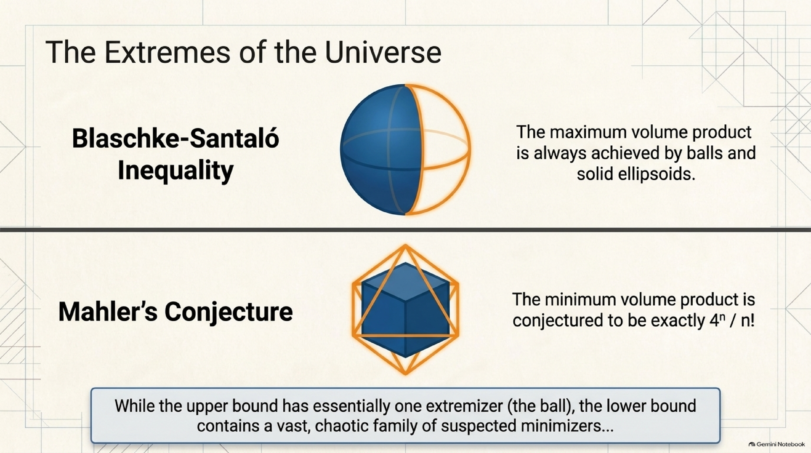

Part of what makes the bottom hard is that, unlike the top, it has **many different winners**. The cube and the cross-polytope score exactly the same, since a body and its polar always have the same product. So do many mixtures of the two, described next. A proof has to treat all of them as equally good and nothing else as good.

### 1.6 Hanner polytopes: the conjectured winners

Start with a line segment $[-a, a]$. Its polar is $[-1/a, 1/a]$ and its volume product is $2a\cdot 2/a = 4$. Now combine two Hanner polytopes $H_1\subset\mathbb R^k$ and $H_2\subset\mathbb R^l$ in two ways:

- the **product** $H_1\times H_2$ (for example square $\times$ segment = cube);
- the **join** $H_1\oplus_1 H_2$, the convex hull of $H_1$ and $H_2$ placed in perpendicular subspaces (for example, joining a square and a segment gives a double pyramid over the square, which is an octahedron up to a linear map).

Everything you can build this way is a **Hanner polytope** (after Olof Hanner, 1956). A **linear Hanner body** is an invertible linear image of one. In the plane these are exactly the parallelograms. In 3D, up to linear maps, they are just the cube and the octahedron. In 4D there are new ones, such as the **octahedral prism** (octahedron $\times$ segment) and its polar, the **cubical bipyramid**.

The polar of a product is the join of the polars, and vice versa. The paper's Lemma 2.1 computes

```math
P(A\oplus_s A')=\frac{P(A)\,P(A')}{\binom{k+l}{k}}\qquad(s\in\{1,\infty\}),
```

so, starting from 4 for a segment, every $n$-dimensional Hanner polytope has volume product exactly $4^n/n!$ (Lemma 2.2). The strong form of the conjecture says these are the **only** minimizers.

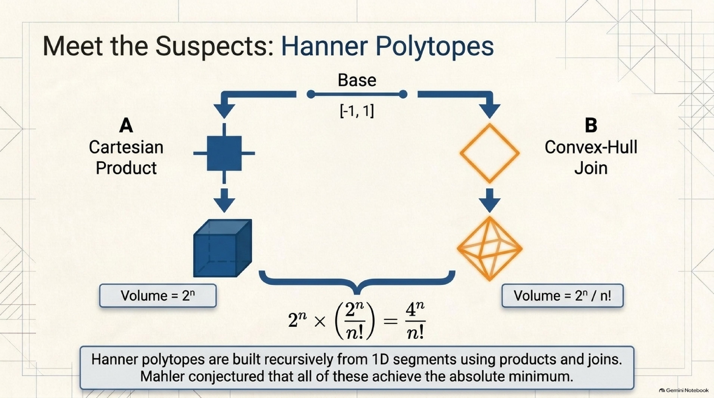

*(The slide's last line credits Mahler with conjecturing about all Hanner polytopes. That is anachronistic, since Hanner's construction dates from 1956; see the [errata](assets/README.md#errata).)*

### 1.7 The non-symmetric cousin

For a body without a center (like a triangle), polarity depends on where you put the origin. The general Mahler problem minimizes $|K|\ |(K-z)^\circ|$ over interior points $z$. The best point is called the **Santaló point**. The conjectured minimum is $(n+1)^{n+1}/(n!)^2$, attained by **simplices** (triangles, tetrahedra, …). In the plane it is $27/4 = 6.75$ for triangles, which is smaller than 8. That is why, as the paper stresses, a proof of the general conjecture does **not** give the symmetric one. The general case is the subject of the [first companion paper](https://github.com/openai/math/blob/main/preprints/The-Mahler-Conjecture-for-General-Convex-Bodies-September-22-2026/paper.pdf).

---

## 2. A short history


| When | Who | What happened |
|---|---|---|
| 1917, 1949 | **Wilhelm Blaschke, Luis Santaló** | The upper bound: balls and ellipsoids have the largest volume product (Blaschke in low dimensions, Santaló in all) |
| 1938–1939 | **Kurt Mahler** | Proves the planar inequality and poses the problem in all dimensions, in work on transference in the geometry of numbers |
| 1956 | **Olof Hanner** | Introduces the recursively built bodies now called Hanner polytopes, in a paper on intersections of translates of convex bodies |
| 1980–81 | **Jean Saint-Raymond** | Proves the sharp inequality for *unconditional* bodies (symmetric under every coordinate sign change) |
| 1981 | **Allan B. Hansen, Åsvald Lima** | Classify the finite-dimensional normed spaces in which three pairwise-intersecting balls always share a point: iterated $\ell_1$ and $\ell_\infty$ sums of lines. This is the last step of the new equality proof |
| 1985–1988 | **Shlomo Reisner; Mathieu Meyer; Yehoram Gordon** | Sharp inequality for zonoids (Reisner; short proof by Gordon, Meyer and Reisner), which also gives parallelograms as the planar equality cases. Hanner equality cases in the unconditional class (Meyer 1986, Reisner 1987) |
| 1987 | **Jean Bourgain, Vitali Milman** | The "reverse Santaló inequality": the volume product is at least $c^n$ times the ball's, for an absolute constant $c>0$. The right exponential order, but not the sharp constant |
| 1991 | **Mathieu Meyer** | Equality in the planar non-symmetric case: exactly triangles |
| 2000 | **Claude Viterbo** | Proposes a sharp volume–capacity inequality in symplectic geometry |
| 2008 | **Greg Kuperberg** | An explicit, stronger exponential lower bound via Gauss linking integrals |
| 2008 | **Matthieu Fradelizi, Mathieu Meyer** | Functional versions: the geometric conjecture in every dimension would imply a functional Mahler inequality |
| 2010, 2014 | **Nazarov, Petrov, Ryabogin, Zvavitch; Jaegil Kim** | The cube is a strict local minimizer; then every Hanner polytope is |
| 2012 | **Fedor Nazarov** | A complex-analytic proof of Bourgain–Milman, using Hörmander's $\bar\partial$ method and Bergman kernels |
| 2014 | **Shiri Artstein-Avidan, Roman Karasev, Yaron Ostrover** | Show that Viterbo's conjecture would imply the symmetric Mahler conjecture, and compute the Hofer–Zehnder capacity of $K\times K^\circ$ to be 4 |
| 2019 | **Renan Gross** | A conformal Skorokhod embedding. A rotation of his uniform-distribution map is the "lens" used in this paper |
| 2020 | **Hiroshi Iriyeh, Masataka Shibata** | The symmetric conjecture in dimension 3, with equality cases |
| 2022 | **Fradelizi, Hubard, Meyer, Roldán-Pensado, Zvavitch** | A shorter 3D proof based on equipartitions, with stability |
| 2024–2026 | **Pazit Haim-Kislev, Yaron Ostrover** | A counterexample to Viterbo's conjecture in general (it uses a non-symmetric pentagon) |
| 2026 | **Shibing Chen, Yuanyuan Li, Dongmeng Xi, Zhe-Feng Xu** | Preprint: the 3D non-symmetric case ($64/9$, tetrahedra), with a shadow-flow proof of the 3D symmetric case |
| 22 Sep 2026 | **OpenAI** (internal model) | The symmetric conjecture in every dimension with its equality cases; companion papers on the general case and on symplectic width |

---

## 3. What the paper proves

> **Main theorem (Theorem 1.1).** For every integer $n\ge 1$ and every origin-symmetric convex body $K\subset\mathbb R^n$,
>
> $$|K|\ |K^\circ|\ \ge\ \frac{4^n}{n!}.$$
>
> Equality holds if and only if $K$ is a linear Hanner body, that is, an invertible linear image of a Hanner polytope.

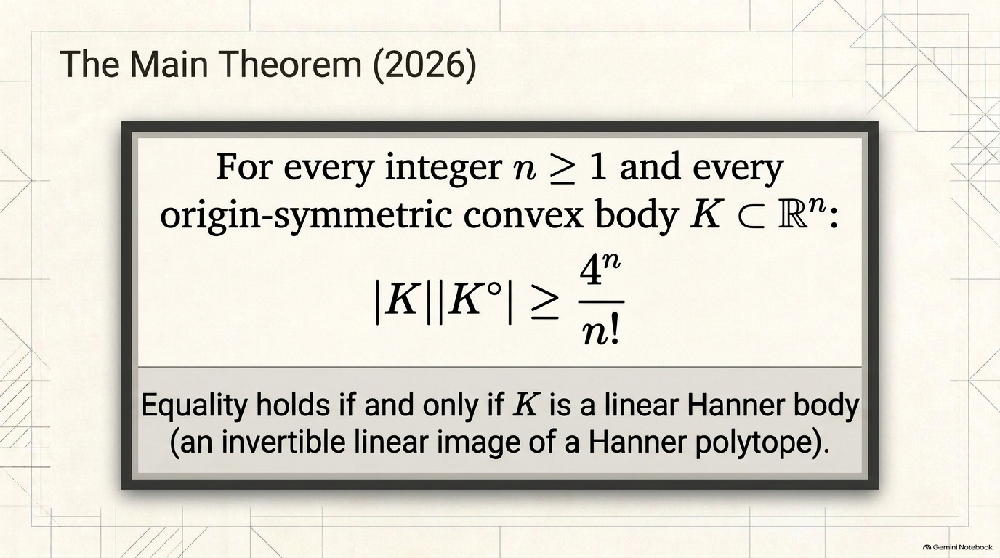

In plain words, no symmetric convex body, in any dimension, has a smaller volume product than the cube. The only bodies that tie with the cube are the Hanner polytopes and their stretched or sheared copies. The linear maps keep the origin fixed, because the origin is used to define the polar. No smoothness, polytope or general-position assumption is made about $K$.

The Lean 4 statement of the inequality, from the [openai/math Comparator challenge](https://github.com/openai/math/blob/main/lean/ComparatorChallenges/MahlerConjecture.lean), reads (`coordinatePolar K` is the set of `p` with `∑ i, p i * v i ≤ 1` for every `v ∈ K`):

```lean
theorem symmetric_mahler {n : ℕ} (hn : 1 ≤ n)
    {K : Set (Fin n → ℝ)} (hK : IsCompact K) (hconv : Convex ℝ K)
    (hsym : ∀ x ∈ K, -x ∈ K) (hint : (interior K).Nonempty) :
    (4:ℝ)^n/(Nat.factorial n:ℝ) ≤
      (volume K).toReal*(volume (coordinatePolar K)).toReal
```

The [equality statement](https://github.com/openai/math/blob/main/lean/ComparatorChallenges/SymmetricMahlerEquality.lean) defines Hanner bodies inductively (interval, product, join) and states that equality holds if and only if `IsLinearHanner K`.

The paper also derives two consequences outside convex bodies (Section 1.3):

1. **Even functional Mahler inequality (Corollary 1.2).** For every even convex function $\varphi$ on $\mathbb R^n$ with $0<\int e^{-\varphi}<\infty$, and its Legendre transform $\varphi^{\ast}(y) = \sup_x\ (\langle x,y\rangle - \varphi(x))$,

   $$\int_{\mathbb R^n} e^{-\varphi(x)}\ dx\ \cdot\ \int_{\mathbb R^n} e^{-\varphi^{\ast}(y)}\ dy\ \ge\ 4^n.$$

   It follows from the theorem in *all* dimensions through an implication of Fradelizi and Meyer (2008). The constant is sharp: $\varphi(x) = \sum_i |x_i|$ gives $2^n\cdot 2^n$.
2. **Symmetric entropy–transport inequality (Corollary 1.3).** For two symmetric log-concave probability measures, the sum of their entropies relative to Lebesgue measure (the paper's $H$, which is minus the usual differential entropy) is bounded by $-n\log(4e^2)$ plus a transport cost between their "moment measures". It follows from Corollary 1.2 through an equivalence due to Gozlan, as stated by Fradelizi, Gozlan and Zugmeyer.

---

## 4. Why it matters

| Question | Before | After |
|---|---|---|
| **Symmetric Mahler conjecture** | Proved in dimensions 2 and 3, and for unconditional bodies and zonoids | Proved in every dimension |
| **Who the minimizers are** | Hanner polytopes were known to be *local* minimizers (Kim, 2014); equality was classified in the plane, in 3D and within special classes | Exactly the linear Hanner bodies, among all symmetric convex bodies |
| **Size of the gap** | Lower bounds of the right exponential order, $c^n\lvert B^n\rvert^2$ (Bourgain–Milman, Kuperberg), with a non-sharp constant | The sharp constant $4^n/n!$ |
| **Even functional Mahler inequality** | Known to follow from the geometric conjecture in all dimensions (Fradelizi–Meyer, 2008) | Proved, as a consequence of the main theorem (Corollary 1.2) |
| **Together with the companions** | The non-symmetric conjecture was open in general beyond the plane (special classes were known, and a 3D preprint appeared in 2026) | Simplices minimize in every dimension (general companion). For $n\ge2$, $\mathrm{int}\ K\times\mathrm{int}\ K^\circ$ has Gromov width 4 (symplectic companion) |

The gap is real. The ratio of the ball's score to the cube's grows quickly with dimension:

| Dimension $n$ | Cube, $4^n/n!$ | Ball, $\lvert B^n\rvert^2$ | Ratio |
|---|---|---|---|
| 2 | 8 | $\pi^2\approx 9.87$ | 1.23 |
| 3 | $32/3\approx 10.67$ | $(4\pi/3)^2\approx 17.55$ | 1.64 |
| 10 | $\approx 0.289$ | $\approx 6.50$ | 22.5 |

Bourgain–Milman says the true minimum lies within an exponential factor of the ball. The new theorem says exactly where: at the cube.

There is also a reading in the language of normed spaces. Every symmetric convex body is the unit ball of a norm, and its polar is the unit ball of the dual norm. The theorem says that, in every finite dimension, the volume of a norm's unit ball times the volume of its dual's unit ball is at least the cube's value. The only norms that achieve this are the ones built from the real line by repeated $\ell_1$ and $\ell_\infty$ sums, up to a linear change of coordinates. Along the way the proof shows something extra about such a minimizer: any three pairwise-intersecting balls of its dual norm have a common point.

---

## 5. The main idea of the proof

The geometric proof runs from Section 2 to Section 8 of a 26-page paper. Here it is at three zoom levels. To keep notation light, $n$ is the dimension throughout; the paper calls it $d$ in the middle sections.

### Level 1: the one-paragraph version

The proof counts one quantity, a sum of probabilities $S$, in two different ways. It first replaces $K$ by a polytope cut out by finitely many slabs. Then it runs a random experiment with complex numbers: put random points on the edge of a special lens-shaped region, solve some linear equations, and check whether all the remaining slab conditions hold. **First count:** a general fact about holomorphic maps, applied to high powers of a conformal map, shows that the success probabilities add up to **at least 1**. **Second count:** because of how the lens is built, each success can be matched with its own small simplex inside $K^\circ$, and different successes never overlap. So the total is **at most** $(n!/4^n)\ |K|\ |K^\circ|$. Put together, $1 \le S \le (n!/4^n)\ |K|\ |K^\circ|$, which is the theorem. For the equality cases, the paper asks what happens when the second count has no room to spare.

> **Analogy:** a lottery is guaranteed to produce at least one winner on average. Each winner must be given a private plot of land inside $K^\circ$, plots never overlap, and the lens fixes how much land a win is worth. So the land available ($K^\circ$, counted once for each point of $K$) must be at least one winner's worth, and that is the inequality. The holomorphic estimate guarantees the winners; the lens sizes the plots and keeps them apart.

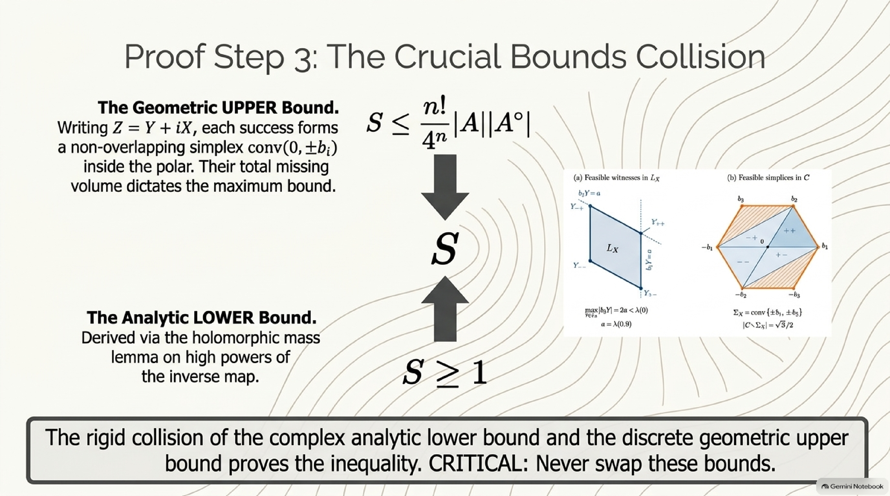

*(The inset is the paper's Figure 2, with a garbled caption. "Their total missing volume dictates the maximum bound" is also garbled: the upper bound holds because the simplices sit inside the polar, and the missing volume is the slack in it. The bottom line, "CRITICAL: never swap these bounds", is a leaked instruction from the generation prompt. See the [errata](assets/README.md#errata).)*

### Level 2: the step-by-step picture

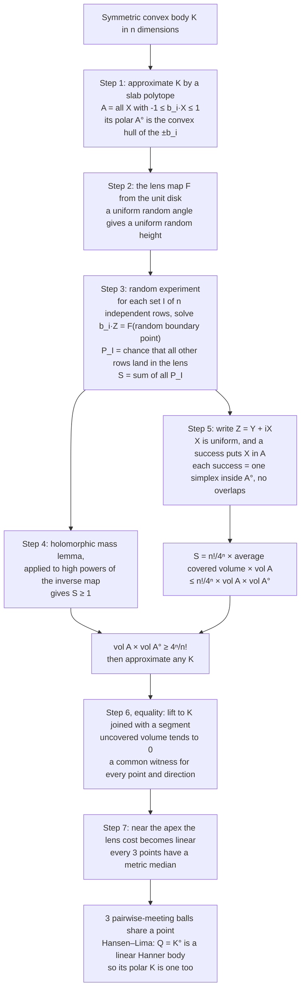

**Step 1: Reduce to slab polytopes.** Pick finitely many vectors $b_1,\dots,b_m$ and let $A$ be the set of points $X$ with $|b_i\cdot X|\le 1$ for every $i$. This is an intersection of symmetric slabs, and its polar is $A^\circ = \mathrm{conv}\lbrace\pm b_1,\dots,\pm b_m\rbrace$. For any symmetric convex body $K$ there are such polytopes squeezed between $K$ and a slightly enlarged copy of $K$, as tightly as you like (take $A$ to be the polar of a fine symmetric polytope inside $K^\circ$), so it is enough to prove the inequality for them (Corollary 6.2).

**Step 2: The lens.** The paper uses one explicit function (Lemma 3.1):

$$F(z)=\frac{8}{\pi^2}\sum_{j\ge 0}\frac{(-1)^j z^{2j+1}}{(2j+1)^2} = \frac{8}{\pi^2}\Big(z-\frac{z^3}{9}+\frac{z^5}{25}-\cdots\Big).$$

It maps the unit disk one-to-one and conformally onto a convex **lens**: the region of points $v+it$ with $-1\le t\le 1$ and $|v|\le\lambda(t)$. The half-width $\lambda$ is concave, vanishes at the tips $t=\pm1$, and has $\lambda''(t) = -\sec(\pi t/2)$. The key property:

> **If you pick a uniformly random point on the circle, $F$ sends it to the lens edge at a height $t$ that is uniformly distributed on $[-1,1]$, and to the left or right edge with probability 1/2 each.**

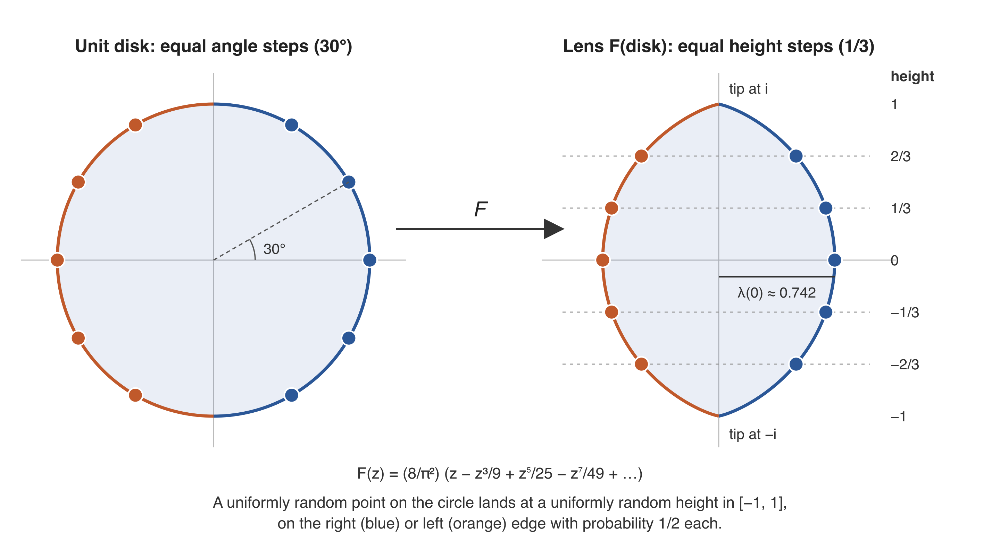

The paper notes that this map is a rotation of an example in Renan Gross's 2019 *conformal Skorokhod embedding*.

**Step 3: A random experiment.** Call a set $I$ of $n$ of the vectors $b_i$ a *basis* if they are linearly independent. For each basis, pick independent uniformly random angles $\theta_i$ and solve the $n$ complex linear equations $b_i\cdot Z = F(e^{i\theta_i})$, $i\in I$, for a complex vector $Z\in\mathbb C^n$. Let $P_I$ be the probability that every *other* row also lands in the closed lens: $b_j\cdot Z\in\overline{D}$ for all $j$. Set $S=\sum_I P_I$.

**Step 4: The first count, $S\ge 1$ (Lemma 5.1).** This comes from a lemma about holomorphic maps (Lemma 4.1). If a holomorphic map vanishes only at the origin, and vanishes there to order $k$ (plus a mild compactness condition), then the integral of its squared Jacobian minors over the region where $|f|<1$ is at least $(\pi k)^n/n!$. The paper applies this to $f_k(z) = (g(b_1\cdot z)^k,\dots,g(b_m\cdot z)^k)$, where $g = F^{-1}$. High powers are tiny inside the lens and only reach size 1 near its edge, so as $k\to\infty$ the integral piles up on boundary points of exactly the kind sampled in Step 3. After dividing by $k^n$, the bound becomes $\pi^n/n! \le (\pi^n/n!)\ S$. This step works for *any* conformal map of the disk onto a bounded region with $F(0)=0$. The special lens matters only in Step 5.

**Step 5: The second count, $S\le (n!/4^n)\ |A|\ |A^\circ|$ (Proposition 6.1).** Write the random complex vector as $Z = Y + iX$. Because the heights are uniform, the imaginary part $X$ is spread uniformly over the region where the chosen rows satisfy $|b_i\cdot X|\le 1$, and a success forces $X$ into $A$. The real part $Y$ is then pinned down: it is the point where the chosen rows sit exactly on the edges of the small polytope $L_X = \lbrace Y : |b_j\cdot Y|\le\lambda(b_j\cdot X)\ \text{for all } j\rbrace$, on the sides given by a choice of signs $\epsilon$. Success means this point really is a corner of $L_X$. Each successful pair $(I,\epsilon)$ is matched with the simplex $\mathrm{conv}(0,\epsilon_i b_i : i\in I)$, which sits inside $A^\circ$. Distinct successes give simplices with disjoint interiors. (Each simplex corresponds to the unique corner of $L_X$ where a certain linear function is maximized.) Adding up the volumes gives the exact identity

```math
1\ \le\ S\ =\ \frac{n!}{4^n}\int_A |\Sigma_X|\,dX\ \le\ \frac{n!}{4^n}\,|A|\,|A^\circ|,
```

where $\Sigma_X\subset A^\circ$ is the union of the successful simplices at $X$. This proves the inequality for slab polytopes, and approximation extends it to every symmetric convex body. As a bonus, the identity measures the **missing volume** $\int_A (|A^\circ|-|\Sigma_X|)\ dX \le |A|\ |A^\circ| - 4^n/n!$. That is the handle used for equality.

**Step 6: Equality, part 1 (Section 7).** Suppose $P(K) = 4^n/n!$ and let $Q = K^\circ$. Lift to one dimension higher by joining $K$ with a segment: $B = K\oplus_1[-1,1]$, whose polar is the prism $Q\times[-1,1]$. The product formula shows $B$ is also a minimizer, so for polytope approximations of $B$ the missing volume tends to 0. A compactness argument then gives, for **every** interior point $X$ and **every** direction $\xi$, a way of writing $\xi$ as a combination of points of the polar that is optimal for a "lens cost", together with one common witness vector $Y$ (Proposition 7.1).

**Step 7: Equality, part 2: from costs to medians to Hanner (Section 8).** Now let $X$ approach the apex of $B$. There the lens width behaves like $\lambda(1-\eta) = \frac{2}{\pi}\eta\log\frac{1}{\eta} + O(\eta)$ (Lemma 3.2), so the optimal costs become essentially linear. Comparing two representations and separating convex sets shows that, in the norm whose unit ball is $Q$, **every three points have a metric median**: a point $m$ that lies "between" each pair, so that $\lVert x_i - x_j\rVert = \lVert x_i - m\rVert + \lVert m - x_j\rVert$ for all three pairs (Proposition 8.1). Medians imply the **three-ball intersection property**: any three closed balls that meet pairwise have a common point (Lemma 8.2). By Hansen and Lima's 1981 structure theorem (Theorem 8.3), a finite-dimensional normed space with that property is built from the real line by $\ell_1$ and $\ell_\infty$ sums. So $Q$ is a linear Hanner body, and so is $K = Q^\circ$ (Proposition 8.4).

> **Why medians single out Hanner bodies, in the plane.** In the taxicab norm $\lvert x_1\rvert + \lvert x_2\rvert$ (unit ball: the diamond), the coordinate-wise median of three points is always a metric median. For $(0,0)$, $(2,0)$ and $(1,3)$ it is $(1,0)$, and the three distances 2, 4, 4 split as $1+1$, $1+3$, $1+3$. In the ordinary Euclidean norm (unit ball: the disk), a median of three points not on a line would have to lie on all three sides of their triangle, which is impossible. The diamond is a Hanner body; the disk is not.

### A worked calculation

**The plane.** The square $[-1,1]^2$ has area 4. Its polar, the diamond $|y_1|+|y_2|\le 1$, has area 2. The product is $8 = 4^2/2!$. The unit disk is its own polar, so its product is $\pi\cdot\pi = \pi^2 \approx 9.87$. The regular hexagon with corners at distance 1 has area $3\sqrt3/2\approx 2.598$. Its polar is a hexagon turned by 30°, with sides at distance 1 and corners at distance $2/\sqrt3$, and area $2\sqrt3\approx 3.464$. Their product is exactly $(3\sqrt3/2)(2\sqrt3) = 9$. So $8 < 9 < \pi^2$, as the theorem and Blaschke–Santaló require. For comparison, the triangle, which is not symmetric, scores $27/4 = 6.75$ at its centroid.

<details>
<summary><b>The proof's identity for the cube, where nothing is wasted</b> (a short check)</summary>

Take the cube $A = [-1,1]^n$, cut out by the $n$ coordinate rows $b_i = e_i$. There is only one basis, the identity matrix, and no "other rows" to check, so $P_I = 1$ and $S = 1$.

On the other side, $L_X$ is the box with half-widths $\lambda(X_1),\dots,\lambda(X_n)$. All $2^n$ sign choices give corners of that box, so every pair $(I,\epsilon)$ succeeds. The $2^n$ simplices $\mathrm{conv}(0,\epsilon_1e_1,\dots,\epsilon_ne_n)$ tile the whole cross-polytope, so $|\Sigma_X| = |A^\circ| = 2^n/n!$ at every $X$. Then

$$\frac{n!}{4^n}\int_A|\Sigma_X|\ dX = \frac{n!}{4^n}\cdot 2^n\cdot\frac{2^n}{n!} = 1 = S.$$

Both inequalities in the chain are equalities and the missing volume is zero, as it must be for a minimizer.

For a body that is not a minimizer, some volume is always missed. The paper's Figure 2 takes the regular hexagon $C=\mathrm{conv}\lbrace\pm b_1,\pm b_2,\pm b_3\rbrace$ with $b_1=(1,0)$, $b_2=(1/2,\sqrt3/2)$, $b_3=(-1/2,\sqrt3/2)$. At the point $X = 0.9\ (1, 1/\sqrt3)$, the successful simplices cover only $\mathrm{conv}\lbrace\pm b_1,\pm b_2\rbrace$, and one third of the polar is left uncovered.

**A 4D Hanner polytope that is neither a cube nor a cross-polytope.** The octahedral prism $[-1,1]\times O$, where $O$ is the octahedron $|y_1|+|y_2|+|y_3|\le1$, has volume $2\cdot\frac43 = \frac83$. Its polar is the join $[-1,1]\oplus_1[-1,1]^3$, a double pyramid over the cube, with volume $\frac{1!\ 3!}{4!}\cdot 2\cdot 8 = 4$ by Lemma 2.1. The product is $\frac{32}{3} = \frac{4^4}{4!}$, the same as the 4-cube.
</details>

### Level 3: the analytic engine, for readers who know several complex variables

**The holomorphic mass lemma (Lemma 4.1).** Let $f:\mathcal U\to\mathbb C^N$ be holomorphic near $0\in\mathbb C^d$ ($N\ge d$). Suppose $f^{-1}(0)=\lbrace0\rbrace$, $f = H + O(|z|^{k+1})$ with $H$ homogeneous of degree $k$ and nonvanishing off $0$, and the sublevel sets of $\tau = |f|^2$ below 1 are compact. Then

```math
\int_{\{\tau<1\}}\ \sum_{|I|=d}\Big|\det\Big(\frac{\partial f_i}{\partial z_j}\Big)_{i\in I}\Big|^2\,dV\ \ge\ \frac{(\pi k)^d}{d!}.
```

The proof compares $\int_{\lbrace\tau<s\rbrace}(dd^c\tau)^d$ with the flux of $d^c\log\tau\wedge(dd^c\log\tau)^{d-1}$ through a small sphere. Plurisubharmonicity of $\log\tau$ makes the difference nonnegative. The flux of the homogeneous part is shown to equal that of $|z|^{2k}$, which is $(\pi k)^d$. Cauchy–Binet turns $(dd^c\tau)^d$ into $d!\sum_I|\det Z_I|^2\ dV$. The paper notes that this is a special case of Demailly's sublevel-mass and comparison formulas for generalized Lelong numbers, and gives a direct Stokes proof with the normalization it needs. In dimension one with $f(z) = z^k$, the integral is $\int_{|z|<1}|kz^{k-1}|^2\ dA = \pi k$ exactly: the image covers the unit disk $k$ times.

**From mass to boundary probabilities (Lemma 5.1).** With $h_j(z) = g(b_j\cdot z)$, change variables $u_i = h_i(z)$ for $i\in I$, then substitute $u_i = \rho_i^{1/k}e^{i\theta_i}$. The factor $k^d$ cancels, the measure becomes the fixed measure $\prod\rho_i\ d\rho_i\ d\theta_i$ on the unit ball of $\mathbb C^d$ (total mass $\pi^d/d!$), and $F(\rho_i^{1/k}e^{i\theta_i})\to F(e^{i\theta_i})$ as $k\to\infty$. The reverse Fatou lemma then gives $\limsup_k M_{I,k}/k^d\le(\pi^d/d!)\ P_I$. Strict concavity of $\lambda$ makes extra boundary ties a null event (Lemma 5.2). This is what lets Proposition 6.1 count simplices with disjoint interiors.

**Where the shape of the lens is used.** Besides the strict curvature behind Lemma 5.2, the lens enters three more times. Its uniform boundary law turns $P_I$ into the real integral $P_I = 4^{-d}D_I\int_A\sum_\epsilon\mathbf 1\lbrace(I,\epsilon)\text{ feasible at }X\rbrace\ dX$, with $D_I = |\det B_I|$. Its concavity extends feasibility from the vertices of the polar to their convex hull in the equality argument. Its logarithmic endpoint behavior, $\lambda(1-\delta c)/\lambda(1-\delta)\to c$, linearizes costs at the apex of the lifted body.

**The two companions.** The [symplectic companion](https://github.com/openai/math/blob/main/preprints/Symplectic-Balls-in-Symmetric-Polar-Products-September-22-2026/paper.pdf) reuses the same lens and high powers $g^k$, but in a different way. If a holomorphic map $f$ vanishes only at the origin, and to order at least $k$ there (with compact sublevels), then the domain where $|f|<1$, with a symplectic form built from the potential $|z|^2+|f|^2$, contains balls of every capacity below $\pi k$ (its Theorem 2.1). The paper realizes the relevant domain inside $\mathrm{int}\ K\times S_k\ \mathrm{int}\ K^\circ$ with $S_k = (1+o(1))\pi k/4$. Rescaling gives balls of every capacity $c<4$ in $\mathrm{int}\ K\times\mathrm{int}\ K^\circ$, and a supporting-cylinder argument with Gromov's nonsqueezing theorem gives the matching upper bound, so its Gromov width is 4 when $n\ge2$. Since symplectic maps preserve volume and the ball of capacity $c$ has volume $c^n/n!$, this gives a second proof of $|K|\ |K^\circ|\ge 4^n/n!$. That paper says it uses neither the volume-product theorem nor the equality classification of the principal paper, and it makes no claim about equality cases. The [general companion](https://github.com/openai/math/blob/main/preprints/The-Mahler-Conjecture-for-General-Convex-Bodies-September-22-2026/paper.pdf) uses an entirely different method. It lifts $K$ to a cone and uses Klartag's cone/Laplace reformulation, Euclidean projections of biased Gaussian vectors onto the cone and its dual, Hermite expansions and matrix divided differences. Its one-variable inequalities rest on finite rational certificates, checked by programs in its `verification/` folder.

---

## 6. The people whose ideas this builds on

| Person | Idea | Where it shows up in the proof |
|---|---|---|
| **Kurt Mahler** | The volume-product problem and its planar case | The whole question |
| **Wilhelm Blaschke, Luis Santaló** | The upper bound; the Santaló point | The other end of the range; the center used in the general companion |
| **Olof Hanner** | Recursively built bodies from intervals by products and joins | The equality cases |
| **Allan B. Hansen, Åsvald Lima** | Structure of finite-dimensional spaces with the 3.2 intersection property; Lima's metric-median criterion | The final step of the equality classification |
| **Jean Saint-Raymond, Mathieu Meyer, Shlomo Reisner** | Sharp results for unconditional bodies and zonoids. Reisner's unconditional equality theorem already linked minimal volume product to ball intersections | Precedents. The new proof gets the ball structure without assuming unconditionality |
| **Renan Gross** | The conformal Skorokhod embedding and its uniform-distribution map | The lens (Step 2) |
| **Jean-Pierre Demailly** (after **Pierre Lelong**) | Generalized Lelong numbers and mass comparison | Background for the holomorphic mass lemma (Step 4), which the paper proves directly |
| **Augustin-Louis Cauchy, Jacques Binet; George Stokes** | Cauchy–Binet formula; Stokes' theorem | Inside the mass lemma |
| **Magnus Lundin, Mirosław Baran; Len Bos, Jean-Paul Calvi, Norman Levenberg** | Extremal plurisubharmonic functions for symmetric convex sets | Motivation for the analytic search, not used as premises |
| **Jean Bourgain, Vitali Milman; Greg Kuperberg; Fedor Nazarov; Bo Berndtsson** | Exponential lower bounds; complex-analytic approaches to them | Precedents. The paper stresses that their estimates are not hypotheses of its proof |
| **Hiroshi Iriyeh, Masataka Shibata** | The 3D case | The previous frontier |
| **Matthieu Fradelizi, Mathieu Meyer; Nathael Gozlan; Simon Zugmeyer; Dario Cordero-Erausquin, Bo'az Klartag** | Functional inverse Santaló inequalities; entropy–transport equivalence; moment measures | Corollaries 1.2 and 1.3 |
| **Mikhael Gromov; Claude Viterbo; Shiri Artstein-Avidan, Roman Karasev, Yaron Ostrover** | Nonsqueezing; the volume–capacity conjecture; its link to Mahler | The symplectic companion |

---

## 7. What it does not prove, and caveats

> [!IMPORTANT]
> **What this paper does not claim.** It proves the *symmetric* conjecture only. The non-symmetric conjecture, with a smaller constant (for $n\ge2$) and simplices as minimizers, is a separate theorem in the [general companion](https://github.com/openai/math/blob/main/preprints/The-Mahler-Conjecture-for-General-Convex-Bodies-September-22-2026/paper.pdf), proved by an independent method. The paper does not classify the equality cases of its functional inequality: it notes that the limiting argument behind Corollary 1.2 does not transfer equality cases. It also gives no stability statement (how close to a Hanner body a near-minimizer must be). The symplectic companion establishes Gromov width 4 only for the particular products $K\times K^\circ$ with $K$ symmetric and $n\ge 2$. It does not assert an embedding at capacity exactly 4 or make any claim about Viterbo's conjecture for general convex domains, which Haim-Kislev and Ostrover have shown to be false.

> [!NOTE]
> **Provenance.** The paper was produced by an unreleased internal OpenAI model as part of the [openai/math](https://github.com/openai/math) release. That repository's README says the vast majority of results were obtained with the same fixed procedure, and the exceptions it names (a zeta zero-free region and the Hodge conjecture for CM abelian varieties) do not include this family. openai/math also released a 45-page **abridged summary of the model's reasoning** for this family, titled *Summarized chain of thought (Symmetric and general Mahler conjectures)*. It is a narrative of the model's attempts with short verbatim excerpts, not a proof. It describes three separate attempts. Part I, on the symmetric bound, reaches the lens, the probability sum and the Stokes/flux argument after trying other routes. Part II, on equality, takes the bound as a supplied premise and reconstructs the lens, missing-volume, median and Hansen–Lima route. In that reconstruction the inequality $S\ge1$ is reached by a different route, a monotonicity argument plus a complex-Gaussian computation, instead of the paper's mass lemma. Part III, on general bodies, is the bulk of the document. It records dozens of abandoned or partial approaches and ends with the cone and Gaussian-projection argument, whose "proposed conclusion remains dependent on the uniform scalar inequalities". The published general paper proves its scalar inequalities in two appendices, using finite rational certificates that are checked by programs. The summary says its three parts "retain separate arguments and hypotheses". The prompts quoted in it posed the symmetric problem for $n\ge 4$.

> [!NOTE]
> **Verification status.** The Lean scope document [`lean/docs/087.md`](https://github.com/openai/math/blob/main/lean/docs/087.md) states that the formalization establishes $|K|\ |K^\circ|\ge 4^n/n!$ for every $n\ge1$, and characterizes equality exactly by invertible linear images of Hanner bodies. Its next sentence reads "The nonsymmetric Mahler conjecture and the functional inequalities are not included." The following paragraph contradicts this for the nonsymmetric (general) conjecture. It says "the formalization proves" the simplex bound $(n+1)^{n+1}/(n!)^2$ with equality exactly for simplices, and the document's Comparator table links a [`GeneralMahler.lean`](https://github.com/openai/math/blob/main/lean/ComparatorChallenges/GeneralMahler.lean) statement. The same document also describes a formalized Gromov-width theorem for $n\ge2$, and says the general paper's functional inequality is outside the selected statement. The catalogue [`lean/formalization.yaml`](https://github.com/openai/math/blob/main/lean/formalization.yaml) (re-fetched on 7 October 2026; the repository then had a single commit, dated 6 October 2026) lists three main results for this family: `OAI.SymmetricMahler.symmetric_mahler`, `OAI.SymmetricMahler.symmetric_mahler_equality` and `OAI.SymmetricPolar.symmetric_polar_main`. It has no entry for the general statement, and its `sources` list includes the symmetric and symplectic papers but not the general companion. The repository does contain the Comparator configuration `GeneralMahler.json` and the Lean module it names. So openai/math's own documents disagree on whether the general statement is formalized. The catalogue-wide `review` field reads `unchecked`. This explainer did not re-run the Lean build, Comparator or the general companion's verification programs. As of October 2026 the paper is a preprint that has not been peer reviewed.

> [!TIP]
> **Simplifications.** To stay readable, this explainer suppresses the reduction to pairwise non-proportional rows, null-set and measurability details, the regular-value and Sard arguments in the mass lemma, and the exact form of the compactness argument in the equality proof. Every precise statement is in the paper.

---

## 8. Glossary

| Term | Meaning |
|---|---|
| **Convex body** | A closed, bounded convex set in $\mathbb R^n$ with nonempty interior |
| **Origin-symmetric** | $K = -K$: the body looks the same after reflecting through the origin |
| **Polar body** $K^\circ$ | All $y$ with $\langle x,y\rangle\le1$ for every $x\in K$. Big bodies have small polars, and corners trade places with flat sides |
| **Volume product (Mahler volume)** | $P(K) = \lvert K\rvert\ \lvert K^\circ\rvert$. Unchanged by invertible linear maps |
| **Cube / cross-polytope** | $[-1,1]^n$ / the set where $\lvert y_1\rvert+\dots+\lvert y_n\rvert\le1$. Each is the polar of the other |
| **Hanner polytope** | Built from segments by products $H_1\times H_2$ and joins $H_1\oplus_1H_2$. Volume product $4^n/n!$ |
| **Linear Hanner body** | An invertible linear image of a Hanner polytope |
| **$\ell_1$ / $\ell_\infty$ sum** | Ways to combine two norms: add them, or take the larger. Their unit balls are the join and the product |
| **Blaschke–Santaló inequality** | $\lvert K\rvert\ \lvert K^\circ\rvert\le\lvert B^n\rvert^2$ for symmetric $K$: balls and ellipsoids score highest |
| **Reverse Santaló (Bourgain–Milman)** | A lower bound of the form $c^n\lvert B^n\rvert^2$ with an absolute constant $c>0$ |
| **Santaló point** | For a non-symmetric body, the interior point that minimizes the volume of the polar about that point |
| **Simplex** | The convex hull of $n+1$ points in general position: triangle, tetrahedron, … |
| **Unconditional body** | A body symmetric under every coordinate sign change |
| **Zonoid** | A limit of sums of segments (Minkowski sums) |
| **Slab polytope** | An intersection of finitely many slabs $\lvert b_i\cdot X\rvert\le1$. Its polar is the convex hull of the $\pm b_i$ |
| **Holomorphic map** | A map of one or more complex variables that is complex-differentiable, so locally it is given by a convergent power series |
| **Conformal map / biholomorphism** | A one-to-one holomorphic map. It preserves angles |
| **The lens** | The image of the unit disk under the paper's map $F$. A uniform random boundary angle lands at a uniform random height |
| **Jacobian minor** | The determinant of a square block of the matrix of partial derivatives |
| **Lelong number** | A measure of how strongly a plurisubharmonic function such as $\log\lvert f\rvert$ is singular at a point |
| **Missing volume** | The part of the polar not covered by the successful simplices, integrated over the body. Zero means equality |
| **Metric median** | A point lying "between" each pair of three given points, in the sense of the triangle inequality being an equality |
| **Three-ball (3.2) intersection property** | Any three closed balls that meet pairwise have a common point |
| **Legendre transform** $\varphi^{\ast}$ | $\varphi^{\ast}(y) = \sup_x(\langle x,y\rangle - \varphi(x))$, the function analogue of polarity |
| **Gromov width** | The supremum of the capacities $\pi r^2$ of balls that fit into a region by a symplectic embedding |
| **Lean 4 / Comparator** | A proof assistant that checks every logical step mechanically, and a Lean tool ([leanprover/comparator](https://github.com/leanprover/comparator)) that openai/math uses to check a formal proof against a fixed statement |

---

## 9. Slides, audio and other assets

Everything below except the two hand-made figures was generated with **Google NotebookLM** (now "Gemini Notebook"). The slides, infographics and audio come from the paper, the general companion, the reasoning summary, the Lean scope document and the Wikipedia article on the Mahler volume. The mind map comes from the two papers and the Lean scope document only, and the report from this paper and the Lean scope document only. The outputs are kept exactly as NotebookLM produced them. They are AI-generated, so see the [errata](assets/README.md#errata) before relying on any detail. Slides 2, 10 and 13 were revised once to fix a non-convex "convex" example, a rotated lens and text leaked from the prompt. Slide 12 still says the median is "unique", and slide 11 still carries a leaked instruction; a revision that also targeted those two slides made slide 11 worse and was not shipped. The report follows this paper's lens argument but has a few wrong numbers, such as 27/2 for the triangle.

| Asset | What it is |
|---|---|
| [Slide deck (PDF)](assets/notebooklm/slides.pdf) ([PPTX](assets/notebooklm/slides.pptx)) | 13 beginner slides (slides 2, 10 and 13 revised once) |
| [Infographic: overview](assets/notebooklm/infographic-overview.png) | The one-page summary shown at the top |
| [Infographic: history timeline](assets/notebooklm/infographic-history-timeline.png) | From Blaschke and Mahler to 2026 |
| [Polar-pairs figure](assets/figures/polar-pairs.svg) ([PNG](assets/figures/polar-pairs.png)) | Hand-made: square/diamond, hexagon/hexagon and disk/disk, with volume products 8, 9 and $\pi^2$ (section 1.3) |
| [Lens figure](assets/figures/lens.svg) ([PNG](assets/figures/lens.png)) | Hand-made from the paper's series for $F$: equal angle steps land at equal heights (section 5) |
| [Audio overview (≈1.8 min)](assets/notebooklm/audio-overview-brief.m4a) | A short podcast-style summary (not reviewed) |
| [Beginner report](assets/notebooklm/beginner-explainer-report.md) | NotebookLM's long-form written explainer of this paper's proof; read with the errata |
| [Mind map](assets/notebooklm/mindmaps.md) | How the two proofs and their history fit together |

<details>
<summary><b>All 13 slides</b> (click to expand)</summary>

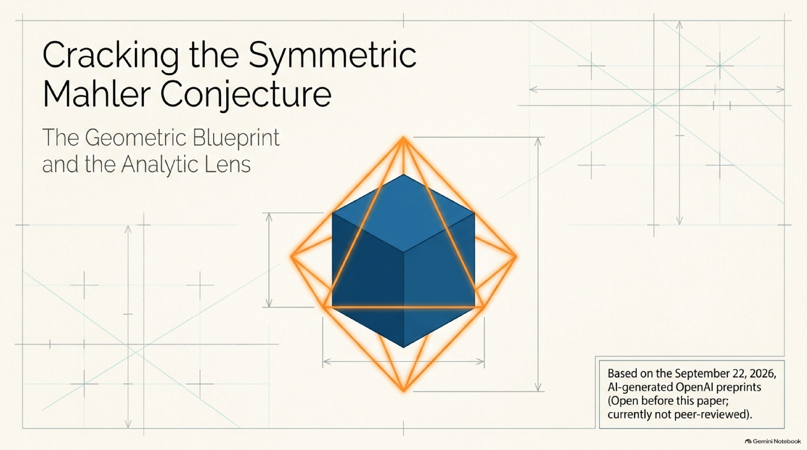

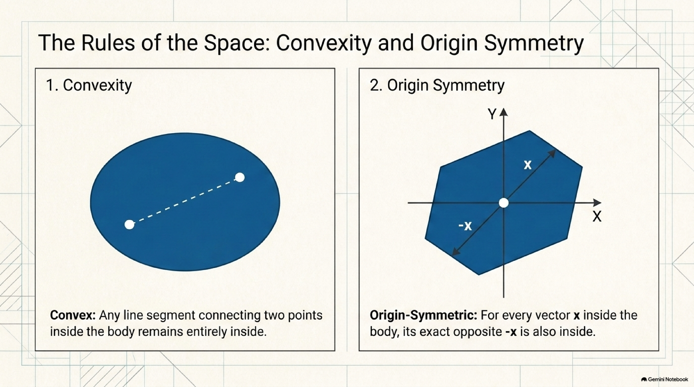

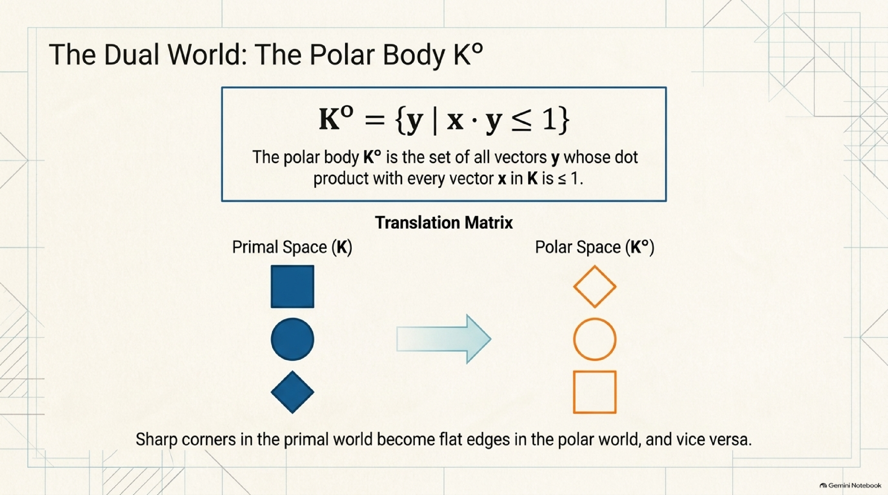

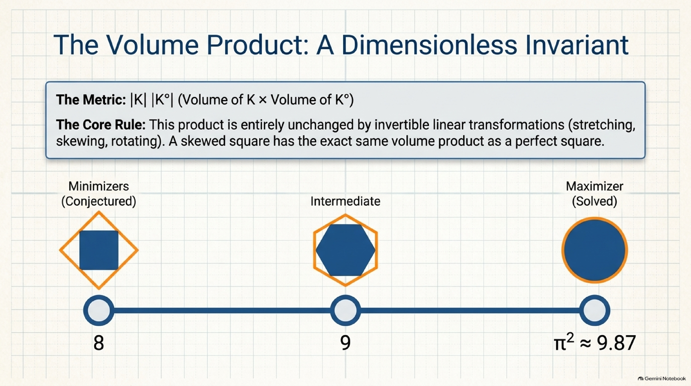


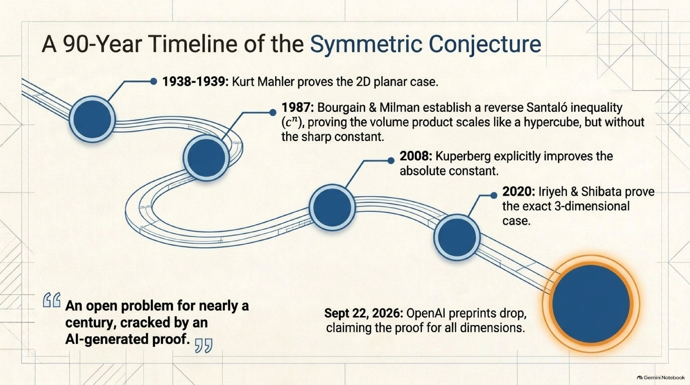


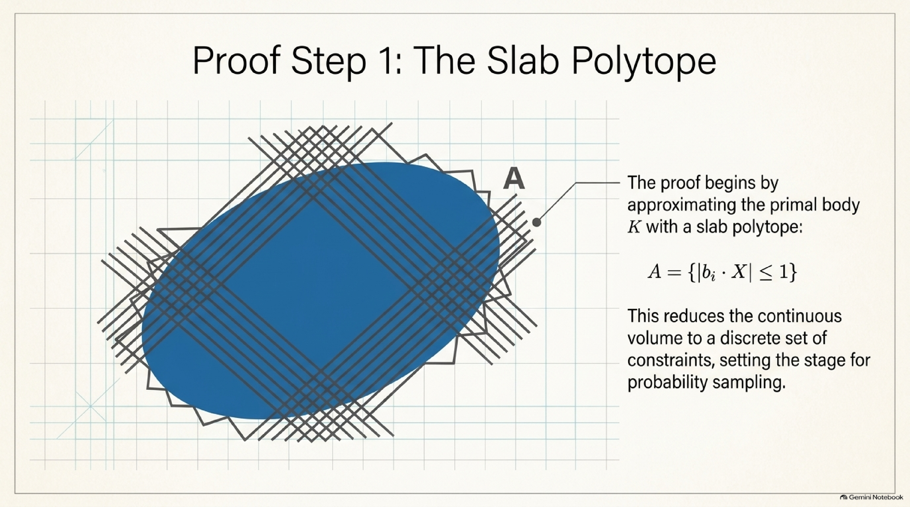

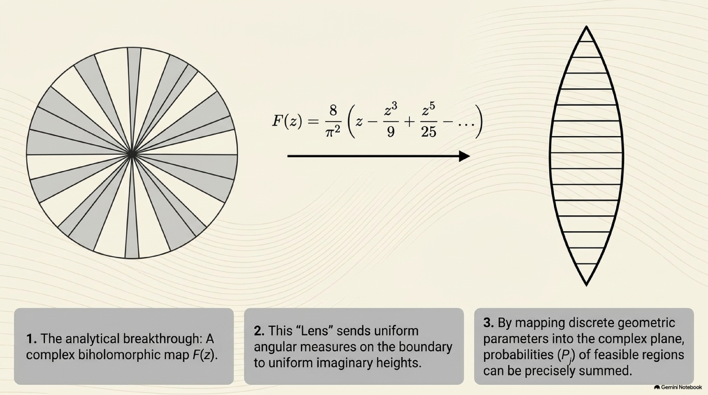


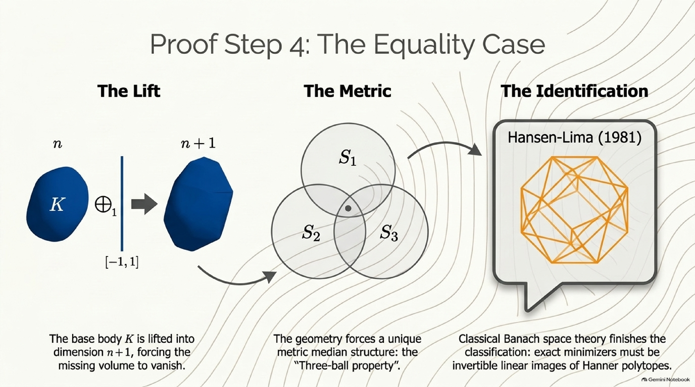

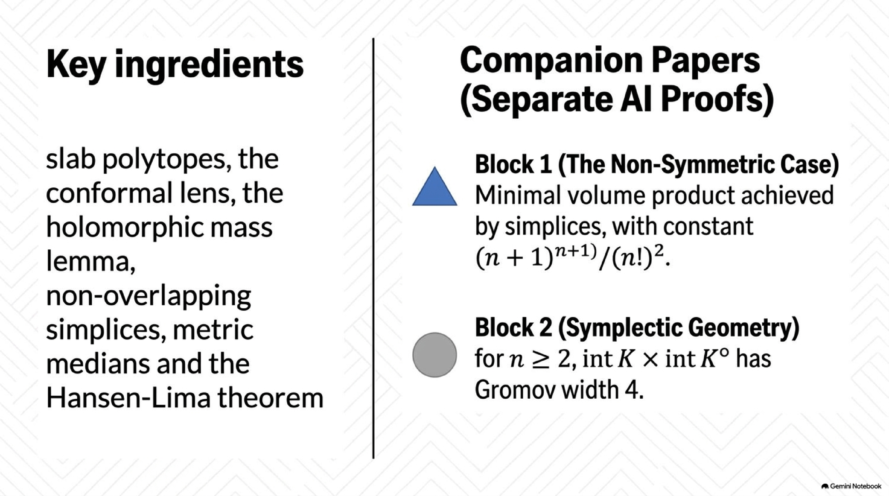

</details>

---

## How this explainer was made

1. The paper's TeX source and PDF, both companions, the reasoning summary, the Lean scope document and the Comparator statements were downloaded from [openai/math](https://github.com/openai/math).
2. A NotebookLM notebook was built through the [`notebooklm-mcp-cli`](https://github.com/jacob-bd/gemini-notebook-mcp-cli) CLI from the principal paper, the general companion, the reasoning summary, the Lean scope document and the Wikipedia article on the [Mahler volume](https://en.wikipedia.org/wiki/Mahler_volume). It generated the slides, infographics, report, mind map and audio in [`assets/notebooklm/`](assets/notebooklm/).
3. The text on this page was written by hand (with AI assistance) directly from the paper's introduction, proof overview and Sections 2–8, and from the companions' introductions. Historical dates come from the papers' bibliographies, cross-checked against Wikipedia. The two figures were drawn by hand; the lens is plotted from the paper's own series for $F$. The NotebookLM outputs contain mistakes, listed in the [errata](assets/README.md#errata), so they were used only as visual aids, not as the source of truth.

See [`PIPELINE.md`](../../PIPELINE.md) for the exact, repeatable steps.

*Citation for the underlying paper:*

```bibtex
@misc{OAI:The-symmetric-Mahler-conjecture-and-its-equality-cases-September-22-2026,
  author = {{OpenAI}},
  title = {{The symmetric Mahler conjecture and its equality cases}},
  howpublished = {OpenAI Math Release preprint
                  \href{https://github.com/openai/math/blob/main/preprints/The-symmetric-Mahler-conjecture-and-its-equality-cases-September-22-2026/paper.pdf}{OAI:The-symmetric-Mahler-conjecture-and-its-equality-cases-September-22-2026}},
  year = {2026}
}
```

